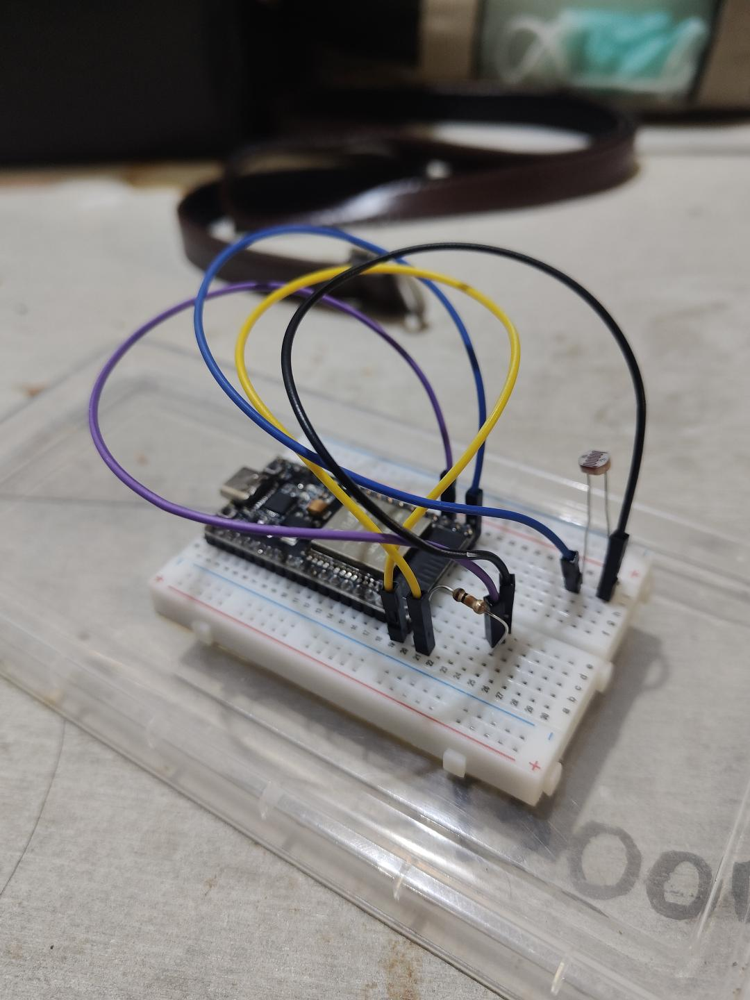

Homeworkweek 3

รูปต่อวงจรในใบงาน

## **1.6 คำนวณแรงดันเอาต์พุตจากวงจร**

| สภาพแสง  | ความต้านทาน   | แรงดันเอาต์พุต (โวลต์) |     |
| -------- | ------------- | ---------------------- | --- |
| มืดสนิท  | 200 kΩ – 2 MΩ | **0.02 V – 0.16 V**    |     |
| ห้องปกติ | 10 kΩ – 50 kΩ | 0.55 V – 1.65 V        |     |
| ใต้โคมไฟ | 2 kΩ – 10 kΩ  | 1.65 V – 2.75 V        |     |
| กลางแจ้ง | 200 Ω – 2 kΩ  | 2.75 V – 3.24 V        |     |

**ส่วนที่ 5 — การทำกราฟ เพื่อหาสมการ**

### **แบบ Polynomial Fit 

-**สมการ:** $y = 0.000127x^2 - 0.1212x + 51.03$
**ค่าสัมประสิทธิ์การตัดสินใจ ($R^2$):** $0.9930$

การทำ Calibration ในโค้ด

// แปลงค่า ADC (raw) เป็น Lux ด้วยสมการ Polynomial 2nd Order
float adc_val = (float)raw;
float lux = (0.000127f * adc_val * adc_val) - (0.1212f * adc_val) + 51.03f;

// ป้องกันกรณีค่า Lux ติดลบในสภาพแสงมืดมากๆ
if (lux < 0.0f) {
    lux = 0.0f;
}

printf("ADC Raw = %d, Calculated Lux = %.2f Lux\n", raw, lux);

## **ส่วนที่ 8 — คำถามท้ายใบงาน**

1. ทำไมต้องใช้ Voltage Divider ในการอ่าน LDR?
เพราะ ADC อ่านได้เฉพาะแรงดันไฟฟ้า ไม่สามารถวัดความต้านทานโดยตรงได้ วงจร Voltage Divider จึงแปลงค่าความต้านทานของ LDR ให้เป็นแรงดันไฟฟ้าเพื่อให้ ADC อ่านได้

2. ทำไมต้องเก็บข้อมูลหลายจุดก่อนทำ Calibration?
เพราะ LDR มีความสัมพันธ์กับความเข้มแสงแบบไม่เป็นเส้นตรง การเก็บข้อมูล 5–7 จุดช่วยให้สร้างสมการ Calibration ได้ครอบคลุมช่วงการใช้งานมากขึ้น

3. ถ้า Noise มากกว่าสัญญาณจริง จะเกิดอะไรขึ้น?
ค่า ADC จะผันผวน ทำให้คำนวณค่า Lux ผิดพลาด และอาจทำให้ระบบควบคุมทำงานผิดปกติ เช่น ไฟกะพริบ

4. ทำไมตำแหน่งเซนเซอร์จึงสำคัญต่อ Signal Integrity?
เพราะเงาบังหรือแสงสะท้อนทำให้วัดแสงคลาดเคลื่อน ส่วนสายสัญญาณที่ยาวหรืออยู่ใกล้แหล่งรบกวนทางไฟฟ้าอาจทำให้เกิด Noise ได้

5. ถ้า ADC มี Resolution ต่ำ จะส่งผลอย่างไร?
ค่า ADC จะมีขั้นการวัดที่หยาบขึ้น ทำให้ตรวจจับการเปลี่ยนแปลงของแสงเพียงเล็กน้อยได้ยาก และลดความละเอียดในการวัดค่า Lux