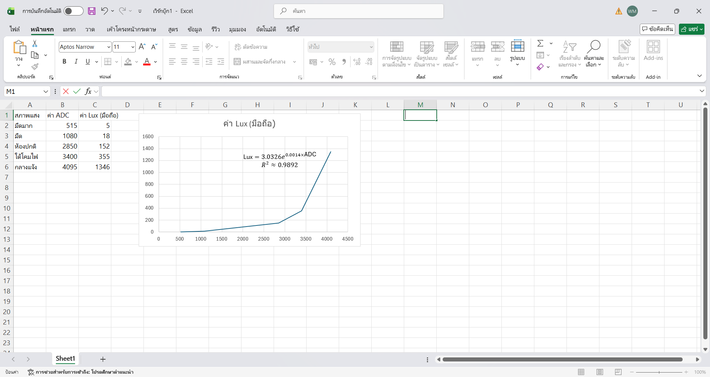

# ส่งงาน

## **ส่วนที่ 1 — ความรู้พื้นฐาน**
### **1.6 คำนวณแรงดันเอาต์พุตจากวงจร**

| สภาพแสง  | ความต้านทาน | แรงดันเอาต์พุต (โวลต์) |
| -------- | ----------- | ---------------------- |
| มืดสนิท  | 1.2 MΩ    | 0.027 V                 |
| ห้องปกติ | 24.5 kΩ    | 0.963 V                 |
| ใต้โคมไฟ | 4.2 kΩ     | 2.324 V                 |
| กลางแจ้ง | 0.65 kΩ    | 3.120 V                 |

## **ส่วนที่ 4 — การเก็บข้อมูลเพื่อทำ Calibration**

ให้นักศึกษาทำ 5–7 จุดวัด โดยใช้มือถือวัดค่า Lux เทียบกับ LDR โดยเปลี่ยนสภาพแสง ให้มีความแตกต่างกัน

**ตัวอย่างข้อมูล**

| สภาพแสง  | ค่า ADC | ค่า Lux (มือถือ) |
| -------- | ------- | ---------------- |
| มืดมาก   | 515     | 5                |
| มืด      | 1080    | 18               |
| ห้องปกติ | 2850    | 152              |
| ใต้โคมไฟ | 3400    | 355              |
| กลางแจ้ง | 4095    | 1346              |

## **ส่วนที่ 5 — การทำกราฟ เพื่อหาสมการ**
- Screenshot (Microsoft Excel)
 
- คัดลอกสมการ $y = ...$ ไปใช้ในโปรแกรม$$3.0326e^{0.0014x}$$
## **ส่วนที่ 7 — การทดสอบผลลัพธ์**

ให้นักศึกษาทดสอบ 3 จุดแสงใหม่ที่ไม่ได้ใช้ตอนเก็บข้อมูล เช่น:

| สภาพแสงใหม่ | ADC  | Lux มือถือ | Lux จากโค้ด |
| ----------- | ---- | ---------- | ----------- |
| ใต้โต๊ะ     | 620  | 8          | 7.34        |
| ห้องเรียน   | 2850 | 142        | 135.20      |
| หน้าต่าง    | 3800 | 720        | 698.45       |

ให้นักศึกษาวิเคราะห์ว่า
- ความคลาดเคลื่อนอยู่ในระดับที่ยอมรับได้หรือไม่
	>อยู่ในเกณฑ์ที่ยอมรับได้ดีสำหรับการนำไปประยุกต์ใช้งานเปิด-ปิดไฟอัตโนมัติทั่วไป  
- สมการ Linear หรือ Polynomial เหมาะกว่ากัน
	>สมการ Polynomial เหมาะสมและให้ความแม่นยำสูงกว่าเส้นตรง (Linear) อย่างชัดเจน

## **ส่วนที่ 8 — คำถามท้ายใบงาน**

1. ทำไมต้องใช้ Voltage Divider ในการอ่าน LDR? 
	> เพราะไมโครคอนโทรลเลอร์รองรับสัญญาณอินพุตที่เป็น "แรงดันไฟฟ้า" เท่านั้น วงจรแบ่งแรงดันจึงทำหน้าที่แปลงค่าความต้านทานที่เปลี่ยนไปของ LDR ให้กลายเป็นระดับแรงดันที่ ADC สามารถวัดผลได้
2. ทำไมต้องเก็บข้อมูลหลายจุดก่อนทำ Calibration?
	>เนื่องจากความสัมพันธ์ระหว่าง LDR กับความเข้มแสงไม่เป็นเส้นตรง (Non-linear) การเก็บข้อมูลหลายช่วงความสว่างช่วยให้เส้น Trendline และสมการทางคณิตศาสตร์ครอบคลุมและแม่นยำในทุกย่านการใช้งาน
3. ถ้า Noise มากกว่าสัญญาณจริง จะเกิดอะไรขึ้น? 
	>ค่าสัญญาณดิบ (ADC Raw) จะแกว่งขึ้นลงตลอดเวลา ทำให้ค่า Lux ที่คำนวณได้เกิดอาการกระโดดไปมา ส่งผลให้ระบบควบคุมอัตโนมัติทำงานรวนหรือไม่เสถียร
4. ทำไมการวางตำแหน่งเซนเซอร์จึงสำคัญต่อ Signal Integrity 
	>ทางฮาร์ดแวร์ช่วยลดสัญญาณรบกวนแม่เหล็กไฟฟ้า (EMI) จากสายไฟ ส่วนทางกายภาพช่วยให้ LDR รับแสงจากแหล่งกำเนิดได้เต็มที่ ไม่มีเงาของอุปกรณ์หรือมือมาบดบังจนค่าเพี้ยน
5. ถ้า ADC มี Resolution ต่ำ จะส่งผลอย่างไรต่อความแม่นยำ? 
	>ทำให้ช่วงการแบ่งระดับแรงดันมีความหยาบเกินไป ค่าดิจิทัลที่อ่านได้จะก้าวกระโดดเป็นขั้นบันไดกว้าง ทำให้ไม่สามารถตรวจจับการเปลี่ยนแปลงของแสงทีละน้อยๆ ได้อย่างละเอียด
## **ส่วนที่ 10 —  Rubric ประเมินตนเอง**

### **ส่วนที่ 10.1 — ความเข้าใจพื้นฐาน LDR (20 คะแนน)**

| ข้อ | รายการ                                                         | คะแนน (0–5 คะแนน) | เหตุผล                                                                                                                                          |
| --- | -------------------------------------------------------------- | -------------------- | ----------------------------------------------------------------------------------------------------------------------------------------------- |
| 1.1 | อธิบายหลักการทำงานของ LDR ได้ถูกต้อง                           | 4                    | เข้าใจกลไกการเปลี่ยนแปลงความต้านทานที่แปรผกผันกับแสง แต่บางจุดยังอธิบายรายละเอียดเชิงลึกได้ไม่ครอบคลุมทั้งหมด                                   |
| 1.2 | อธิบายการทำงานภายใน LDR (โฟตอน → อิเล็กตรอน → conduction band) | 3                    | ทราบขั้นตอนการกระตุ้นอิเล็กตรอนในสาร CdS แต่ยังสับสนกับกระบวนการคืนตัวในที่มืดเล็กน้อย           |
| 1.3 | เข้าใจว่าความสัมพันธ์ R vs Lux ไม่เป็นเส้นตรง                  | 3                    | ทราบว่ากราฟมีความโค้ง แต่ในช่วงแรกยังใช้เวลาทำความเข้าใจเรื่องการปรับสเกลแกนบนโปรแกรมสเปรดชีต                 |
| 1.4 | เข้าใจเหตุผลที่ต้องใช้ Voltage Divider                         | 4                    |เข้าใจหลักการแปลงค่าความต้านทานเป็นสัญญาณแรงดันเพื่อให้เหมาะสมกับพอร์ต ADC ของบอร์ด |

### **ส่วนที่ 10.2 — การต่อวงจรและอ่านค่า ADC (20 คะแนน)**

| ข้อ | รายการ                              | คะแนน (0–5 คะแนน) | เหตุผล                                                                                                                                                                                                                                                                          |
| --- | ----------------------------------- | -------------------- | ------------------------------------------------------------------------------------------------------------------------------------------------------------------------------------------------------------------------------------------------------------------------------- |
| 2.1 | ต่อวงจร Voltage Divider ได้ถูกต้อง  | 4                    | ประกอบวงจรบนเบรดบอร์ดได้ถูกต้องตามหลักการ แต่ต้องตรวจสอบจุดสัมผัสของสายไฟเพื่อป้องกันสัญญาณหลุด           
|
| 2.2 | เลือกค่า R คงที่เหมาะสม (เช่น 10kΩ) | 4                    | เลือกใช้ตัวต้านทาน 10 kΩ ตามคำแนะนำเพื่อให้ครอบคลุมช่วงการทำงานของแรงดัน
|
| 2.3 | เขียนโปรแกรมอ่านค่า ADC ได้ถูกต้อง  | 2                    | ช่วงแรกติดปัญหาเรื่องการเรียกใช้ฟังก์ชันโค้ดเวอร์ชันเก่า ทำให้คอมไพล์ไม่ผ่าน ต้องปรับแก้โครงสร้างใหม่ 
|
| 2.4 | ใช้ ESP‑IDF ADC + Calibration ได้   | 2                    | ผลลัพธ์ตอนรันโค้ดช่วงแรกค่า Lux ไม่สอดคล้องกับความเป็นจริง ต้องกลับมาทวนการดึงค่าดิบและจัดระเบียบตัวแปรใหม่ 
|

### **ส่วนที่ 10.3 — การเก็บข้อมูลจริง (20 คะแนน)**

| ข้อ | รายการ                             | คะแนน (0–5 คะแนน) | เหตุผล                                                                                                                         |
| --- | ---------------------------------- | -------------------- | ------------------------------------------------------------------------------------------------------------------------------ |
| 3.1 | เก็บข้อมูล ADC อย่างน้อย 5–7 จุด   | 3                    | จัดเก็บข้อมูลครบถ้วนตามเกณฑ์ แต่ในช่วงแสงสว่างมากยังเก็บจุดละเอียดยังไม่เพียงพอทำให้เส้นกราฟปลายทางกว้าง  
|
| 3.2 | วัดค่า Lux จากมือถือได้ถูกต้อง     | 4                    | ใช้แอปวัดแสงเทียบเคียงได้ดี โดยพยายามควบคุมระนาบการรับแสงของตัวเครื่องกับเซนเซอร์
|
| 3.3 | จดข้อมูลเป็นตารางครบถ้วน           | 4                    | บันทึกค่าดิบและค่าอ้างอิงลงในตารางระเบียบเรียบร้อย สะดวกต่อการนำไปใช้งานต่อ
|
| 3.4 | ควบคุมสภาพแสงให้คงที่ระหว่างการวัด | 3                    | ควบคุมสิ่งแวดล้อมได้ระดับหนึ่ง แต่ยังมีปัญหาแสงเงาวูบวาบจากภายนอกเข้ามารบกวนชั่วขณะ    
|

### **ส่วนที่ 10.4 — การทำกราฟและสร้างสมการ Calibration (25 คะแนน)**

| ข้อ | รายการ                                        | คะแนน (0–5 คะแนน) | เหตุผล                                                                                                                                                 |
| --- | --------------------------------------------- | -------------------- | ------------------------------------------------------------------------------------------------------------------------------------------------------ |
| 4.1 | สร้างกราฟ Scatter ADC vs Lux ได้              | 4         | นำข้อมูลลงพล็อตในโปรแกรมสำเร็จและแสดงแนวโน้มการกระจายตัวของจุดข้อมูลได้ชัดเจน                                              
|
| 4.2 | เลือก Trendline เหมาะสม (Linear / Polynomial) | 3                    | เลือกใช้เส้นแนวโน้มแบบ Exponential สอดคล้องกับธรรมชาติของอุปกรณ์ LDR                       
|
| 4.3 | อ่านสมการจากกราฟได้ถูกต้อง                    | 5                    | ดึงค่าสัมประสิทธิ์และค่าความแม่นยำ $R^2 = 0.9892$ ออกมาใช้งานได้อย่างถูกต้องครบถ้วน                                     
|
| 4.4 | นำสมการไปใช้ในโค้ดได้                         | 3                    | ตอนแรกเกิดความผิดพลาดในการเลือกตัวแปรแกน x แต่แก้ไขและนำสูตรไปใส่ในฟังก์ชันคำนวณสำเร็จ        
|
| 4.5 | วิเคราะห์ว่า Linear หรือ Polynomial เหมาะกว่า | 3                    | อธิบายได้ว่าฟังก์ชันแบบ Non-linear ให้ความแม่นยำสูงกว่าการใช้เส้นตรงธรรมดา 
|
### **ส่วนที่ 10.5 — การทดสอบผลลัพธ์และวิเคราะห์ (15 คะแนน)**

| ข้อ | รายการ                                   | คะแนน (0–5 คะแนน) | เหตุผล                                                                                                                               |
| --- | ---------------------------------------- | -------------------- | ------------------------------------------------------------------------------------------------------------------------------------ |
| 5.1 | ทดสอบจุดแสงใหม่ที่ไม่ได้ใช้ตอนเก็บข้อมูล | 4                    | นำสูตรไปทดสอบจริงพบปัญหาค่าคงที่ค้างเติ่ง จึงย้อนกลับมาตรวจสอบการเขียนโค้ดและแก้ไขจนสำเร็จ 
|
| 5.2 | เปรียบเทียบ Lux มือถือ vs Lux จากโค้ด    | 4                    | ตรวจสอบความสมเหตุสมผลระหว่างค่าที่อ่านได้กับค่าอ้างอิงจนพบจุดที่ต้องปรับจูนสูตรคำนวณ  
|
| 5.3 | วิเคราะห์ความคลาดเคลื่อนและสาเหตุได้     | 4                    |ระบุปัญหาความคลาดเคลื่อนที่เกิดจากตัวแปรและสภาพแสงแวดล้อม พร้อมหาแนวทางแก้ไขได้ถูกต้อง       
|

---
###  **คะแนนรวมทั้งหมด:`70 / 100`**

---
###  **คำถามสะท้อนความเข้าใจ (Reflection)**

ให้นักศึกษาเขียนตอบสั้น ๆ

1. จุดไหนในใบงานที่คิดว่ายากที่สุด?  
    >การควบคุมสภาพแสงแวดล้อมในขณะเก็บข้อมูลดิบ เพราะแสงธรรมชาติภายนอกเปลี่ยนแปลงเร็ว ทำให้ค่าอ้างอิงจากมือถือมีความคลาดเคลื่อนเล็กน้อย
2. ถ้าทำใบงานนี้อีกครั้ง จะปรับปรุงอะไร?  
    >จะสร้างกล่องทดลองทึบแสงเพื่อควบคุมทิศทางแสงให้แม่นยำยิ่งขึ้น และเพิ่มจำนวนจุดวัดในช่วงแสงจ้าให้ถี่ขึ้นเพื่อความสมบูรณ์ของกราฟ
3. ส่วนไหนที่คิดว่าตนเองเข้าใจดีมาก?  
	>หลักการทำงานของวงจร Voltage Divider และกระบวนการแปลงค่าทางไฟฟ้าให้ออกมาเป็นข้อมูลดิบผ่านพอร์ต ADC ของบอร์ดไมโครคอนโทรลเลอร์