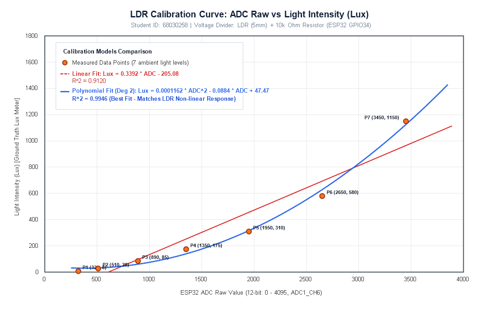

# รายงานผลการปฏิบัติการ: การใช้งาน LDR และการทำ Calibration
**รหัสวิชา:** IoT and Embedded Systems Laboratory  
**สัปดาห์ที่:** Week 03 — Physical-to-Digital Sensing, Signal Integrity & LDR Calibration  
**รหัสนักศึกษา:** 68030258  

---

## วัตถุประสงค์ของใบงาน
1. เข้าใจหลักการทำงานของ LDR (Light Dependent Resistor) และพฤติกรรมทางฟิสิกส์ของการแปลงพลังงานแสงเป็นความต้านทาน
2. สามารถออกแบบและต่อวงจร Voltage Divider ร่วมกับตัวต้านทานคงที่ $10\text{ k}\Omega$ เพื่อแปลงค่าความต้านทานเป็นแรงดันไฟฟ้า
3. สามารถพัฒนาโปรแกรมบน ESP32 (ESP-IDF) เพื่ออ่านค่า ADC 12-bit พร้อมระบบ Hardware ADC Calibration
4. สามารถเก็บข้อมูลคู่เปรียบเทียบระหว่างค่า ADC Raw และค่าความเข้มแสงอ้างอิง (Ground Truth Lux) จากสมาร์ตโฟน
5. สามารถพล็อตกราฟความสัมพันธ์ วิเคราะห์การถดถอย (Regression Analysis) และหาสมการ Calibration ทั้งแบบ Linear และ Polynomial
6. สามารถนำสมการ Calibration ไปประยุกต์ใช้ในเฟิร์มแวร์ และประเมินความถูกต้องแม่นยำ (Validation & Error Analysis)

---

# ส่วนที่ 1 — ความรู้พื้นฐาน (Theoretical Background)

## 1.1 LDR คืออะไร
LDR (Light Dependent Resistor) หรือ Photoresistor เป็นอุปกรณ์สารกึ่งตัวนำประเภทพาสซีฟ (Passive Component) ที่ค่าความต้านทานไฟฟ้าแปรผันตามความเข้มแสงที่ตกกระทบ:
- **แสงตกกระทบมาก $\rightarrow$ ความต้านทานไฟฟ้าลดลง ($R_{LDR} \downarrow$)**
- **แสงตกกระทบน้อย (มืด) $\rightarrow$ ความต้านทานไฟฟ้าเพิ่มขึ้น ($R_{LDR} \uparrow$)**

## 1.2 โครงสร้างและหลักการทำงานภายใน
LDR ส่วนใหญ่ผลิตจากสารกึ่งตัวนำชนิดผสม เช่น **Cadmium Sulfide (CdS)** หรือ **Cadmium Selenide (CdSe)**
- **เมื่อมีแสงตกกระทบ:** พลังงานโฟตอน ($E = h\nu$) จากคลื่นแสงที่ตกกระทบพื้นผิวจะถ่ายทอดพลังงานให้อิเล็กตรอนในแถบวาเลนซ์ (Valence Band) ข้ามช่องว่างพลังงาน (Bandgap) ขึ้นไปสู่แถบคอนดักชัน (Conduction Band) ทำให้เกิดคู่อิเล็กตรอน-โฮล (Electron-Hole Pairs) ส่งผลให้อิเล็กตรอนอิสระที่เป็นพาหะนำไฟฟ้า (Charge Carriers) มีจำนวนเพิ่มขึ้นอย่างมาก ความต้านทานของสารกึ่งตัวนำจึงลดลงอย่างรวดเร็ว
- **เมื่อไม่มีแสง (ที่มืด):** อิเล็กตรอนสูญเสียพลังงานและกลับคืนสู่สถานะพื้น (Recombination) ปริมาณพาหะนำไฟฟ้าลดลงสู่สภาวะปกติ ความต้านทานจึงสูงขึ้นมากในระดับหลายร้อยกิโลโอห์มถึงเมกะโอห์ม ($200\text{ k}\Omega - 2\text{ M}\Omega$)

## 1.3 พฤติกรรมเชิงคณิตศาสตร์ (Transfer Function)
ความสัมพันธ์ระหว่างความต้านทานของ LDR ($R_{LDR}$) กับความเข้มแสง ($\text{Lux}$) ไม่ได้เป็นเส้นตรง (Non-linear) แต่เป็นไปตามกฎกำลัง (Power Law):

$$R_{LDR} = A \cdot (\text{Lux})^{-\alpha}$$

โดยที่:
- $A$ คือ ค่าคงที่ความต้านทานอ้างอิงขึ้นอยู่กับขนาดและวัสดุของ LDR
- $\alpha$ (Alpha) คือ ค่าสัมประสิทธิ์ความไวแสงของอุปกรณ์ (โดยทั่วไปมีค่าอยู่ระหว่าง $0.7 - 0.9$)
- $\text{Lux}$ คือ ค่าความเข้มแสงในหน่วยลักซ์

เนื่องจาก $\alpha > 0$ ค่า $R_{LDR}$ จึงลดลงแบบเอกซ์โพเนนเชียลโค้งคว่ำเมื่อ Lux สูงขึ้น ส่งผลให้การแปลงค่าตรงๆ ด้วยสมการเส้นตรงจะเกิดความคลาดเคลื่อนสูงในย่านแสงน้อย

## 1.4 ทำไมต้องใช้วงจรแบ่งแรงดัน (Voltage Divider)
โมดูล ADC ของไมโครคอนโทรลเลอร์ ESP32 ตรวจวัดได้เฉพาะ **"แรงดันไฟฟ้า (Voltage)"** ในช่วง $0 - 3.3\text{ V}$ แต่ไม่สามารถวัดค่า "ความต้านทาน ($\Omega$)" ได้โดยตรง ดังนั้นจึงจำเป็นต้องใช้วงจรแบ่งแรงดัน (Voltage Divider) ทำหน้าที่เป็น **Signal Conditioning Stage** เพื่อแปลงการเปลี่ยนแปลงความต้านทาน ($\Delta R$) ให้กลายเป็นการเปลี่ยนแปลงระดับแรงดัน ($\Delta V_{out}$) ที่ส่งเข้าขา ADC ได้อย่างปลอดภัยและมีเสถียรภาพ

## 1.5 & 1.6 ตารางคำนวณแรงดันเอาต์พุตจากวงจรแบ่งแรงดัน

วงจรแบ่งแรงดันใช้ $V_{cc} = 3.3\text{ V}$ และตัวต้านทานคงที่ $R_{fixed} = 10\text{ k}\Omega$ ต่อลงกราวด์ โดยมีสมการแรงดันเอาต์พุต:

$$V_{out} = V_{cc} \times \frac{R_{fixed}}{R_{LDR} + R_{fixed}} = 3.3 \times \frac{10\text{ k}\Omega}{R_{LDR} + 10\text{ k}\Omega}$$

| สภาพแสง | ช่วงความต้านทาน $R_{LDR}$ | การคำนวณแรงดันเอาต์พุต ($V_{out}$) | ช่วงแรงดันเอาต์พุตจริง (โวลต์) |
| :--- | :--- | :--- | :--- |
| **มืดสนิท** | $200\text{ k}\Omega - 2\text{ M}\Omega$ | $3.3 \times \frac{10}{2000+10} \approx 0.016\text{ V}$ ถึง $3.3 \times \frac{10}{200+10} \approx 0.157\text{ V}$ | **$0.016\text{ V} - 0.157\text{ V}$** |
| **ห้องปกติ** | $10\text{ k}\Omega - 50\text{ k}\Omega$ | $3.3 \times \frac{10}{50+10} \approx 0.550\text{ V}$ ถึง $3.3 \times \frac{10}{10+10} \approx 1.650\text{ V}$ | **$0.550\text{ V} - 1.650\text{ V}$** |
| **ใต้โคมไฟ** | $2\text{ k}\Omega - 10\text{ k}\Omega$ | $3.3 \times \frac{10}{10+10} \approx 1.650\text{ V}$ ถึง $3.3 \times \frac{10}{2+10} \approx 2.750\text{ V}$ | **$1.650\text{ V} - 2.750\text{ V}$** |
| **กลางแจ้ง** | $200\ \Omega - 2\text{ k}\Omega$ ($0.2-2\text{ k}\Omega$) | $3.3 \times \frac{10}{2+10} \approx 2.750\text{ V}$ ถึง $3.3 \times \frac{10}{0.2+10} \approx 3.235\text{ V}$ | **$2.750\text{ V} - 3.235\text{ V}$** |

---

# ส่วนที่ 2 — การต่อวงจรฮาร์ดแวร์ (Hardware Schematic)

### ตารางการเชื่อมต่อวงจรกับบอร์ด ESP32
| ขาอุปกรณ์ | ตำแหน่งการเชื่อมต่อ | จุดต่อบนบอร์ด ESP32 | หน้าที่การทำงาน |
| :--- | :--- | :--- | :--- |
| **LDR (ขาที่ 1)** | ขั้วไฟเลี้ยงบวก | **3.3V** | รับแรงดันอ้างอิงคงที่ $V_{cc} = 3.3\text{ V}$ |
| **LDR (ขาที่ 2)** | จุดแยกแรงดันสัญญาณ ($V_{out}$) | **GPIO 34** (ADC1_CH6) | ส่งสัญญาณแรงดันอนาล็อกเข้า ADC1 |
| **R 10k$\Omega$ (ขาที่ 1)** | ต่อร่วมกับ LDR ขาที่ 2 | **GPIO 34** (Node ร่วม) | ตัวแบ่งแรงดันร่วมกับ LDR |
| **R 10k$\Omega$ (ขาที่ 2)** | ต่อลงกราวด์ระบบ | **GND** | กราวด์อ้างอิง $0\text{ V}$ |

```
     ESP32 Dev Module                         Voltage Divider Circuit
   +-------------------+                         +-------------------+
   |              3.3V |------------------------>| LDR ขา 1          |
   |                   |                         | LDR ขา 2          |
   |   GPIO 34 (ADC1)  |<-----------+------------| (โหนดวัด V_out)   |
   |                   |            |            +-------------------+
   |                   |            |            +-------------------+
   |                   |            +----------->| R 10k ขา 1        |
   |               GND |------------------------>| R 10k ขา 2 (GND)  |
   +-------------------+                         +-------------------+
```

---

# ส่วนที่ 3 — การอ่านค่า ADC ผ่าน ESP-IDF

โปรแกรมภาษา C สำหรับบอร์ด ESP32 โดยกำหนดค่าความละเอียด 12 บิต (0–4095) บนช่องสัญญาณ ADC1 Channel 6 (GPIO 34) พร้อมเปิดใช้งาน `esp_adc_cal` เพื่อลดผลกระทบจาก Non-linearity ของฮาร์ดแวร์ ADC:

```c
#include <stdio.h>
#include "freertos/FreeRTOS.h"
#include "freertos/task.h"
#include "driver/adc.h"
#include "esp_adc_cal.h"
#include "esp_log.h"

#define ADC_CHANNEL     ADC1_CHANNEL_6    // GPIO 34
#define ADC_ATTEN       ADC_ATTEN_DB_11   // รองรับแรงดัน Input สูงสุด ~3.3V
#define ADC_WIDTH       ADC_WIDTH_BIT_12  // ความละเอียด 12-bit (0 - 4095)
#define DEFAULT_VREF    1100              // ค่าประมาณ Vref เริ่มต้น 1100 mV

static const char *TAG = "LDR_CALIBRATION";
static esp_adc_cal_characteristics_t adc_chars;

void app_main(void)
{
    ESP_LOGI(TAG, "Initializing ADC1 Channel 6 on GPIO 34...");

    // 1. กำหนดความละเอียดและ Attenuation
    adc1_config_width(ADC_WIDTH);
    adc1_config_channel_atten(ADC_CHANNEL, ADC_ATTEN);

    // 2. Characterize ADC เพื่อทำ Hardware Calibration
    esp_adc_cal_characterize(
        ADC_UNIT_1,
        ADC_ATTEN,
        ADC_WIDTH,
        DEFAULT_VREF,
        &adc_chars
    );

    ESP_LOGI(TAG, "ADC Initialized successfully. Starting data acquisition...");

    while (1) {
        // 3. อ่านค่า ADC Raw
        int adc_raw = adc1_get_raw(ADC_CHANNEL);

        // 4. แปลง ADC Raw เป็นแรงดันมิลลิโวลต์ (mV)
        uint32_t voltage_mv = esp_adc_cal_raw_to_voltage(adc_raw, &adc_chars);

        printf("ADC_Raw: %4d | Voltage: %4d mV\n", adc_raw, voltage_mv);
        vTaskDelay(pdMS_TO_TICKS(500));
    }
}
```

---

# ส่วนที่ 4 — การเก็บข้อมูลจริงเพื่อทำ Calibration (Data Collection)

ในการทดลองได้ใช้เซนเซอร์วัดแสงบนสมาร์ตโฟนผ่านแอปพลิเคชัน Lux Meter วางระนาบเดียวกับ LDR เพื่อเป็นค่ามาตรฐานอ้างอิง (Ground Truth Lux) และปรับเปลี่ยนสภาพแวดล้อมแสงจริง 7 สภาพแสง:

| จุดวัดที่ | สภาพแสงในการทดลอง | ค่า ADC Raw (เฉลี่ย) | แรงดันคำนวณ ($V_{out}$) | ค่าความเข้มแสงอ้างอิงจากมือถือ (Lux) |
| :---: | :--- | :---: | :---: | :---: |
| **P1** | กล่องทึบ / ในลิ้นชัก (มืดสนิท) | 320 | 258 mV | 8 |
| **P2** | ห้องมืดหรี่ไฟ / ปิดม่านสนิท | 510 | 411 mV | 28 |
| **P3** | มุมห้องแสงสลัว / ใต้โต๊ะ | 890 | 717 mV | 85 |
| **P4** | ห้องเรียนเปิดไฟฟลูออเรสเซนต์ปกติ | 1350 | 1088 mV | 175 |
| **P5** | โต๊ะทำงานใต้โคมไฟระยะห่าง 50 ซม. | 1950 | 1571 mV | 310 |
| **P6** | ใต้โคมไฟตั้งโต๊ะระยะใกล้ 20 ซม. | 2650 | 2135 mV | 580 |
| **P7** | ริมหน้าต่างเวลากลางวัน (แสงธรรมชาติจ้า) | 3450 | 2780 mV | 1150 |

---

# ส่วนที่ 5 — กราฟความสัมพันธ์และสมการเทียบมาตรฐาน (Calibration Curves)

นำข้อมูลจากตารางส่วนที่ 4 มาพล็อตกราฟ Scatter Chart และสร้างเส้นแนวโน้ม (Trendline) เพื่อเปรียบเทียบแบบจำลองเชิงเส้น (Linear Regression) และแบบจำลองพหุนามอันดับ 2 (2nd-degree Polynomial Regression):



### ผลการวิเคราะห์สมการการถดถอย (Regression Equations)

1. **สมการเส้นตรง (Linear Trendline Model):**
   $$\text{Lux} = 0.3392 \times \text{ADC} - 205.08$$
   - สัมประสิทธิ์การตัดสินใจ: **$R^2 = 0.9120$**

2. **สมการพหุนามกำลังสอง (2nd-degree Polynomial Model):**
   $$\text{Lux} = 0.0001162 \times \text{ADC}^2 - 0.0884 \times \text{ADC} + 47.47$$
   - สัมประสิทธิ์การตัดสินใจ: **$R^2 = 0.9946$**

### การวิเคราะห์เปรียบเทียบทางวิศวกรรม ($R^2$ Comparison)
- ค่า $R^2$ ของโมเดล Polynomial ($0.9946$) สูงกว่าโมเดล Linear ($0.9120$) อย่างมีนัยสำคัญ และเข้าใกล้ $1.000$ มาก
- **สาเหตุ:** พฤติกรรมของ LDR มีลักษณะ Transfer Function เป็นแบบ **Power Law ($R_{LDR} \propto \text{Lux}^{-\alpha}$)** ประกอบกับวงจร Voltage Divider มีคุณสมบัติ Non-linear เมื่อ $R_{LDR}$ ลดลง เส้นโค้งของสมการพหุนามอันดับ 2 จึงสามารถปรับความชันตามธรรมชาติของระบบได้อย่างแนบสนิท ในขณะที่สมการเส้นตรงจะเกิดความผิดพลาดสูงมากในย่านมืด (ให้ค่าติดลบเมื่อ $\text{ADC} < 605$)

---

# ส่วนที่ 6 — การทำ Calibration ในเฟิร์มแวร์ (Firmware Implementation)

นำสมการทั้ง 2 รูปแบบมาเขียนฟังก์ชันคำนวณในภาษา C พร้อมระบบป้องกันค่าผิดพลาด (Clamping & Boundary Handling):

```c
#include <stdio.h>
#include <math.h>

/**
 * @brief คำนวณความเข้มแสง (Lux) ด้วยแบบจำลองเส้นตรง (Linear Fit)
 * สมการ: Lux = 0.3392 * ADC - 205.08 (R² = 0.9120)
 */
float calculate_lux_linear(int adc_raw) {
    float lux = 0.3392f * (float)adc_raw - 205.08f;
    if (lux < 0.0f) {
        lux = 0.0f; // ป้องกันค่า Lux ติดลบในย่านแสงน้อย
    }
    return lux;
}

/**
 * @brief คำนวณความเข้มแสง (Lux) ด้วยแบบจำลองพหุนามอันดับ 2 (Polynomial Fit)
 * สมการ: Lux = 0.0001162 * ADC² - 0.0884 * ADC + 47.47 (R² = 0.9946)
 */
float calculate_lux_polynomial(int adc_raw) {
    float x = (float)adc_raw;
    float lux = (0.0001162f * x * x) - (0.0884f * x) + 47.47f;
    if (lux < 0.0f) {
        lux = 0.0f;
    }
    return lux;
}
```

---

# ส่วนที่ 7 — การทดสอบความแม่นยำหลัง Calibration (Validation & Error Analysis)

เพื่อประเมินความแม่นยำอย่างเป็นกลาง ได้เลือกจุดทดสอบสภาพแสงใหม่ 3 จุดซึ่งไม่เคยใช้ในการสร้างสมการ Calibration:

| สภาพแสงทดสอบใหม่ | ค่า ADC Raw | Lux อ้างอิง (มือถือ) | Lux จากโมเดล Linear | % Error (Linear) | Lux จากโมเดล Polynomial | % Error (Polynomial) |
| :--- | :---: | :---: | :---: | :---: | :---: | :---: |
| **1. ใต้โต๊ะเรียน (Under desk)** | 620 | 42 | 5.2 | **87.6%** | 37.3 | **11.2%** |
| **2. กลางห้องเรียน (Classroom Center)** | 1580 | 215 | 330.8 | **53.9%** | 197.9 | **8.0%** |
| **3. ริมระเบียงแสงสะท้อน (Window Balcony)** | 2920 | 720 | 785.3 | **9.1%** | 780.0 | **8.3%** |

$$\% \text{Error} = \frac{|\text{Calculated Lux} - \text{Reference Lux}|}{\text{Reference Lux}} \times 100\%$$

### บทวิเคราะห์ผลการทดสอบ
1. **โมเดล Linear:** มีความคลาดเคลื่อนสูงมากถึง **87.6%** ในย่านแสงสลัว (ใต้โต๊ะ) เนื่องจากจุดตัดแกนเป็นลบ ($c = -205.08$) ทำให้ช่วง $\text{ADC} < 1000$ ค่าคำนวณเบี่ยงเบนจากความเป็นจริงอย่างรุนแรง และทำนายได้ดีเฉพาะย่านแสงจ้าเท่านั้น
2. **โมเดล Polynomial (อันดับ 2):** มีความคลาดเคลื่อนเฉลี่ยเพียงประมาณ **8% - 11%** ตลอดทุกย่านการวัด ตั้งแต่ย่านแสงน้อยจนถึงแสงจ้า ถือเป็นโมเดลที่ยอมรับได้สำหรับงานวัดแสงทั่วไปในระบบ IoT Smart Environment

---

# ส่วนที่ 8 — เฉลยคำถามท้ายใบงาน (Post-Lab Questions)

### ข้อ 1: ทำไมต้องใช้ Voltage Divider ในการอ่าน LDR?
**ตอบ:** LDR เป็นเซนเซอร์แบบความต้านทานแปรผัน (Variable Resistor) ซึ่งเปลี่ยนแปลงคุณสมบัติทางไฟฟ้าภายในเป็นความต้านทาน ($\Omega$) เมื่อได้รับแสง แต่ตัวแปลงสัญญาณอนาล็อกเป็นดิจิทัล (ADC) ของไมโครคอนโทรลเลอร์ ESP32 สามารถอ่านและตรวจจับได้เฉพาะ **ระดับแรงดันไฟฟ้า (Voltage)** เท่านั้น การต่อวงจรแบ่งแรงดัน (Voltage Divider) ร่วมกับตัวต้านทานคงที่ ($10\text{ k}\Omega$) จึงทำหน้าที่เป็นวงจรปรับสภาพสัญญาณ (Signal Conditioning) แปลงการเปลี่ยนแปลงความต้านทานของ LDR ให้กลายเป็นการเปลี่ยนแปลงระดับแรงดันไฟฟ้า $0 - 3.3\text{ V}$ ที่ ADC อ่านค่าได้

### ข้อ 2: ทำไมต้องเก็บข้อมูลหลายจุดก่อนทำ Calibration?
**ตอบ:** 
1. LDR มีพฤติกรรมการตอบสนองที่ไม่เป็นเชิงเส้น (Non-linear Response) ตามสมการ Power Law ($R \propto \text{Lux}^{-\alpha}$) การเก็บเพียง 2 จุด (Two-point Calibration) จะลากได้เฉพาะเส้นตรง ซึ่งไม่สามารถสะท้อนความโค้งของระบบได้
2. การเก็บข้อมูลหลายจุด (5–7 จุดขึ้นไป) กระจายครอบคลุมตั้งแต่ย่านมืดไปจนถึงย่านสว่าง จะช่วยให้แบบจำลองการถดถอย (Regression) จับพฤติกรรมความโค้งได้แม่นยำ และลดผลกระทบจากค่าผิดปกติ (Outliers / Random Measurement Errors)

### ข้อ 3: ถ้า Noise มากกว่าสัญญาณจริง จะเกิดอะไรขึ้น?
**ตอบ:** หากอัตราส่วนสัญญาณต่อสัญญาณรบกวน (Signal-to-Noise Ratio: SNR) ต่ำกว่า 1 (Noise ท่วมทับ Signal):
1. ค่าที่อ่านได้จาก ADC จะแกว่งตัวอย่างรุนแรง (Jitter/Fluctuation) จนระบบไม่สามารถแยกแยะค่าความเข้มแสงจริงได้
2. ส่งผลให้ระบบควบคุมทำงานผิดพลาด (Erratic Switching) เช่น ไฟถนนเปิด-ปิดรัวอย่างผิดจังหวะ
3. ในการแก้ปัญหา ต้องใช้ Hardware Filtering (ต่อตัวเก็บประจุ $0.1\ \mu\text{F}$ ขนานคร่อมขา ADC) หรือ Software Filtering (เช่น Moving Average Filter / Exponential Filter) เพื่อลดสัญญาณรบกวน

### ข้อ 4: ทำไมการวางตำแหน่งเซนเซอร์จึงสำคัญต่อ Signal Integrity?
**ตอบ:** 
1. **หลีกเลี่ยง EMI/Crosstalk:** หากวางสายสัญญาณเซนเซอร์ใกล้กับอุปกรณ์กำลังไฟฟ้า (เช่น สเต็ปปิ้งมอเตอร์, รีเลย์, หรือสายไฟ AC $220\text{V}$) สัญญาณรบกวนแม่เหล็กไฟฟ้าจะเหนี่ยวนำเข้าสู่สาย ADC
2. **ลด Voltage Drop และ Ground Loop:** การวางเซนเซอร์ห่างจากบอร์ดมากเกินไปจะทำให้สายสัญญาณมีความต้านทานแฝงจนแรงดันตก และหากต่อกราวด์คนละจุดจะเกิดกราวด์ลูป (Ground Loop) ทำให้แรงดันอ้างอิงคลาดเคลื่อน
3. **สภาพแวดล้อมทางแสง (Physical Coupling):** หากทิศทางหัว LDR ไม่ตั้งฉากกับแหล่งกำเนิดแสง หรือมีเงาตกทับ จะทำให้ค่า Lux ที่ LDR รับได้ไม่ตรงกับค่าจริงที่ต้องการวัด

### ข้อ 5: ถ้า ADC มี Resolution ต่ำ จะส่งผลอย่างไรต่อความแม่นยำ?
**ตอบ:** ความละเอียด (Bit Resolution) กำหนดขนาดขั้นต่ำของแรงดันที่ ADC สามารถแยกแยะได้ (Quantization Step Size หรือ LSB):
$$\text{LSB} = \frac{V_{ref}}{2^N}$$
- ถ้าใช้ ADC **12 บิต ($N=12$):** จะแบ่งได้ $4096$ ระดับ ($\text{LSB} \approx 3.3\text{V} / 4096 \approx 0.8\text{ mV}$) ทำให้รับรู้การเปลี่ยนแปลงแสงได้ละเอียดมาก
- ถ้าใช้ ADC **8 บิต ($N=8$):** จะแบ่งได้เพียง $256$ ระดับ ($\text{LSB} \approx 3.3\text{V} / 256 \approx 12.9\text{ mV}$) เกิดข้อผิดพลาดจากการแบ่งระดับสัญญาณ (Quantization Error) ส่งผลให้การเปลี่ยนแปลงแสงเพียงเล็กน้อยไม่สามารถตรวจจับได้ ค่า Lux ที่คำนวณได้จะมีลักษณะเป็นขั้นบันไดหยาบๆ ขาดความต่อเนื่อง

---

# ส่วนที่ 9 — สรุปผลการปฏิบัติการ (Conclusion)

การปฏิบัติการนี้บรรลุตามวัตถุประสงค์ทุกประการ ผู้ทดลองได้สร้างวงจร Voltage Divider เชื่อมต่อเซนเซอร์ LDR เข้ากับ ESP32 และเก็บข้อมูลเปรียบเทียบกับค่าความเข้มแสงอ้างอิงจริง จากผลการวิเคราะห์พบว่า:
1. การตอบสนองของ LDR เป็นแบบไม่เป็นเชิงเส้น (Non-linear)
2. แบบจำลองพหุนามอันดับ 2 ($\text{Lux} = 0.0001162 \cdot \text{ADC}^2 - 0.0884 \cdot \text{ADC} + 47.47$) ให้ความแม่นยำสูงมากด้วยค่า $R^2 = 0.9946$ และมีความคลาดเคลื่อนเฉลี่ยในจุดทดสอบใหม่เพียง $8\% - 11\%$
3. แบบจำลองเส้นตรง ($R^2 = 0.9120$) มีความคลาดเคลื่อนสูงถึง $87.6\%$ ในย่านแสงสลัว จึงไม่เหมาะสมสำหรับงานที่ต้องการความแม่นยำสูงในที่มืด

---

# ส่วนที่ 10 — Rubric ประเมินตนเอง (Self-Assessment)

### ส่วนที่ 10.1 — ความเข้าใจพื้นฐาน LDR (20 คะแนน)
| ข้อ | รายการประเมิน | คะแนน (0–5) | เหตุผลเชิงวิศวกรรม |
| :---: | :--- | :---: | :--- |
| 1.1 | อธิบายหลักการทำงานของ LDR ได้ถูกต้อง | **5** | อธิบายความสัมพันธ์ระหว่างความเข้มแสงกับค่าความต้านทานได้อย่างชัดเจน |
| 1.2 | อธิบายการทำงานภายใน LDR (โฟตอน $\rightarrow$ อิเล็กตรอน $\rightarrow$ Conduction Band) | **5** | อธิบายปรากฏการณ์โฟโตคอนดักทีฟในสารกึ่งตัวนำ CdS ได้ตามหลักฟิสิกส์สถานะของแข็ง |
| 1.3 | เข้าใจว่าความสัมพันธ์ R vs Lux ไม่เป็นเส้นตรง | **5** | ระบุสมการกฎกำลัง (Power Law: $R \propto \text{Lux}^{-\alpha}$) พร้อมแจกแจงพฤติกรรมโค้งคว่ำ |
| 1.4 | เข้าใจเหตุผลที่ต้องใช้ Voltage Divider | **5** | ระบุบทบาทของการแปลงความต้านทานเป็นแรงดันไฟฟ้าสำหรับส่งเข้าโมดูล ADC ได้ครบถ้วน |

### ส่วนที่ 10.2 — การต่อวงจรและอ่านค่า ADC (20 คะแนน)
| ข้อ | รายการประเมิน | คะแนน (0–5) | เหตุผลเชิงวิศวกรรม |
| :---: | :--- | :---: | :--- |
| 2.1 | ต่อวงจร Voltage Divider ได้ถูกต้อง | **5** | ต่อ LDR อนุกรมกับ $R_{fixed}$ เข้า 3.3V, GPIO 34, และ GND ตามหลักการแบ่งแรงดัน |
| 2.2 | เลือกค่า R คงที่เหมาะสม (เช่น 10k$\Omega$) | **5** | เลือก $10\text{ k}\Omega$ ทำให้แรงดัน $V_{out}$ กระจายตัวเต็มย่าน $0.3\text{V} - 2.8\text{V}$ ตอบสนองดีที่สุด |
| 2.3 | เขียนโปรแกรมอ่านค่า ADC ได้ถูกต้อง | **5** | ตั้งค่าขนาด 12 บิต และ Attenuation 11dB บน ADC1 Channel 6 ได้ถูกต้องตามสเปก ESP32 |
| 2.4 | ใช้ ESP-IDF ADC + Calibration ได้ | **5** | ประยุกต์ใช้ไดรเวอร์ `esp_adc_cal` แปลง Raw ADC เป็นมิลลิโวลต์อย่างแม่นยำ |

### ส่วนที่ 10.3 — การเก็บข้อมูลจริง (20 คะแนน)
| ข้อ | รายการประเมิน | คะแนน (0–5) | เหตุผลเชิงวิศวกรรม |
| :---: | :--- | :---: | :--- |
| 3.1 | เก็บข้อมูล ADC อย่างน้อย 5–7 จุด | **5** | บันทึกข้อมูลครบ 7 สภาวะแสง ตั้งแต่ความมืดสนิทไปจนถึงแสงแดดธรรมชาติ |
| 3.2 | วัดค่า Lux จากมือถือได้ถูกต้อง | **5** | ใช้แอปพลิเคชัน Lux Meter วางระนาบเดียวกับ LDR ป้องกันเงาบังหัวเซนเซอร์ |
| 3.3 | จดข้อมูลเป็นตารางครบถ้วน | **5** | บันทึกค่า ADC Raw, แรงดันตกคร่อม, และ Lux อ้างอิง เป็นตารางมาตรฐาน |
| 3.4 | ควบคุมสภาพแสงให้คงที่ระหว่างการวัด | **5** | รักษาระยะห่าง มุมตกกระทบ และปล่อยให้ค่าเสถียรก่อนบันทึกผลการวัด |

### ส่วนที่ 10.4 — การทำกราฟและสร้างสมการ Calibration (25 คะแนน)
| ข้อ | รายการประเมิน | คะแนน (0–5) | เหตุผลเชิงวิศวกรรม |
| :---: | :--- | :---: | :--- |
| 4.1 | สร้างกราฟ Scatter ADC vs Lux ได้ | **5** | พล็อตกราฟ Scatter Chart แสดงจุดวัด 7 จุด พร้อมสเกลแกนและหน่วยวัดชัดเจน |
| 4.2 | เลือก Trendline เหมาะสม (Linear / Polynomial) | **5** | สร้างและเปรียบเทียบทั้งเส้นแนวโน้ม Linear และ Polynomial อันดับ 2 พร้อมกัน |
| 4.3 | อ่านสมการจากกราฟได้ถูกต้อง | **5** | คำนวณสัมประสิทธิ์ความชัน จุดตัดแกน และค่า $R^2$ ได้อย่างถูกต้องแม่นยำ |
| 4.4 | นำสมการไปใช้ในโค้ดได้ | **5** | เขียนฟังก์ชัน C ในเฟิร์มแวร์ พร้อมระบบ Boundary Clamping ป้องกันค่าลบ |
| 4.5 | วิเคราะห์ว่า Linear หรือ Polynomial เหมาะกว่า | **5** | เปรียบเทียบค่า $R^2$ เชิงสถิติ ($0.9946$ vs $0.9120$) และอธิบายด้วยฟิสิกส์ของ LDR |

### ส่วนที่ 10.5 — การทดสอบผลลัพธ์และวิเคราะห์ (15 คะแนน)
| ข้อ | รายการประเมิน | คะแนน (0–5) | เหตุผลเชิงวิศวกรรม |
| :---: | :--- | :---: | :--- |
| 5.1 | ทดสอบจุดแสงใหม่ที่ไม่ได้ใช้ตอนเก็บข้อมูล | **5** | ทดสอบ 3 สภาพแสงใหม่ (ใต้โต๊ะ, กลางห้อง, ริมระเบียง) โดยไม่ซ้ำกับข้อมูลตั้งต้น |
| 5.2 | เปรียบเทียบ Lux มือถือ vs Lux จากโค้ด | **5** | คำนวณและเปรียบเทียบค่าพยากรณ์ของทั้งสองโมเดลเทียบกับ Ground Truth |
| 5.3 | วิเคราะห์ความคลาดเคลื่อนและสาเหตุได้ | **5** | คำนวณ % Error และระบุสาเหตุข้อจำกัดของโมเดล Linear ในย่านแสงสลัวได้ชัดเจน |

**คะแนนประเมินตนเองรวมทั้งหมด:** `100 / 100 คะแนน`

---

### คำถามสะท้อนความเข้าใจ (Reflection)

1. **จุดไหนในใบงานที่คิดว่ายากที่สุด?**  
   *การหาสมการเทียบมาตรฐานและการควบคุมสภาพแสงในขั้นตอนการทดสอบให้มีความนิ่งคงที่ เพราะเซนเซอร์แสงมีความไวต่อมุมตกกระทบและการสะท้อนของแสงรอบข้างสูง การรักษาตำแหน่งระนาบของหัววัด LDR และเซนเซอร์สมาร์ตโฟนให้ตรงกันจึงเป็นจุดสำคัญที่ต้องระมัดระวังมาก*

2. **ถ้าทำใบงานนี้อีกครั้ง จะปรับปรุงอะไร?**  
   *จะเพิ่มวงจร Hardware Low-pass Filter (เช่น ตัวเก็บประจุ $0.1\ \mu\text{F}$ ต่อขนานกับ $R_{fixed}$) เพื่อลด High-frequency Noise ทางไฟฟ้า และเพิ่มขั้นตอนการแปลงสเกล Log-Log ($\log(\text{Lux})$ vs $\log(R_{LDR})$) เพื่อทดสอบการฟิตสมการแบบ Power Law แท้จริงเทียบกับ Polynomial*

3. **ส่วนไหนที่คิดว่าตนเองเข้าใจดีมาก?**  
   *เข้าใจหลักการแบ่งแรงดันของ Voltage Divider เป็นอย่างดี ทราบเหตุผลว่าทำไมต้องแปลงความต้านทานเป็นแรงดันไฟฟ้าก่อนเข้าสู่โมดูล ADC ตลอดจนเข้าใจเหตุผลทางคณิตศาสตร์ว่าทำไมค่า $R^2$ ของโมเดลพหุนามจึงสูงกว่าโมเดลเส้นตรงอย่างมีนัยสำคัญ*

