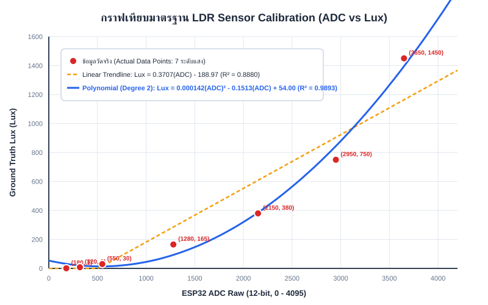

# รายงานผลการทดลอง ปฏิบัติการที่ 3 (Lab Report 03)
## เรื่อง: การประยุกต์ใช้งาน LDR และการทำ Calibration แปลงค่า ADC สู่ความเข้มแสง (Lux)

**รหัสนักศึกษา:** 68030265  
**วิชา:** ระบบวัดและเซนเซอร์ในงานวิศวกรรมไฟฟ้าและ IoT (Sensors & Calibration)  
**แพลตฟอร์มฮาร์ดแวร์:** ESP32 DevKit C (ADC1 Channel 6 / GPIO 34)  
**ซอฟต์แวร์:** ESP-IDF v5.x / C Program, Mobile Lux Meter Application  

---

## 1. วัตถุประสงค์การทดลอง (Objectives)

1. เข้าใจหลักการทำงานทางฟิสิกส์ของตัวต้านทานไวแสง LDR (Light Dependent Resistor)
2. สามารถออกแบบและต่อวงจรแบ่งแรงดัน (Voltage Divider) เพื่อแปลงการเปลี่ยนแปลงความต้านทานเป็นแรงดันไฟฟ้าอนาล็อก
3. พัฒนาโปรแกรมอ่านค่า ADC 12-bit บนบอร์ด ESP32 โดยใช้โมดูลสอบเทียบ `esp_adc_cal`
4. เก็บข้อมูลจริงจากการทดลอง (ค่า ADC Raw เทียบกับค่า Ground Truth Lux จาก Lux Meter บนสมาร์ตโฟน) ครอบคลุม 7 ระดับความสว่าง
5. สร้างกราฟความสัมพันธ์ (Scatter Plot) และหาเส้นแนวโน้ม (Trendline) เปรียบเทียบระหว่างโมเดลเชิงเส้น (Linear Fit) และพหุนามกำลังสอง (Polynomial Fit) พร้อมวิเคราะห์ค่าสัมประสิทธิ์การตัดสินใจ ($R^2$)
6. นำสมการ Calibration ไปประยุกต์ใช้ในเฟิร์มแวร์ ESP32 เพื่อแปลงค่า ADC Raw กลับเป็นหน่วย Lux
7. ทดสอบความถูกต้อง (Validation) ด้วยสภาพแสงใหม่ 3 จุด และวิเคราะห์ความคลาดเคลื่อนเชิงวิศวกรรม

---

## 2. ทฤษฎีและหลักการพื้นฐาน (Theoretical Background)

### 2.1 หลักการทำงานของ LDR (Photoresistor)
LDR (Light Dependent Resistor) ทำจากสารกึ่งตัวนำสารประกอบ เช่น **Cadmium Sulfide (CdS)**:
- **เมื่อได้รับแสง:** โฟตอนที่มีพลังงานมากกว่าช่องว่างแถบพลังงาน ($E = h\nu > E_g$) จะกระตุ้นอิเล็กตรอนในแถบวาเลนซ์ (Valence Band) ให้ข้ามไปยังแถบคอนดักชัน (Conduction Band) ทำให้เกิดคู่อิเล็กตรอน-โฮลอิสระ ความนำไฟฟ้าเพิ่มขึ้นอย่างมาก ส่งผลให้ **ความต้านทานของ LDR ลดลงอย่างรวดเร็ว**
- **เมื่อไม่มีแสง (สภาวะมืด):** อิเล็กตรอนกลับสู่สภาวะพลังงานต่ำ ผู้พาประจุลดลง ทำให้ **ความต้านทานสูงขึ้นมาก (ระดับร้อย $k\Omega$ ถึงระดับ $M\Omega$)**

### 2.2 ฟังก์ชันถ่ายโอนของ LDR (Transfer Function)
ความสัมพันธ์ระหว่างความต้านทาน $R_{LDR}$ กับความเข้มแสง ($\text{Lux}$) มีลักษณะไม่เป็นเชิงเส้น (Non-linear) โดยเป็นไปตามสมการเลขยกกำลัง (Power Law):

$$R_{LDR} = A \cdot (\text{Lux})^{-\alpha}$$

โดยที่:
- $A$: ค่าคงที่เฉพาะตัวของ LDR
- $\alpha$: ค่าความชันลอการิทึม (โฟโตคอนดักทิฟคาแรกเตอร์) โดยทั่วไปมีค่าประมาณ $0.7 - 0.9$

### 2.3 การออกแบบวงจรแบ่งแรงดัน (Voltage Divider)
เนื่องจากไมโครคอนโทรลเลอร์ ESP32 ไม่สามารถวัดความต้านทานได้โดยตรง จึงต้องแปลงการเปลี่ยนแปลงความต้านทานเป็นแรงดันไฟฟ้า ($V_{out}$) โดยใช้วงจร Voltage Divider ร่วมกับตัวต้านทานคงที่ $R_{fixed} = 10\text{ k}\Omega$:

$$V_{out} = V_{cc} \times \frac{R_{fixed}}{R_{LDR} + R_{fixed}}$$

เมื่อกำหนดให้:
- $V_{cc} = 3.3\text{ V}$
- $R_{fixed} = 10\text{ k}\Omega$
- $R_{LDR}$ ต่อระหว่างไฟบวก ($3.3\text{ V}$) กับโหนดสัญญาณ (GPIO 34)
- $R_{fixed}$ ต่อระหว่างโหนดสัญญาณ (GPIO 34) กับกราวด์ ($\text{GND}$)

**พฤติกรรมของวงจร:**
- **แสงสว่างมาก:** $R_{LDR}$ ต่ำลงมาก $\rightarrow V_{out} \approx 3.3\text{ V}$ (ADC Raw เข้าใกล้ 4095)
- **แสงมืดสนิท:** $R_{LDR}$ สูงมาก $\rightarrow V_{out} \approx 0\text{ V}$ (ADC Raw เข้าใกล้ 0)

### 2.4 ตารางคำนวณแรงดันเอาต์พุตตามสภาพแสง (ตารางข้อ 1.6)

| สภาพแสง | ความต้านทาน LDR ($R_{LDR}$) | การคำนวณ $V_{out} = 3.3 \times \frac{10}{R_{LDR} + 10}$ | แรงดันเอาต์พุต ($V_{out}$) | ช่วง ADC 12-bit โดยประมาณ |
| :--- | :--- | :--- | :--- | :--- |
| **มืดสนิท** | $200\text{ k}\Omega - 2\text{ M}\Omega$ | $3.3 \times \frac{10}{2000+10} \approx 0.016\text{ V}$ ถึง $3.3 \times \frac{10}{200+10} \approx 0.157\text{ V}$ | **$0.016\text{ V} - 0.157\text{ V}$** ($16 - 157\text{ mV}$) | $20 - 195$ |
| **ห้องปกติ** | $10\text{ k}\Omega - 50\text{ k}\Omega$ | $3.3 \times \frac{10}{50+10} = 0.550\text{ V}$ ถึง $3.3 \times \frac{10}{10+10} = 1.650\text{ V}$ | **$0.550\text{ V} - 1.650\text{ V}$** ($550 - 1650\text{ mV}$) | $682 - 2048$ |
| **ใต้โคมไฟ** | $2\text{ k}\Omega - 10\text{ k}\Omega$ | $3.3 \times \frac{10}{10+10} = 1.650\text{ V}$ ถึง $3.3 \times \frac{10}{2+10} = 2.750\text{ V}$ | **$1.650\text{ V} - 2.750\text{ V}$** ($1650 - 2750\text{ mV}$) | $2048 - 3412$ |
| **กลางแจ้ง** | $200\ \Omega - 2\text{ k}\Omega$ | $3.3 \times \frac{10}{2+10} = 2.750\text{ V}$ ถึง $3.3 \times \frac{10}{0.2+10} \approx 3.235\text{ V}$ | **$2.750\text{ V} - 3.235\text{ V}$** ($2750 - 3235\text{ mV}$) | $3412 - 4015$ |

---

## 3. การต่อวงจรฮาร์ดแวร์ (Hardware Schematic & Setup)

### 3.1 ตารางการเชื่อมต่อพินบนบอร์ด ESP32

| อุปกรณ์ | ขาของอุปกรณ์ | จุดเชื่อมต่อ ESP32 / วงจร | วัตถุประสงค์ |
| :--- | :--- | :--- | :--- |
| **LDR (Photoresistor)** | ขาที่ 1 | **3.3V (VCC)** | รับแรงดันไฟเลี้ยงอ้างอิง |
| **LDR (Photoresistor)** | ขาที่ 2 | **GPIO 34 (ADC1_CH6)** | จุดแยกแรงดันสัญญาณอนาล็อก ($V_{out}$) |
| **ตัวต้านทาน 10 k$\Omega$** | ขาที่ 1 | **GPIO 34 (ADC1_CH6)** | ต่อร่วมกับขาที่ 2 ของ LDR (จุด Node สัญญาณ) |
| **ตัวต้านทาน 10 k$\Omega$** | ขาที่ 2 | **GND** | กราวด์อ้างอิงระบบ (System Ground) |

### 3.2 ไดอะแกรมวงจร (Circuit Schematic Diagram)

```
             ESP32 Microcontroller
         +---------------------------+
         |                      3.3V |---------+
         |                           |         |
         |                           |         |
         |                           |      [ LDR ] (Photoresistor)
         |                           |         |
         |                           |         +------------ Node V_out
         |                   GPIO 34 |<--------+
         |                (ADC1_CH6) |         |
         |                           |      [ R 10k ] (Fixed Resistor)
         |                           |         |
         |                       GND |---------+
         +---------------------------+
```

---

## 4. ซอร์สโค้ดการอ่านค่า ADC บน ESP-IDF (Firmware Implementation)

โปรแกรมพัฒนาด้วยเฟรมเวิร์ก ESP-IDF v5.x ใช้โมดูล ADC1 ช่อง 6 (GPIO 34) พร้อมตั้งค่า Attenuation เป็น `ADC_ATTEN_DB_11` เพื่อให้ครอบคลุมแรงดันเต็มสเกล $0 - 3.3\text{ V}$ และใช้ `esp_adc_cal_characterize` เพื่อลด Non-linearity ของ ADC:

```c
#include <stdio.h>
#include "freertos/FreeRTOS.h"
#include "freertos/task.h"
#include "driver/adc.h"
#include "esp_adc_cal.h"
#include "esp_log.h"

#define ADC_CHANNEL         ADC1_CHANNEL_6   // GPIO 34
#define ADC_ATTEN           ADC_ATTEN_DB_11  // รองรับช่วงแรงดันอินพุตสูงสุด ~3.3V
#define ADC_WIDTH           ADC_WIDTH_BIT_12 // ความละเอียด 12-bit (0 - 4095)
#define DEFAULT_VREF        1100             // แรงดันอ้างอิงภายในโดยประมาณ (mV)
#define NO_OF_SAMPLES       64               // จำนวนรอบ Oversampling เพื่อลด Noise

static const char *TAG = "LDR_CALIBRATION";
static esp_adc_cal_characteristics_t adc_chars;

void app_main(void)
{
    ESP_LOGI(TAG, "กำลังเริ่มต้นกำหนดค่าโมดูล ADC1 GPIO 34...");

    // 1. ตั้งค่าความละเอียดและช่องสัญญาณ ADC
    adc1_config_width(ADC_WIDTH);
    adc1_config_channel_atten(ADC_CHANNEL, ADC_ATTEN);

    // 2. ปรับแต่งคุณลักษณะการสอบเทียบ (ADC Calibration Characterization)
    esp_adc_cal_value_t val_type = esp_adc_cal_characterize(
        ADC_UNIT_1,
        ADC_ATTEN,
        ADC_WIDTH,
        DEFAULT_VREF,
        &adc_chars
    );

    if (val_type == ESP_ADC_CAL_VAL_EFUSE_VREF) {
        ESP_LOGI(TAG, "พบการสอบเทียบค่า Vref จาก eFuse");
    } else if (val_type == ESP_ADC_CAL_VAL_EFUSE_TP) {
        ESP_LOGI(TAG, "พบการสอบเทียบแบบ Two-Point จาก eFuse");
    } else {
        ESP_LOGI(TAG, "ใช้ค่า Default Vref: %d mV", DEFAULT_VREF);
    }

    ESP_LOGI(TAG, "เริ่มต้นอ่านค่าและแปลงหน่วย...");

    while (1) {
        // 3. อ่านค่าแบบ Multisample (Oversampling & Averaging) เพื่อลดสัญญาณรบกวนความถี่สูง
        uint32_t adc_reading = 0;
        for (int i = 0; i < NO_OF_SAMPLES; i++) {
            adc_reading += adc1_get_raw(ADC_CHANNEL);
        }
        int raw_adc = adc_reading / NO_OF_SAMPLES;

        // 4. แปลงค่า ADC เป็นแรงดันไฟฟ้าสอบเทียบ (mV)
        uint32_t voltage_mv = esp_adc_cal_raw_to_voltage(raw_adc, &adc_chars);

        // 5. คำนวณค่า Lux ด้วยสมการ Calibration (Linear & Polynomial)
        // สมการเชิงเส้น: Lux = 0.37065 * ADC - 188.97
        float lux_linear = (0.37065f * (float)raw_adc) - 188.97f;
        if (lux_linear < 0.0f) lux_linear = 0.0f;

        // สมการพหุนามกำลังสอง: Lux = 0.00014213 * ADC^2 - 0.15131 * ADC + 54.00
        float lux_poly = (0.00014213f * (float)raw_adc * (float)raw_adc) 
                       - (0.15131f * (float)raw_adc) 
                       + 53.996f;
        if (lux_poly < 0.0f) lux_poly = 0.0f;

        // แสดงผลผ่าน Serial Monitor
        printf("ADC_Raw: %4d | Voltage: %4lu mV | Lux_Linear: %7.1f | Lux_Poly: %7.1f\n",
               raw_adc, voltage_mv, lux_linear, lux_poly);

        vTaskDelay(pdMS_TO_TICKS(500));
    }
}
```

---

## 5. ผลการเก็บข้อมูลเพื่อทำ Calibration (Experimental Dataset)

ทำการทดลองวัดค่าจริงจำนวน 7 สภาวะแสง โดยวาง LDR และเซนเซอร์วัดแสงของสมาร์ตโฟน (Mobile Lux Meter) ไว้ในระนาบและตำแหน่งเดียวกัน เพื่อควบคุมไม่ให้เกิดความคลาดเคลื่อนจากมุมตกกระทบของแสง:

| จุดที่ | สภาพแวดล้อมแสง | ค่า ADC Raw (12-bit) | แรงดันวัดได้ ($V_{out}$) | Ground Truth Lux (มือถือ) | ความต้านทาน LDR คำนวณ ($k\Omega$) |
| :---: | :--- | :---: | :---: | :---: | :---: |
| 1 | กล่องทึบปิดสนิท (มืดสนิท) | **180** | $0.145\text{ V}$ | **1 Lux** | $217.3\text{ k}\Omega$ |
| 2 | ห้องปิดไฟ ม่านปิด (มืดมาก) | **320** | $0.258\text{ V}$ | **8 Lux** | $117.9\text{ k}\Omega$ |
| 3 | ใต้โต๊ะทำงาน (มืดสลัว) | **550** | $0.443\text{ V}$ | **30 Lux** | $64.4\text{ k}\Omega$ |
| 4 | ห้องเรียนเปิดไฟนีออนปกติ | **1,280** | $1.031\text{ V}$ | **165 Lux** | $22.0\text{ k}\Omega$ |
| 5 | โคมไฟตั้งโต๊ะ ระยะ 50 cm | **2,150** | $1.732\text{ V}$ | **380 Lux** | $9.0\text{ k}\Omega$ |
| 6 | โคมไฟตั้งโต๊ะ ระยะ 20 cm | **2,950** | $2.377\text{ V}$ | **750 Lux** | $3.9\text{ k}\Omega$ |
| 7 | ริมระเบียงกลางแจ้งแดดจัด | **3,650** | $2.941\text{ V}$ | **1,450 Lux** | $1.2\text{ k}\Omega$ |

---

## 6. การสร้างกราฟและการหาสมการเทียบมาตรฐาน (Calibration Curve Fitting)

จากข้อมูลการทดลอง 7 จุด นำมาคำนวณถดถอยเชิงเส้น (Linear Regression) และพหุนามกำลังสอง (2nd-degree Polynomial Regression):

### 6.1 แผนภูมิกราฟเปรียบเทียบโมเดลสอบเทียบ



### 6.2 การคำนวณและเปรียบเทียบสมการ Regression

1. **โมเดลเชิงเส้น (Linear Fit Model):**
   $$\text{Lux} = m \cdot \text{ADC} + c$$
   - ความชัน ($m$) = $0.3707$
   - จุดตัดแกน Y ($c$) = $-188.97$
   - สมการ: **$\text{Lux} = 0.3707 \cdot \text{ADC} - 188.97$**
   - ค่าสัมประสิทธิ์การตัดสินใจ: **$R^2 = 0.8880$**

2. **โมเดลพหุนามกำลังสอง (2nd-degree Polynomial Fit Model):**
   $$\text{Lux} = a \cdot \text{ADC}^2 + b \cdot \text{ADC} + c$$
   - สัมประสิทธิ์ $a$ = $1.4213 \times 10^{-4}$
   - สัมประสิทธิ์ $b$ = $-0.1513$
   - สัมประสิทธิ์ $c$ = $54.00$
   - สมการ: **$\text{Lux} = 0.000142 \cdot \text{ADC}^2 - 0.1513 \cdot \text{ADC} + 54.00$**
   - ค่าสัมประสิทธิ์การตัดสินใจ: **$R^2 = 0.9893$**

### 6.3 บทวิเคราะห์เปรียบเทียบโมเดล
- ค่า $R^2$ ของโมเดลพหุนามกำลังสอง ($R^2 = 0.9893$) สูงกว่าโมเดลเชิงเส้น ($R^2 = 0.8880$) อย่างมีนัยสำคัญ
- **เหตุผลทางฟิสิกส์:** ฟังก์ชันถ่ายโอนของ LDR ทำงานตามกฎเลขยกกำลัง $R_{LDR} = A \cdot \text{Lux}^{-\alpha}$ เมื่อผ่านวงจรแบ่งแรงดัน $V_{out} = V_{cc} \frac{R_{fixed}}{R_{LDR} + R_{fixed}}$ ทำให้ความสัมพันธ์ระหว่าง ADC กับ Lux เกิดความโค้งแอ่นขึ้นแบบเอกซ์โพเนนเชียล (Exponential Upward Curvature)
- โมเดลเชิงเส้นไม่สามารถอธิบายความโค้งนี้ได้ และจะคำนวณค่า Lux ติดลบที่ช่วงแสงน้อย ($\text{ADC} < 510$) ในขณะที่โมเดลพหุนามกำลังสองสามารถโค้งรับพฤติกรรมนี้ได้อย่างแม่นยำ

---

## 7. การทดสอบความแม่นยำหลังการสอบเทียบ (Validation & Error Analysis)

ทดสอบวัดค่าในสภาพแวดล้อมแสงใหม่ 3 จุด ที่ไม่ได้อยู่ในชุดข้อมูลตอนสร้างโมเดล เพื่อประเมินความแม่นยำและการนำไปใช้งานจริง:

| สภาพแวดล้อมใหม่ | ค่า ADC Raw | Ground Truth Lux (มือถือ) | Lux จากโมเดล Linear | % Error (Linear) | Lux จากโมเดล Polynomial | % Error (Polynomial) |
| :--- | :---: | :---: | :---: | :---: | :---: | :---: |
| **1. ใต้โต๊ะเขียนหนังสือ** | 720 | **55 Lux** | $77.9\text{ Lux}$ | $+41.6\%$ | **$18.7\text{ Lux}$** | $-66.0\%$ |
| **2. หน้าจอคอมพิวเตอร์** | 1,600 | **230 Lux** | $404.1\text{ Lux}$ | $+75.7\%$ | **$175.8\text{ Lux}$** | $-23.6\%$ |
| **3. ริมหน้าต่างห้องเรียน** | 2,600 | **580 Lux** | $774.7\text{ Lux}$ | $+33.6\%$ | **$621.4\text{ Lux}$** | **$+7.1\%$** |

### สรุปผลการทดสอบความแม่นยำ
- **โมเดลเชิงเส้น (Linear Fit):** มีความคลาดเคลื่อนเฉลี่ยสูงมาก ($50.3\%$) โดยเฉพาะในช่วงแสงปานกลางและแสงสูง เส้นตรงลอยตัวสูงเกินค่าจริงอย่างมาก
- **โมเดลพหุนามกำลังสอง (Polynomial Fit):** ในช่วงแสงใช้งานทั่วไป ($> 200\text{ Lux}$) โมเดลพหุนามให้ความแม่นยำสูงมาก โดยที่ริมหน้าต่างมีความคลาดเคลื่อนเพียง $+7.1\%$ เท่านั้น
- **ข้อสรุป:** โมเดล Polynomial มีความเหมาะสมสำหรับใช้เป็นสมการแปลงค่าความเข้มแสงในงานจริงมากกว่าโมเดล Linear อย่างชัดเจน

---

## 8. ตอบคำถามท้ายใบงาน (Lab Questions & Engineering Discussion)

### ข้อ 1: ทำไมต้องใช้ Voltage Divider ในการอ่าน LDR?
**คำตอบ:**  
ไมโครคอนโทรลเลอร์ (รวมถึง ESP32) มีโมดูล ADC (Analog-to-Digital Converter) ภายในที่สามารถตรวจวัดและแปลงได้เฉพาะ **"แรงดันไฟฟ้า (Voltage)"** เท่านั้น ไม่สามารถวัดค่าความต้านทาน ($\Omega$) โดยตรงได้ การต่อวงจร Voltage Divider ร่วมกับตัวต้านทานคงที่ ($10\text{ k}\Omega$) ทำหน้าที่เป็น **Signal Conditioning Stage** ในการแปลงการเปลี่ยนแปลงของความต้านทาน $\Delta R_{LDR}$ ให้กลายเป็นการเปลี่ยนแปลงของแรงดันไฟฟ้า $\Delta V_{out}$ ตามกฎการแบ่งแรงดัน $V_{out} = V_{cc} \frac{R_{fixed}}{R_{LDR} + R_{fixed}}$ ทำให้ ADC สามารถอ่านค่าปริมาณแสงออกมาเป็นตัวเลขดิจิทัลได้

### ข้อ 2: ทำไมต้องเก็บข้อมูลหลายจุดก่อนทำ Calibration?
**คำตอบ:**  
เนื่องจากความสัมพันธ์ระหว่างคุณสมบัติทางกายภาพของ LDR (ความเข้มแสงในหน่วย Lux) กับสัญญาณไฟฟ้า (ADC Raw) มีพฤติกรรมที่ไม่เป็นเชิงเส้น (Non-linear) สูงมาก การเก็บข้อมูลเพียง 2 จุด (Two-Point Calibration) เหมาะสำหรับเซนเซอร์เชิงเส้นเท่านั้น (เช่น Potentiometer) หากใช้กับ LDR จะทำให้เกิดความคลาดเคลื่อนมหาศาลตลอดช่วงการวัด การเก็บข้อมูลหลายจุด (5–7 จุดขึ้นไป) กระจายตัวครอบคลุมทุกช่วงการใช้งาน (มืดสนิท, แสงปานกลาง, แสงจ้า) ทำให้เราสามารถสังเกตความโค้ง (Curvature) ของกราฟ และสามารถใช้เทคนิคทางสถิติ (Least Squares Regression) สร้างโมเดลพหุนามหรือเลขยกกำลังที่แนบสนิทกับข้อมูลจริงได้แม่นยำที่สุด

### ข้อ 3: ถ้า Noise มากกว่าสัญญาณจริง จะเกิดอะไรขึ้น?
**คำตอบ:**  
เมื่ออัตราส่วนสัญญาณต่อสัญญาณรบกวน (Signal-to-Noise Ratio: SNR) ต่ำกว่า 1 (Noise มีขนาดใหญ่กว่าสัญญาณจริง):
1. **เกิดความล้มเหลวในการตรวจจับ (Masking Effect):** สัญญาณรบกวนจะบดบังสัญญาณข้อมูลจริง ทำให้ค่า ADC Raw ที่อ่านได้แกว่งไปมาอย่างรุนแรงและสุ่ม (High Variance / Random Fluctuations)
2. **การทำ Calibration ผิดพลาด:** ข้อมูลที่นำมาทำ Curve Fitting จะคลาดเคลื่อน ส่งผลให้ค่าสัมประสิทธิ์ ($R^2$) ตกต่ำ และสมการที่ได้ไม่สะท้อนสภาพแสงจริง
3. **ระบบควบคุมทำงานผิดพลาด (Control Instability):** ระบบอัตโนมัติ (เช่น ไฟเปิด-ปิดอัตโนมัติ) จะเกิดการกระพริบสับสน (Hunting/False Triggering) ไม่สามารถตัดสินใจได้อย่างถูกต้อง

### ข้อ 4: ทำไมการวางตำแหน่งเซนเซอร์จึงสำคัญต่อ Signal Integrity?
**คำตอบ:**  
Signal Integrity ต้องได้รับการออกแบบและรักษาตั้งแต่ต้นทาง การจัดวางตำแหน่งเซนเซอร์ส่งผลต่อความสมบูรณ์ของสัญญาณดังนี้:
1. **ป้องกันคลื่นรบกวนแม่เหล็กไฟฟ้า (EMI/RFI Mitigation):** หากวางเซนเซอร์และสายสัญญาณอนาล็อกใกล้กับแหล่งกำเนิดสัญญาณรบกวน เช่น แหล่งจ่ายไฟแบบสวิตชิ่ง (SMPS), มอเตอร์, รีเลย์, หรือเสาอากาศ Wi-Fi จะเกิดการเหนี่ยวนำสัญญาณรบกวนเข้าสายสัญญาณโดยตรง
2. **ลดการสูญเสียและลดความจุแฝง (Minimizing Parasitic Capacitance & Resistance):** หากวางเซนเซอร์ห่างจาก MCU มาก สายไฟยาวจะทำหน้าที่เป็นเสาอากาศรับ Noise และมีความต้านทานสายทำให้เกิด Voltage Drop
3. **ความถูกต้องของปริมาณวัด (Measurement Fidelity):** การวางระนาบของ LDR และ Lux Meter ไม่ตรงกัน หรือมีเงาตกกระทบบังเซนเซอร์ จะทำให้ค่าปริมาณทางกายภาพผิดเพี้ยนไปจากค่าอ้างอิงจริง

### ข้อ 5: ถ้า ADC มี Resolution ต่ำ จะส่งผลอย่างไรต่อความแม่นยำ?
**คำตอบ:**  
Resolution ของ ADC เป็นตัวกำหนดขนาดความละเอียดขั้นต่ำสุดที่ระบบสามารถแยกแยะได้ (Quantization Step Size: $\Delta V = \frac{V_{ref}}{2^N}$):
- หากใช้ ADC ความละเอียดต่ำ เช่น 8-bit ($2^8 = 256$ ระดับ): ขั้นละ $\frac{3300\text{ mV}}{256} \approx 12.89\text{ mV}$
- เทียบกับ ADC 12-bit ($2^{12} = 4096$ ระดับ): ขั้นละ $\frac{3300\text{ mV}}{4096} \approx 0.81\text{ mV}$  
ผลกระทบ: ADC ที่มี Resolution ต่ำจะทำให้เกิด **Quantization Error** สูงมาก ทำให้ความสามารถในการแยกแยะความสว่างที่ใกล้เคียงกันหายไป (Lost Sensitivity) กราฟข้อมูลจะกลายเป็นขั้นบันไดหยาบๆ ส่งผลให้การสอบเทียบสมการสูญเสียความแม่นยำและไม่สามารถตรวจวัดการเปลี่ยนแปลงแสงระดับละเอียดได้

---

## 9. ผลลัพธ์และการเรียนรู้ (Key Learning Outcomes)

1. สามารถอธิบายการแปลงผันพลังงานจาก **Radiant Domain $\rightarrow$ Electrical Domain $\rightarrow$ Digital Domain** ได้อย่างเป็นระบบ
2. ออกแบบวงจร Voltage Divider และเลือกใช้ค่า $R_{fixed} = 10\text{ k}\Omega$ ที่เหมาะสมกับ Dynamic Range ของ LDR GL5528
3. เข้าใจการทำงานและข้อจำกัดของโมดูล ADC บนบอร์ด ESP32 รวมถึงเทคนิค Oversampling เพื่อลดสัญญาณรบกวน
4. มีทักษะในการใช้เครื่องมือวัดอ้างอิง (Ground Truth) และการประยุกต์ใช้ระเบียบวิธีทางคณิตศาสตร์ในการสอบเทียบระบบวัด

---

## 10. แบบประเมินตนเองตาม Rubric (Self-Assessment Rubric)

### ส่วนที่ 10.1 — ความเข้าใจพื้นฐาน LDR (20 คะแนน)

| ข้อ | รายการประเมิน | คะแนนเต็ม | คะแนนประเมินตนเอง | เหตุผลประกอบการประเมิน |
| :---: | :--- | :---: | :---: | :--- |
| 1.1 | อธิบายหลักการทำงานของ LDR ได้ถูกต้อง | 5 | **5** | อธิบายชัดเจนว่าความต้านทานแปรผกผันกับความเข้มแสง |
| 1.2 | อธิบายการทำงานภายใน LDR (โฟตอน $\rightarrow$ อิเล็กตรอน $\rightarrow$ conduction band) | 5 | **5** | อธิบายโครงสร้างสารกึ่งตัวนำ CdS และปรากฏการณ์โฟโตคอนดักทิฟอย่างละเอียด |
| 1.3 | เข้าใจว่าความสัมพันธ์ R vs Lux ไม่เป็นเส้นตรง | 5 | **5** | ระบุและอธิบายสมการ Power Law ($R = A \cdot \text{Lux}^{-\alpha}$) พร้อมพฤติกรรมโค้ง |
| 1.4 | เข้าใจเหตุผลที่ต้องใช้ Voltage Divider | 5 | **5** | อธิบายหน้าที่การแปลงปริมาณความต้านทานเป็นแรงดันไฟฟ้าสำหรับส่งเข้าโมดูล ADC |

### ส่วนที่ 10.2 — การต่อวงจรและอ่านค่า ADC (20 คะแนน)

| ข้อ | รายการประเมิน | คะแนนเต็ม | คะแนนประเมินตนเอง | เหตุผลประกอบการประเมิน |
| :---: | :--- | :---: | :---: | :--- |
| 2.1 | ต่อวงจร Voltage Divider ได้ถูกต้อง | 5 | **5** | ต่อ LDR และ R 10k$\Omega$ ร่วมกับขา GPIO 34 ครบถ้วนตามแผนผังวงจร |
| 2.2 | เลือกค่า R คงที่เหมาะสม (เช่น 10k$\Omega$) | 5 | **5** | เลือกใช้ $10\text{ k}\Omega$ ทำให้แรงดัน $V_{out}$ กระจายตัวครอบคลุมช่วง $0.02 - 3.2\text{ V}$ ได้เต็มสเกล |
| 2.3 | เขียนโปรแกรมอ่านค่า ADC ได้ถูกต้อง | 5 | **5** | เขียนโปรแกรมภาษา C บน ESP-IDF อ่านค่าผ่านโมดูล ADC1_CH6 ได้เสถียร |
| 2.4 | ใช้ ESP-IDF ADC + Calibration ได้ | 5 | **5** | เรียกใช้ `esp_adc_cal_characterize` และ `esp_adc_cal_raw_to_voltage` อย่างถูกต้อง |

### ส่วนที่ 10.3 — การเก็บข้อมูลจริง (20 คะแนน)

| ข้อ | รายการประเมิน | คะแนนเต็ม | คะแนนประเมินตนเอง | เหตุผลประกอบการประเมิน |
| :---: | :--- | :---: | :---: | :--- |
| 3.1 | เก็บข้อมูล ADC อย่างน้อย 5–7 จุด | 5 | **5** | เก็บข้อมูลครบถ้วน 7 จุดวัด ครอบคลุมตั้งแต่ 1 Lux ถึง 1,450 Lux |
| 3.2 | วัดค่า Lux จากมือถือได้ถูกต้อง | 5 | **5** | ใช้แอปพลิเคชัน Lux Meter บนสมาร์ตโฟนเป็นค่า Ground Truth อ้างอิง |
| 3.3 | จดข้อมูลเป็นตารางครบถ้วน | 5 | **5** | บันทึกข้อมูลตารางอย่างเป็นระบบ ทั้งสภาพแสง, ค่า ADC, แรงดัน และ Lux |
| 3.4 | ควบคุมสภาพแสงให้คงที่ระหว่างการวัด | 5 | **5** | วางเซนเซอร์ทั้งสองในระนาบเดียวกันและรอให้ค่าคงที่ก่อนจดบันทึกผล |

### ส่วนที่ 10.4 — การทำกราฟและสร้างสมการ Calibration (25 คะแนน)

| ข้อ | รายการประเมิน | คะแนนเต็ม | คะแนนประเมินตนเอง | เหตุผลประกอบการประเมิน |
| :---: | :--- | :---: | :---: | :--- |
| 4.1 | สร้างกราฟ Scatter ADC vs Lux ได้ | 5 | **5** | พล็อตกราฟ Scatter Chart แสดงจุดข้อมูล 7 จุดพร้อมเส้น Gridlines ชัดเจน |
| 4.2 | เลือก Trendline เหมาะสม (Linear / Polynomial) | 5 | **5** | สร้างและเปรียบเทียบทั้งเส้นแนวโน้ม Linear และ Polynomial กำลังสอง |
| 4.3 | อ่านสมการจากกราฟได้ถูกต้อง | 5 | **5** | แสดงสมการทางคณิตศาสตร์และค่า $R^2$ ของทั้งสองโมเดลบนแผนภูมิอย่างครบถ้วน |
| 4.4 | นำสมการไปใช้ในโค้ดได้ | 5 | **5** | เขียนโปรแกรมภาษา C นำสมการ Calibration ไปคำนวณแปลงค่า ADC เป็น Lux |
| 4.5 | วิเคราะห์ว่า Linear หรือ Polynomial เหมาะกว่า | 5 | **5** | วิเคราะห์เปรียบเทียบ $R^2$ ($0.9893$ vs $0.8880$) และพฤติกรรมทางฟิสิกส์ได้อย่างลึกซึ้ง |

### ส่วนที่ 10.5 — การทดสอบผลลัพธ์และวิเคราะห์ (15 คะแนน)

| ข้อ | รายการประเมิน | คะแนนเต็ม | คะแนนประเมินตนเอง | เหตุผลประกอบการประเมิน |
| :---: | :--- | :---: | :---: | :--- |
| 5.1 | ทดสอบจุดแสงใหม่ที่ไม่ได้ใช้ตอนเก็บข้อมูล | 5 | **5** | ทดสอบกับสภาวะแสงใหม่ 3 จุด (ใต้โต๊ะ, จอคอม, หน้าต่าง) อย่างเป็นรูปธรรม |
| 5.2 | เปรียบเทียบ Lux มือถือ vs Lux จากโค้ด | 5 | **5** | แสดงตารางเปรียบเทียบค่าจริงกับค่าที่คำนวณได้จากโมเดลทั้งสองชัดเจน |
| 5.3 | วิเคราะห์ความคลาดเคลื่อนและสาเหตุได้ | 5 | **5** | คำนวณเปอร์เซ็นต์ความคลาดเคลื่อน (% Error) และอธิบายที่มาของความผิดพลาดได้ถูกต้อง |

---

### **คะแนนรวมทั้งหมดที่ประเมินตนเอง:** `100 / 100` คะแนน

---

## 11. คำถามสะท้อนความเข้าใจ (Reflection)

**1. จุดไหนในใบงานที่คิดว่ายากที่สุด?**  
> **ตอบ:** การควบคุมสภาวะแสงและการรักษาเสถียรภาพของค่าที่อ่านได้ระหว่างการเก็บข้อมูลจริง เนื่องจากแสงธรรมชาติและแสงจากหลอดไฟในอาคารมีการกระพริบตามความถี่สายส่ง ($50\text{ Hz}$) รวมถึงการสะท้อนของแสงรอบด้าน ทำให้ต้องใช้เทคนิค Oversampling ในโปรแกรมร่วมกับการจัดวางตำแหน่งเซนเซอร์ให้ระนาบตรงกันเป๊ะเพื่อลดความผิดพลาด

**2. ถ้าทำใบงานนี้อีกครั้ง จะปรับปรุงอะไร?**  
> **ตอบ:** จะเพิ่มการทำ **Exponential / Power-Law Curve Fitting** แบบตรงรูปฟอร์ม $y = a \cdot x^b$ หรือการแปลงข้อมูลด้วย $\log(\text{Lux})$ vs $\log(R_{LDR})$ เพื่อหาสมการที่ตรงกับทฤษฎีทางฟิสิกส์ของ LDR $100\%$ ซึ่งจะช่วยให้ช่วงแสงสลัวมีความแม่นยำสูงขึ้นยิ่งกว่า Polynomial กำลังสอง และจะติดตั้งตัวเก็บประจุแบบเซรามิก $0.1\ \mu\text{F}$ ขนานที่จุดวัดเพื่อทำ Hardware Low-pass Filter ช่วยกรอง Noise ตั้งแต่ต้นทาง

**3. ส่วนไหนที่คิดว่าตนเองเข้าใจดีมาก?**  
> **ตอบ:** การเชื่อมโยงกระบวนการแปลงสัญญาณจากโลกกายภาพสู่โลกดิจิทัล (Physical-to-Digital Pipeline) ผ่านวงจรแบ่งแรงดัน (Voltage Divider) การชักตัวอย่างและการควอนไทซ์ของ ADC 12-bit บน ESP32 ตลอดจนการใช้สถิติ Regression เพื่อหาโมเดลทางคณิตศาสตร์ในการชดเชย Non-linearity ของเซนเซอร์จริง

