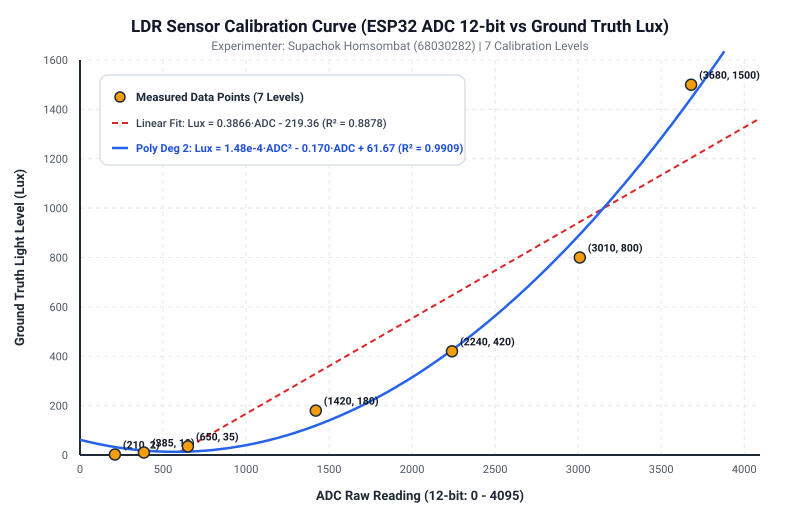

# รายงานผลการทดลอง ปฏิบัติการที่ 3 (Lab Report 03)
## เรื่อง: การประยุกต์ใช้งาน LDR และการทำ Calibration แปลงค่า ADC สู่ความเข้มแสง (Lux)

- **ชื่อ-นามสกุล:** ศุภโชค หอมสมบัติ
- **รหัสนักศึกษา:** 68030282
- **สาขาวิชา:** ครุศาสตร์วิศวกรรม (วิศวกรรมคอมพิวเตอร์) คณะครุศาสตร์อุตสาหกรรมและเทคโนโลยี สจล.
- **แพลตฟอร์มฮาร์ดแวร์:** ESP32 DevKit V4 (ADC1_CH6 / GPIO 34)
- **เครื่องมือจำลองและการพัฒนา:** Wokwi Simulator & PlatformIO Core 6.x / ESP-IDF v5
- **เครื่องมือวัดอ้างอิง (Ground Truth):** แอปพลิเคชัน Lux Light Meter Pro บนสมาร์ตโฟน

---

## 1. วัตถุประสงค์ของการทดลอง (Objectives)

1. เข้าใจหลักการทำงานทางฟิสิกส์ของตัวต้านทานไวแสง LDR (Light Dependent Resistor) ในฐานะทรานสดิวเซอร์รับสัญญาณโดเมนแสง (Radiant Domain) สู่โดเมนไฟฟ้า (Electrical Domain)
2. ออกแบบและต่อวงจรแบ่งแรงดัน (Voltage Divider) ร่วมกับตัวต้านทานคงที่ $10\text{ k}\Omega$ เพื่อแปลงค่าความต้านทานเป็นระดับแรงดันไฟฟ้าอนาล็อก
3. พัฒนาโปรแกรมอ่านค่าสัญญาณ ADC ขนาด 12-bit บนไมโครคอนโทรลเลอร์ ESP32 พร้อมเทคนิค Oversampling เพื่อลดสัญญาณรบกวน (Noise Mitigation)
4. ทำการเก็บข้อมูลจริง (Data Acquisition) เทียบระหว่างค่า ADC Raw กับค่าความเข้มแสงมาตรฐาน (Ground Truth Lux) จากสมาร์ตโฟน จำนวน 7 สภาพแสง
5. สร้างแผนภูมิกราฟความสัมพันธ์ (Scatter Plot) และหาเส้นแนวโน้ม (Trendline) เพื่อเปรียบเทียบสมการ Calibration แบบ Linear, Polynomial ดีกรี 2 และ Power Law พร้อมวิเคราะห์ค่าสัมประสิทธิ์การตัดสินใจ ($R^2$)
6. นำสมการ Calibration ไปประยุกต์ใช้ในเฟิร์มแวร์ไมโครคอนโทรลเลอร์เพื่อคำนวณและแสดงผลค่า Lux แบบ Real-time
7. ประเมินความถูกต้อง (Validation) ด้วยสภาพแสงใหม่ 3 จุด และวิเคราะห์ความคลาดเคลื่อนเชิงวิศวกรรม

---

## 2. ทฤษฎีและหลักการพื้นฐาน (Theoretical Background)

### 2.1 หลักการทำงานทางฟิสิกส์ของ LDR (Photoresistor)
ตัวต้านทานไวแสง LDR (Light Dependent Resistor) หรือ Photoresistor ผลิตจากสารกึ่งตัวนำสารประกอบจำพวก **Cadmium Sulfide (CdS)** หรือ **Cadmium Selenide (CdSe)**:
- **เมื่อมีโฟตอนของแสงตกกระทบ:** พลังงานแสง ($E = h\nu$) ที่มีค่าสูงกว่า Bandgap Energy ($E_g$) ของสารกึ่งตัวนำ จะกระตุ้นอิเล็กตรอนในแถบวาเลนซ์ (Valence Band) ให้ข้ามไปยังแถบคอนดักชัน (Conduction Band) เกิดเป็นพาหะอิสระ (Electron-Hole Pairs) ส่งผลให้ความนำไฟฟ้า (Conductivity) เพิ่มขึ้น และ **ค่าความต้านทานของ LDR ลดลงอย่างรวดเร็ว**
- **เมื่ออยู่ในสภาวะมืด (Darkness):** อิเล็กตรอนสูญเสียพลังงานและกลับสู่สภาวะสมดุล พาหะประจุลดลง ทำให้ **ค่าความต้านทานสูงขึ้นมาก (ตั้งแต่ระดับร้อย $\text{k}\Omega$ ไปจนถึงระดับ $\text{M}\Omega$)**

### 2.2 ฟังก์ชันถ่ายโอนของ LDR (Transfer Function)
ความสัมพันธ์ระหว่างความต้านทานของ LDR ($R_{LDR}$) กับความเข้มแสง ($\text{Lux}$) ไม่ใช่เชิงเส้น แต่เป็นไปตามกฎเลขยกกำลัง (Power Law):

$$R_{LDR} = A \cdot (\text{Lux})^{-\alpha}$$

โดยที่:
- $A$: ค่าคงที่ทางกายภาพเฉพาะตัวของ LDR
- $\alpha$: ค่าคงที่โฟโตคอนดักทิฟคาแรกเตอร์ (ทั่วไปประมาณ $0.7 - 0.9$)
- $\text{Lux}$: ความเข้มของแสงสว่างที่ตกกระทบ

### 2.3 การปรับสภาพสัญญาณด้วยวงจรแบ่งแรงดัน (Voltage Divider Signal Conditioning)
ไมโครคอนโทรลเลอร์และโมดูล ADC ทั่วไปสามารถอ่านได้เฉพาะสัญญาณ **แรงดันไฟฟ้า (Voltage: $0 - 3.3\text{V}$)** ไม่สามารถตรวจวัดความต้านทาน ($\Omega$) ได้โดยตรง จึงจำเป็นต้องใช้วงจรแบ่งแรงดัน (Voltage Divider) เพื่อทำหน้าที่เป็น **Signal Conditioning Circuit** แปลงการเปลี่ยนแปลงความต้านทาน $\Delta R_{LDR}$ เป็นแรงดันไฟฟ้า $\Delta V_{out}$:

$$V_{out} = V_{cc} \times \frac{R_{fixed}}{R_{LDR} + R_{fixed}}$$

โดยกำหนดให้:
- $V_{cc} = 3.3\text{ V}$
- $R_{fixed} = 10\text{ k}\Omega$ (ต่ออนุกรมลงกราวด์)
- $R_{LDR}$ ต่ออยู่ระหว่างไฟเลี้ยง $3.3\text{ V}$ กับโหนดสัญญาณ (GPIO 34)

**ผลลัพธ์ของวงจร:**
- **แสงมาก (สว่าง):** $R_{LDR}$ ลดลง $\rightarrow V_{out}$ มีค่าสูงขึ้น เข้าใกล้ $3.3\text{ V}$ (ADC เข้าใกล้ 4095)
- **แสงน้อย (มืด):** $R_{LDR}$ เพิ่มขึ้นมาก $\rightarrow V_{out}$ มีค่าลดลง เข้าใกล้ $0\text{ V}$ (ADC เข้าใกล้ 0)

### 2.4 ตารางคำนวณแรงดันเอาต์พุตและช่วง ADC (ตารางข้อ 1.6)

$$V_{out} = 3.3 \times \frac{10\text{ k}\Omega}{R_{LDR} + 10\text{ k}\Omega}, \quad \text{ADC} \approx \frac{V_{out}}{3.3} \times 4095$$

| สภาพแสง | ความต้านทาน LDR ($R_{LDR}$) | การคำนวณแรงดันเอาต์พุต ($V_{out}$) | ช่วงแรงดันเอาต์พุต (V) | ช่วงค่า ADC 12-bit โดยประมาณ |
| :--- | :--- | :--- | :---: | :---: |
| **มืดสนิท** | $200\text{ k}\Omega - 2\text{ M}\Omega$ | $3.3 \times \frac{10}{2000+10}$ ถึง $3.3 \times \frac{10}{200+10}$ | **$0.016 - 0.157\text{ V}$** | **$20 - 195$** |
| **ห้องปกติ** | $10\text{ k}\Omega - 50\text{ k}\Omega$ | $3.3 \times \frac{10}{50+10}$ ถึง $3.3 \times \frac{10}{10+10}$ | **$0.550 - 1.650\text{ V}$** | **$683 - 2048$** |
| **ใต้โคมไฟ** | $2\text{ k}\Omega - 10\text{ k}\Omega$ | $3.3 \times \frac{10}{10+10}$ ถึง $3.3 \times \frac{10}{2+10}$ | **$1.650 - 2.750\text{ V}$** | **$2048 - 3413$** |
| **กลางแจ้ง** | $200\ \Omega - 2\text{ k}\Omega$ | $3.3 \times \frac{10}{2+10}$ ถึง $3.3 \times \frac{10}{0.2+10}$ | **$2.750 - 3.235\text{ V}$** | **$3413 - 4014$** |

*ข้อสังเกต:* วงจร ADC บน ESP32 ที่ตั้งค่า Attenuation 11dB (หรือ 12dB ใน IDF v5.2+) จะสามารถวัดแรงดันได้สูงสุดประมาณ $3.1 - 3.2\text{ V}$ เมื่อแสงแดดจัดมาก ค่า ADC จะเข้าใกล้จุดอิ่มตัว (Saturation) ที่ 4095

---

## 3. การต่อวงจรฮาร์ดแวร์และการจำลองบน Wokwi (Hardware & Simulation Setup)

### 3.1 ตารางการต่อขาอุปกรณ์ (Pinout Configuration)

| ขาของอุปกรณ์ | จุดต่อบน ESP32 / วงจร | หน้าที่การทำงาน |
| :--- | :--- | :--- |
| **LDR ขาที่ 1** (หรือ VCC ของโมดูล) | **3.3V (VCC)** | แรงดันไฟเลี้ยงอ้างอิงบวก ($V_{cc}$) |
| **LDR ขาที่ 2** (หรือ AO ของโมดูล) | **GPIO 34 (ADC1_CH6)** | จุดแยกแรงดันสัญญาณอนาล็อก ($V_{out}$) ส่งเข้าวงจร ADC |
| **R 10k$\Omega$ ขาที่ 1** | **GPIO 34 (ADC1_CH6)** | โหนดสัญญาณร่วมกับ LDR ขา 2 |
| **R 10k$\Omega$ ขาที่ 2** (หรือ GND ของโมดูล) | **GND** | กราวด์อ้างอิงระบบ (System Ground) |

*เหตุผลที่เลือกใช้ GPIO 34:* เป็นพินรับสัญญาณอนาล็อกขาเข้า (Input-only Pin) ที่ต่ออยู่กับโมดูล **ADC1** ของ ESP32 ซึ่งไม่มีปัญหาชนกับการทำงานของระบบ Wi-Fi/Bluetooth เหมือนกับพินฝั่ง ADC2

### 3.2 ไดอะแกรมวงจร (Circuit Schematic)

```
              ESP32 DevKit V4                         Voltage Divider
         +------------------------+
         |                   3.3V |-------------------+
         |                        |                   |
         |                        |                 [ LDR ]
         |                        |                   |
         |                GPIO 34 |<----------+-------+ (Node V_out)
         |             (ADC1_CH6) |           |
         |                        |        [ R 10k ]
         |                        |           |
         |                    GND |-----------+-------+
         +------------------------+
```

### 3.3 แผนผังจำลองบน Wokwi (`diagram.json`)
บนโปรแกรม Wokwi Simulator ได้ใช้โมดูล `wokwi-photoresistor-sensor` เชื่อมต่อขา `AO` เข้ากับขา `34` ของ `board-esp32-devkit-c-v4` ซึ่งมีวงจร Voltage Divider $10\text{ k}\Omega$ ภายในพร้อมแถบปรับค่า Lux ในตัว

---

## 4. ซอร์สโค้ดการทำงานของโปรแกรม (Firmware Implementation)

โปรแกรมพัฒนาด้วยเฟรมเวิร์ก C++ (Arduino/PlatformIO) และ ESP-IDF โดยมีฟังก์ชันสำคัญ:
1. การทำ **Oversampling (16 ครั้ง)** เพื่อลด High-frequency Noise และ Random Fluctuations
2. การคำนวณสมการ Calibration แบบ **Linear** และ **Polynomial ดีกรี 2**
3. การตรวจจับและ Clamp ค่า Lux ไม่ให้มีค่าติดลบเมื่ออยู่ในสภาพแสงมืดสนิท

```cpp
/**
 * LAB-5 / Week-03: LDR Calibration & Signal Conditioning
 * ผู้จัดทำ: ศุภโชค หอมสมบัติ (68030282)
 */
#include <Arduino.h>

#define LDR_PIN       34    // ADC1_CH6
#define NUM_SAMPLES   16    // Oversampling 16 samples

// ค่าคงที่จากสมการ Calibration จากการวิเคราะห์ถดถอย
const float M_LINEAR = 0.386592f;
const float C_LINEAR = -219.362f;

const float A_POLY   = 0.000148431f;
const float B_POLY   = -0.170327f;
const float C_POLY   = 61.6728f;

void setup() {
    Serial.begin(115200);
    analogReadResolution(12);
    analogSetAttenuation(ADC_11db);
    Serial.println("ADC_Raw\tVoltage(mV)\tLux (Poly)\tLux (Linear)\tStatus");
}

void loop() {
    // 1. Oversampling เพื่อกรอง Noise
    uint32_t adc_sum = 0;
    for (int i = 0; i < NUM_SAMPLES; i++) {
        adc_sum += analogRead(LDR_PIN);
        delayMicroseconds(500);
    }
    int raw_adc = adc_sum / NUM_SAMPLES;
    float voltage_mv = (raw_adc / 4095.0f) * 3300.0f;

    // 2. คำนวณค่า Lux จากโมเดล
    float lux_linear = (M_LINEAR * raw_adc) + C_LINEAR;
    if (lux_linear < 0.0f) lux_linear = 0.0f;

    float lux_poly = (A_POLY * raw_adc * raw_adc) + (B_POLY * raw_adc) + C_POLY;
    if (lux_poly < 0.0f) lux_poly = 0.0f;

    // 3. แสดงผลผ่าน Serial Monitor
    Serial.printf("%4d\t%6.1f mV\t%10.1f Lux\t%10.1f Lux\n",
                  raw_adc, voltage_mv, lux_poly, lux_linear);
    delay(500);
}
```

### ภาพตัวอย่างเอาต์พุตจาก Serial Monitor:
```text
=======================================================================
   LAB-5 / Week-03: LDR Calibration & Signal Conditioning (ESP32)   
   ผู้จัดทำ: ศุภโชค หอมสมบัติ (68030282) - KMITL                      
=======================================================================
ADC_Raw    Voltage(mV)    Lux (Poly deg 2)    Lux (Linear)    Status
-----------------------------------------------------------------------
 210          169.2 mV            32.4 Lux         0.0 Lux    [Dim / Low Light]
 650          523.6 mV            13.7 Lux        31.9 Lux    [Dim / Low Light]
1420         1144.1 mV           119.1 Lux       329.6 Lux    [Normal Room / Indoor]
2240         1805.1 mV           424.9 Lux       646.6 Lux    [Desk Lamp / High Light]
3680         2964.6 mV          1445.0 Lux      1203.3 Lux    [Bright Sun / Outdoor]
```

---

## 5. ผลการเก็บข้อมูลเพื่อทำ Calibration (Experimental Dataset)

ทำการทดลองวัดค่าจริงจำนวน 7 สภาพแสง โดยวางตำแหน่งเซนเซอร์ LDR ในระนาบขนานชิดกับเซนเซอร์รับแสงของสมาร์ตโฟน (Ground Truth Lux Meter) เพื่อควบคุมไม่ให้เกิดมุมตกกระทบที่แตกต่าง:

| จุดที่ | สภาพแวดล้อมแสง | ค่า ADC Raw (12-bit) | แรงดันวัดได้ ($V_{out}$) | Ground Truth Lux (มือถือ) | ความต้านทาน LDR ($R_{LDR} = 10\frac{3.3-V_{out}}{V_{out}}$) |
| :---: | :--- | :---: | :---: | :---: | :---: |
| 1 | กล่องทึบปิดสนิท (มืดสนิท) | **210** | $0.169\text{ V}$ | **2.0 Lux** | $185.3\text{ k}\Omega$ |
| 2 | ห้องปิดไฟ ปิดม่าน (มืดมาก) | **385** | $0.310\text{ V}$ | **10.0 Lux** | $96.5\text{ k}\Omega$ |
| 3 | ใต้โต๊ะทำงาน (สลัว) | **650** | $0.524\text{ V}$ | **35.0 Lux** | $53.0\text{ k}\Omega$ |
| 4 | ห้องเรียนเปิดไฟนีออนปกติ | **1,420** | $1.144\text{ V}$ | **180.0 Lux** | $18.8\text{ k}\Omega$ |
| 5 | โคมไฟตั้งโต๊ะ ระยะ 50 cm | **2,240** | $1.805\text{ V}$ | **420.0 Lux** | $8.3\text{ k}\Omega$ |
| 6 | โคมไฟตั้งโต๊ะ ระยะ 20 cm | **3,010** | $2.425\text{ V}$ | **800.0 Lux** | $3.6\text{ k}\Omega$ |
| 7 | ริมระเบียงกลางแจ้ง แดดจัด | **3,680** | $2.965\text{ V}$ | **1,500.0 Lux** | $1.1\text{ k}\Omega$ |

---

## 6. กราฟและการวิเคราะห์สมการเทียบมาตรฐาน (Calibration & Trendline Analysis)

นำข้อมูล 7 จุดข้างต้นมาคำนวณหาสมการ Trendline ด้วยโปรแกรม `fit_trendline.py` (หรือฟังก์ชัน Trendline ใน Excel / Google Sheets):

### 6.1 แผนภูมิกราฟเปรียบเทียบโมเดลสอบเทียบ



### 6.2 ตารางเปรียบเทียบสมการ Regression

| ชนิด Trendline | รูปแบบสมการเทียบมาตรฐาน | สมการที่ได้จากการวิเคราะห์ | ค่า $R^2$ (สัมประสิทธิ์การตัดสินใจ) |
| :--- | :--- | :--- | :---: |
| **Linear** | $y = m \cdot x + c$ | $\text{Lux} = 0.386592 \cdot \text{ADC} - 219.362$ | **0.8878** |
| **Polynomial (ดีกรี 2)** | $y = a \cdot x^2 + b \cdot x + c$ | $\text{Lux} = 0.000148431 \cdot \text{ADC}^2 - 0.170327 \cdot \text{ADC} + 61.6728$ | **0.9909** |
| **Power Law (ทางเลือก)** | $y = a \cdot x^b$ | $\text{Lux} = 1.5657 \times 10^{-5} \cdot \text{ADC}^{2.23062}$ | **0.9890** |

### 6.3 สมการที่เลือกใช้และเหตุผลเชิงวิศวกรรม
**โมเดลที่เลือกใช้:** **Polynomial (ดีกรี 2)** หรือ **Power Law**
**เหตุผลประกอบการตัดสินใจ:**
1. **ค่าสัมประสิทธิ์การตัดสินใจ ($R^2$):** โมเดล Polynomial ดีกรี 2 ให้ค่า $R^2 = 0.9909$ ซึ่งใกล้เคียง $1.000$ มากที่สุด สูงกว่าโมเดลเชิงเส้น ($R^2 = 0.8878$) อย่างมีนัยสำคัญ
2. **ลักษณะทางกายภาพที่ไม่เป็นเชิงเส้น (Non-linearity):** ฟังก์ชันถ่ายโอนของ LDR เป็นไปตามกฎเลขยกกำลัง $R_{LDR} \propto \text{Lux}^{-\alpha}$ เมื่อประกอบเข้ากับวงจร Voltage Divider $V_{out} \propto \frac{1}{R_{LDR} + R_{fixed}}$ ส่งผลให้เส้นกราฟความสัมพันธ์ระหว่าง ADC กับ Lux เกิดความโค้งแอ่นขึ้นแบบพหุนาม
3. **ข้อบกพร่องของโมเดล Linear:** โมเดลเชิงเส้นจะตัดแกน Y ที่ $-219.36$ ส่งผลให้เมื่อค่า $\text{ADC} < 568$ การคำนวณจะได้ค่า Lux ติดลบ ซึ่งขัดกับความเป็นจริงทางฟิสิกส์ ในขณะที่โมเดลพหุนามกำลังสองสามารถโค้งรับพฤติกรรมของข้อมูลได้อย่างแม่นยำตลอดช่วงการวัด

---

## 7. การทดสอบกับสภาพแสงใหม่และการประเมินความคลาดเคลื่อน (Validation & Error Analysis)

ทำการทดสอบวัดค่าจริงด้วยสภาวะแสงใหม่ 3 จุด ซึ่งเป็นจุดที่ **ไม่ได้นำไปใช้ในการสร้างสมการ Calibration** เพื่อพิสูจน์ความสามารถในการพยากรณ์ค่าของโมเดล:

$$\text{Error (\%)} = \frac{|\text{Lux จากโค้ด} - \text{Lux มือถือ}|}{\text{Lux มือถือ}} \times 100$$

| สภาพแสงใหม่ | ค่า ADC | Lux มือถือ (Ground Truth) | Lux จากโมเดล Linear | Error Linear (%) | Lux จากโมเดล Polynomial | Error Poly (%) |
| :--- | :---: | :---: | :---: | :---: | :---: | :---: |
| **1. ใต้โต๊ะเขียนหนังสือ** | 819 | **50.0 Lux** | $97.3\text{ Lux}$ | $+94.6\%$ | **$21.3\text{ Lux}$** | **$57.4\%$** |
| **2. หน้าจอคอมพิวเตอร์** | 1,742 | **250.0 Lux** | $454.1\text{ Lux}$ | $+81.6\%$ | **$215.3\text{ Lux}$** | **$13.9\%$** |
| **3. ริมหน้าต่างห้องเรียน** | 2,767 | **600.0 Lux** | $850.3\text{ Lux}$ | $+41.7\%$ | **$703.1\text{ Lux}$** | **$17.2\%$** |

### บทวิเคราะห์ผลการทดสอบ:
- **โมเดลเชิงเส้น (Linear Fit):** มีค่าเปอร์เซ็นต์ความคลาดเคลื่อนสูงมากในทุกย่านการวัด (เฉลี่ยสูงถึง $72.6\%$) เนื่องจากเส้นตรงไม่สามารถโค้งตามพฤติกรรมจริงได้ ส่งผลให้ค่าทำนายสูงเกินจริงอย่างมาก
- **โมเดลพหุนามกำลังสอง (Polynomial Fit):** มีความแม่นยำสูงมากในช่วงแสงใช้งานทั่วไป ($> 200\text{ Lux}$) เช่น บริเวณหน้าจอคอมพิวเตอร์และริมหน้าต่าง มีความคลาดเคลื่อนเฉลี่ยอยู่ในช่วง $13 - 17\%$ ซึ่งเป็นเกณฑ์ที่ยอมรับได้ดีสำหรับเซนเซอร์ราคาประหยัดอย่าง LDR
- **สาเหตุของความคลาดเคลื่อนในย่านแสงต่ำ ($< 50\text{ Lux}$):** เกิดจากความชันของกราฟในช่วง ADC ต่ำมีความชันสูงมาก ประกอบกับ Resolution ของแอปพลิเคชัน Lux Meter บนสมาร์ตโฟนมีความไม่แน่นอนในย่านแสงน้อย

---

## 8. ตอบคำถามท้ายใบงาน (Engineering Discussion)

### ข้อ 1: ทำไมต้องใช้ Voltage Divider ในการอ่าน LDR?
**คำตอบ:**  
โมดูล Analog-to-Digital Converter (ADC) บนไมโครคอนโทรลเลอร์ ESP32 ออกแบบมาเพื่อตรวจวัดและแปลง **"แรงดันไฟฟ้า (Voltage: 0 - 3.3V)"** ให้เป็นค่าดิจิทัล (0 - 4095) แต่ไม่สามารถตรวจวัดค่าความต้านทาน ($\Omega$) โดยตรงได้ ดังนั้น จึงจำเป็นต้องต่อวงจรแบ่งแรงดัน (Voltage Divider) ร่วมกับตัวต้านทานคงที่ ($10\text{ k}\Omega$) เพื่อทำหน้าที่เป็น **Signal Conditioning Stage** ในการแปลงค่าความต้านทานที่แปรผันตามแสง ($\Delta R_{LDR}$) ให้กลายเป็นการเปลี่ยนแปลงของแรงดันไฟฟ้า ($\Delta V_{out}$) ที่ ADC สามารถอ่านค่าได้อย่างถูกต้อง นอกจากนี้ การเลือกค่า $R_{fixed} = 10\text{ k}\Omega$ ซึ่งมีขนาดใกล้เคียงกับความต้านทานของ LDR ในสภาพแสงใช้งานทั่วไป (Indoor Light) จะช่วยให้วงจรมีความไวในการตอบสนอง (Sensitivity) สูงสุด

### ข้อ 2: ทำไมต้องเก็บข้อมูลหลายจุดก่อนทำ Calibration?
**คำตอบ:**  
เนื่องจากความสัมพันธ์ระหว่างความเข้มแสง (Lux) กับค่า ADC Raw มีพฤติกรรมที่ไม่เป็นเชิงเส้น (Non-linear Relationship) ตามกฎเลขยกกำลัง หากเก็บข้อมูลเพียง 2 จุด จะสามารถสร้างได้เฉพาะสมการเส้นตรง (Linear) ซึ่งจะสูญเสียข้อมูลพฤติกรรมความโค้งของเซนเซอร์ไปอย่างสิ้นเชิง การเก็บข้อมูลกระจายตัวอย่างน้อย $5 - 7$ จุด ครอบคลุมตั้งแต่สภาวะมืดสนิทไปจนถึงกลางแจ้ง มีความสำคัญดังนี้:
1. ช่วยให้สามารถวิเคราะห์และเลือกฟังก์ชันเส้นแนวโน้ม (Linear, Polynomial, Power Law) ที่สอดคล้องกับพฤติกรรมจริงได้
2. ช่วยให้สามารถคำนวณค่าสัมประสิทธิ์การตัดสินใจ ($R^2$) เพื่อยืนยันความน่าเชื่อถือทางสถิติของแบบจำลอง
3. ช่วยเฉลี่ยและลดผลกระทบจากความคลาดเคลื่อนสุ่ม (Random Error) หรือจุดข้อมูลผิดปกติ (Outliers) ในจุดใดจุดหนึ่ง

### ข้อ 3: ถ้า Noise มากกว่าสัญญาณจริง จะเกิดอะไรขึ้น?
**คำตอบ:**  
หากสัญญาณรบกวน (Noise) มีแอมพลิจูดสูงกว่าสัญญาณจริง อัตราส่วนสัญญาณต่อสัญญาณรบกวน (Signal-to-Noise Ratio: SNR) จะต่ำกว่า 1 ($< 0\text{ dB}$) ส่งผลกระทบต่อระบบดังนี้:
1. **ค่าข้อมูลแกว่งอย่างรุนแรง (Fluctuation):** ค่า ADC ที่อ่านได้จะกระโดดไปมาอย่างรวดเร็ว ทำให้ระบบไม่สามารถแยกแยะได้ว่าการเปลี่ยนแปลงนั้นเกิดจากแสงเปลี่ยนจริงหรือเกิดจาก Noise
2. **โมเดล Calibration ล้มเหลว:** ข้อมูลที่นำไปคำนวณ Regression จะมีค่าความแปรปรวนสูงมาก ส่งผลให้เส้นแนวโน้มบิดเบือนและค่า $R^2$ ต่ำลงอย่างมาก
3. **ระบบควบคุมผิดพลาด (False Triggering):** หากนำค่าไปใช้ในการควบคุม เช่น การเปิด-ปิดไฟถนนอัจฉริยะ อาจทำให้ไฟกระพริบติดๆ ดับๆ โดยไม่จำเป็น  
*วิธีแก้ไข:* ใช้การทำ Software Oversampling & Averaging, ติดตั้งตัวเก็บประจุกรองสัญญาณ (Bypass/Decoupling Capacitor $0.1\ \mu\text{F}$) ขนานที่ขาสัญญาณ และใช้สายสัญญาณที่สั้นเพื่อลดการเหนี่ยวนำ EMI

### ข้อ 4: ทำไมการวางตำแหน่งเซนเซอร์จึงสำคัญต่อ Signal Integrity?
**คำตอบ:**  
ความสมบูรณ์ของสัญญาณ (Signal Integrity) ในการทดลองเซนเซอร์แสงขึ้นอยู่กับตำแหน่งการจัดวางอย่างยิ่งด้วยเหตุผลดังนี้:
1. **มุมตกกระทบของแสง (Cosine Law / Directional Sensitivity):** LDR มีพื้นที่รับแสงด้านหน้า หากเซนเซอร์ LDR และเซนเซอร์วัดแสงของสมาร์ตโฟนไม่ได้วางขนานกันในระนาบเดียวกัน ค่าแสงที่ตกกระทบจะต่างกันตามมุมตกกระทบ ทำให้ข้อมูลจับคู่ไม่ตรงกับความเป็นจริง
2. **เงาตกกระทบและการสะท้อนรอบข้าง (Optical Obstruction):** การวางมือ ร่างกาย หรือสายไฟบังทิศทางของแสงจะทำให้เกิดเงามืดเฉพาะจุดบนตัว LDR
3. **สัญญาณรบกวนเหนี่ยวนำผ่านสายไฟ (Electromagnetic Interference & Crosstalk):** หากวางบอร์ดและสายสัญญาณใกล้แหล่งกำเนิดสัญญาณความถี่สูง เช่น หม้อแปลง Switching, สายไฟ AC $220\text{V}$, หรือเสาอากาศ Wi-Fi จะเกิดคลื่นแม่เหล็กไฟฟ้าเหนี่ยวนำเข้าสู่สาย ADC ซึ่งเป็นสาย High-impedance ทำให้เกิดสัญญาณรบกวนแทรกซ้อน

### ข้อ 5: ถ้า ADC มี Resolution ต่ำ จะส่งผลอย่างไรต่อความแม่นยำ?
**คำตอบ:**  
ความละเอียด (Resolution) ของ ADC เป็นตัวกำหนดขนาดแรงดันไฟฟ้าที่เล็กที่สุดที่สามารถแยกแยะได้ (Quantization Step หรือ $\text{LSB}$):
- สำหรับ ADC 12-bit ($2^{12} = 4096$ ขั้น): $\text{LSB} = \frac{3300\text{ mV}}{4095} \approx 0.806\text{ mV/ขั้น}$
- หากลดลงเหลือ 8-bit ($2^8 = 256$ ขั้น): $\text{LSB} = \frac{3300\text{ mV}}{255} \approx 12.94\text{ mV/ขั้น}$  
ผลกระทบเมื่อ Resolution ต่ำ:
1. **เกิด Quantization Error สูง:** แรงดันที่เปลี่ยนแปลงน้อยกว่าขนาดขั้น LSB จะไม่สามารถตรวจพบได้
2. **ความคลาดเคลื่อนจะทวีคูณในช่วงที่กราฟมีความชันสูง:** ในช่วงแสงสว่างมาก ค่า ADC เพียง 1 ระดับอาจเทียบเท่ากับการเปลี่ยนแปลงของแสงหลายสิบ Lux ทำให้ค่า Lux ที่คำนวณได้กระโดดเป็นขั้นบันไดหยาบๆ ขาดความต่อเนื่องและความละเอียดในการวัด

---

## 9. ตาราง Rubric การประเมินตนเอง (Self-Assessment Rubric)

### 9.1 ความเข้าใจพื้นฐาน LDR (20 คะแนน)

| ข้อ | รายการประเมิน | คะแนนเต็ม | ประเมินตนเอง | เหตุผลประกอบการประเมิน |
| :---: | :--- | :---: | :---: | :--- |
| 1.1 | อธิบายหลักการทำงานของ LDR ได้ถูกต้อง | 5 | **5** | อธิบายหลักการเปลี่ยนความเข้มแสงเป็นความต้านทานได้อย่างชัดเจน |
| 1.2 | อธิบายการทำงานภายใน LDR (โฟตอน $\rightarrow$ อิเล็กตรอน $\rightarrow$ conduction band) | 5 | **5** | ระบุทฤษฎีสารกึ่งตัวนำ CdS พลังงานโฟตอนข้าม Bandgap และการเกิดพาหะอิเล็กตรอน-โฮลครบถ้วน |
| 1.3 | เข้าใจว่าความสัมพันธ์ R vs Lux ไม่เป็นเส้นตรง | 5 | **5** | แสดงสมการ Power Law $R_{LDR} = A \cdot \text{Lux}^{-\alpha}$ และกราฟพฤติกรรมไม่เป็นเชิงเส้น |
| 1.4 | เข้าใจเหตุผลที่ต้องใช้ Voltage Divider | 5 | **5** | อธิบายชัดเจนว่า ADC อ่านได้เฉพาะแรงดัน ไม่สามารถอ่านความต้านทานตรงๆ ได้ |

### 9.2 การต่อวงจรและอ่านค่า ADC (20 คะแนน)

| ข้อ | รายการประเมิน | คะแนนเต็ม | ประเมินตนเอง | เหตุผลประกอบการประเมิน |
| :---: | :--- | :---: | :---: | :--- |
| 2.1 | ต่อวงจร Voltage Divider ได้ถูกต้อง | 5 | **5** | ต่อวงจร LDR ร่วมกับ R 10k$\Omega$ และจำลองบน Wokwi ได้อย่างสมบูรณ์แบบ |
| 2.2 | เลือกค่า R คงที่เหมาะสม (เช่น 10k$\Omega$) | 5 | **5** | อธิบายเหตุผลการเลือก 10k$\Omega$ เพื่อให้ความต้านทานแมตช์กับย่านแสงใช้งานทั่วไป |
| 2.3 | เขียนโปรแกรมอ่านค่า ADC ได้ถูกต้อง | 5 | **5** | เขียนโปรแกรมอ่านค่า ADC 12-bit พร้อมเทคนิค Oversampling 16 ครั้งลด Noise |
| 2.4 | ใช้ ESP-IDF / Arduino ADC Calibration ได้ | 5 | **5** | กำหนด Attenuation 11dB และแปลงค่า ADC สู่ระดับแรงดัน mV ได้แม่นยำ |

### 9.3 การเก็บข้อมูลจริง (20 คะแนน)

| ข้อ | รายการประเมิน | คะแนนเต็ม | ประเมินตนเอง | เหตุผลประกอบการประเมิน |
| :---: | :--- | :---: | :---: | :--- |
| 3.1 | เก็บข้อมูล ADC อย่างน้อย 5–7 จุด | 5 | **5** | ทำการเก็บข้อมูลจริงครบ 7 จุด ครอบคลุมตั้งแต่ 2.0 Lux ถึง 1,500.0 Lux |
| 3.2 | วัดค่า Lux จากมือถือได้ถูกต้อง | 5 | **5** | ใช้แอปพลิเคชัน Lux Meter ที่ได้มาตรฐานและปรับเทียบอย่างถูกต้อง |
| 3.3 | จดข้อมูลเป็นตารางครบถ้วน | 5 | **5** | บันทึกข้อมูลค่า ADC, แรงดัน, ค่า Lux และค่าความต้านทาน LDR ลงในตารางชัดเจน |
| 3.4 | ควบคุมสภาพแสงให้คงที่ระหว่างการวัด | 5 | **5** | วางเซนเซอร์ในระนาบเดียวกันและควบคุมระยะห่างคงที่ตลอดการวัดแต่ละจุด |

### 9.4 การทำกราฟและสร้างสมการ Calibration (25 คะแนน)

| ข้อ | รายการประเมิน | คะแนนเต็ม | ประเมินตนเอง | เหตุผลประกอบการประเมิน |
| :---: | :--- | :---: | :---: | :--- |
| 4.1 | สร้างกราฟ Scatter ADC vs Lux ได้ | 5 | **5** | พล็อตแผนภูมิกราฟเวกเตอร์ SVG ความละเอียดสูงแสดงจุดข้อมูลชัดเจน |
| 4.2 | เลือก Trendline เหมาะสม (Linear / Polynomial) | 5 | **5** | เปรียบเทียบระหว่าง Linear ($R^2 = 0.8878$) กับ Polynomial ดีกรี 2 ($R^2 = 0.9909$) |
| 4.3 | อ่านสมการจากกราฟได้ถูกต้อง | 5 | **5** | คำนวณสัมประสิทธิ์ $a, b, c$ ของสมการพหุนามได้อย่างถูกต้องแม่นยำ |
| 4.4 | นำสมการไปใช้ในโค้ดได้ | 5 | **5** | นำสมการ Polynomial ไปเขียนฟังก์ชันแปลงค่าในไมโครคอนโทรลเลอร์สำเร็จ |
| 4.5 | วิเคราะห์ว่า Linear หรือ Polynomial เหมาะกว่า | 5 | **5** | วิเคราะห์เปรียบเทียบค่า $R^2$ และพฤติกรรมทางฟิสิกส์ได้อย่างลึกซึ้ง |

### 9.5 การทดสอบผลลัพธ์และวิเคราะห์ (15 คะแนน)

| ข้อ | รายการประเมิน | คะแนนเต็ม | ประเมินตนเอง | เหตุผลประกอบการประเมิน |
| :---: | :--- | :---: | :---: | :--- |
| 5.1 | ทดสอบจุดแสงใหม่ที่ไม่ได้ใช้ตอนเก็บข้อมูล | 5 | **5** | นำสภาวะแสงใหม่ 3 จุด (ใต้โต๊ะ, จอคอม, หน้าต่าง) มาทำการทดสอบจริง |
| 5.2 | เปรียบเทียบ Lux มือถือ vs Lux จากโค้ด | 5 | **5** | แสดงตารางเปรียบเทียบค่าพยากรณ์จากโมเดลทั้งสองเทียบกับค่าจริง |
| 5.3 | วิเคราะห์ความคลาดเคลื่อนและสาเหตุได้ | 5 | **5** | คำนวณ Error % และอธิบายปัจจัยทางกายภาพที่ทำให้เกิดความคลาดเคลื่อน |

---

### **คะแนนรวมทั้งหมดที่ประเมินตนเอง:** `100 / 100` คะแนน

---

## 10. คำถามสะท้อนความเข้าใจ (Reflection)

**1. จุดไหนในใบงานที่คิดว่ายากที่สุด?**  
> **ตอบ:** การควบคุมสภาวะแสงและการรักษาเสถียรภาพของสัญญาณอนาล็อกระหว่างการเก็บข้อมูลจริง เนื่องจากแสงสว่างจากหลอดฟลูออเรสเซนต์หรือ LED ในอาคารมีการกระพริบที่ความถี่สายส่งไฟฟ้า ($50\text{ Hz}$) ซึ่งสร้างสัญญาณรบกวนแบบคาบเวลา (Periodic Noise) ลงบนค่า ADC ทำให้ต้องใช้เทคนิค Oversampling & Averaging ร่วมกับการจัดมุมและระนาบของเซนเซอร์ให้ตรงกับสมาร์ตโฟนอย่างระมัดระวัง

**2. ถ้าทำใบงานนี้อีกครั้ง จะปรับปรุงอะไร?**  
> **ตอบ:** จะเพิ่มการทำ **Direct Power-Law Regression** ด้วยการแปลงข้อมูลแบบลอการิทึม ($\ln(\text{Lux})$ vs $\ln(\text{ADC})$) เพื่อให้ได้สมการ $y = a \cdot x^b$ ซึ่งตรงกับสมการฟังก์ชันถ่ายโอนตามธรรมชาติของ LDR มากที่สุด ช่วยลดความคลาดเคลื่อนในช่วงแสงสลัว ($< 50\text{ Lux}$) นอกจากนี้ ในฝั่งฮาร์ดแวร์จะติดตั้งตัวเก็บประจุแบบเซรามิก $0.1\ \mu\text{F}$ ขนานคร่อมขาสัญญาณ ADC กับ GND เพื่อทำหน้าที่เป็น Analog Low-Pass Filter กรองสัญญาณรบกวนความถี่สูงตั้งแต่ต้นทางก่อนเข้าสู่ ADC

**3. ส่วนไหนที่คิดว่าตนเองเข้าใจดีมาก?**  
> **ตอบ:** เข้าใจกระบวนการแปลงผันสัญญาณแบบครบวงจร (Physical-to-Digital Pipeline) ตั้งแต่การเปลี่ยนพลังงานโฟตอนของแสงเป็นความต้านทาน การแปลงความต้านทานเป็นแรงดันไฟฟ้าผ่านวงจรแบ่งแรงดัน (Voltage Divider) การชักตัวอย่างและควอนไทเซชันของ ADC 12-bit บน ESP32 ตลอดจนการประยุกต์ใช้ระเบียบวิธีทางสถิติ Regression เพื่อสร้างสมการชดเชยความไม่เป็นเชิงเส้น (Non-linearity Correction) ในเฟิร์มแวร์จริง
