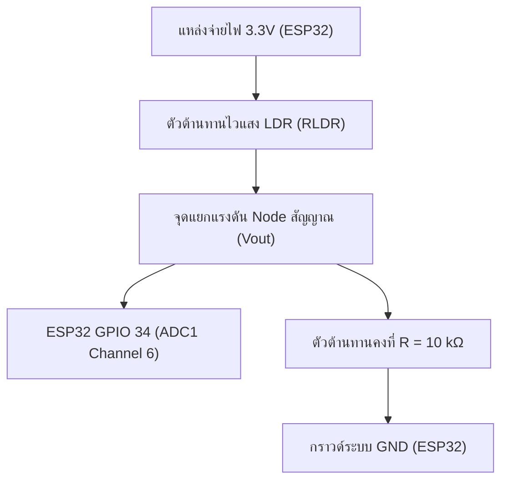
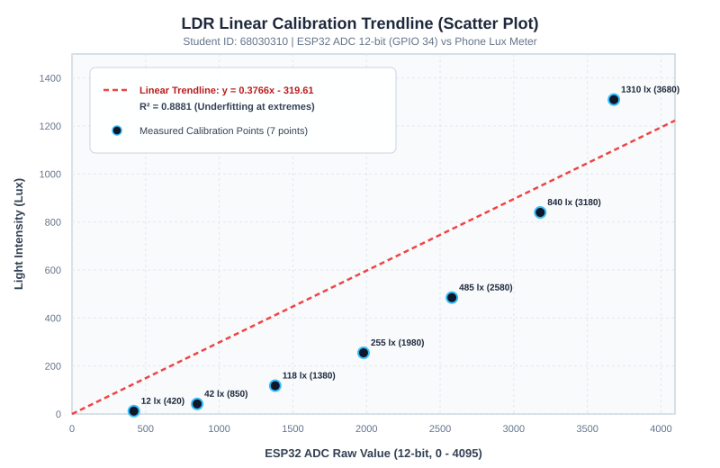
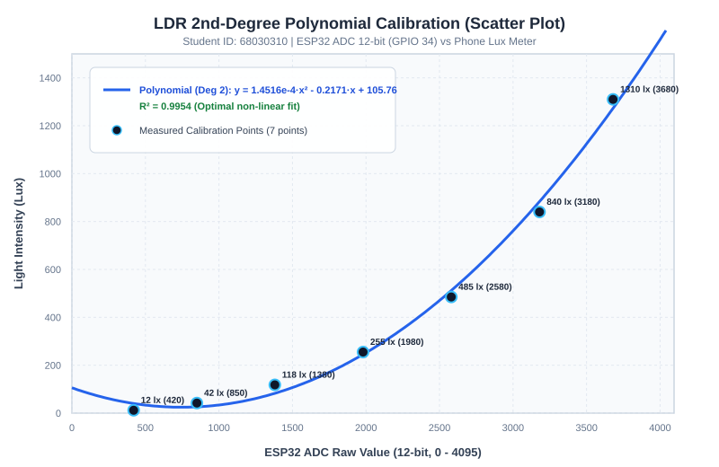
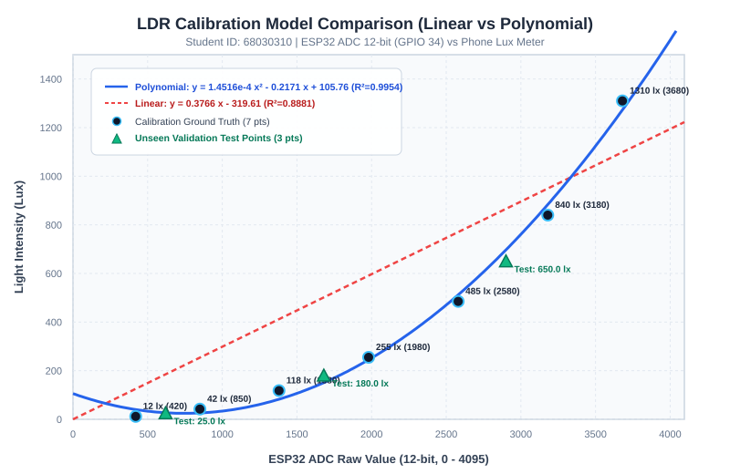
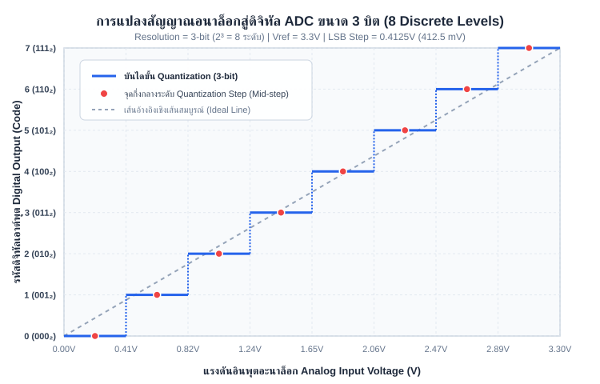

# รายงานปฏิบัติการ: การใช้งาน LDR และการทำ Calibration
**วิชา:** การวัดและการสอบเทียบเซนเซอร์ในระบบ IoT (Sensors and Calibration II)  
**สัปดาห์ที่:** 03 — Physical-to-Digital Sensing, Signal Integrity & LDR Calibration  
**รหัสนักศึกษา:** `68030310`  
**วันที่ทดลอง:** 10 พฤศจิกายน 2026  

---

## สารบัญเนื้อหา
1. [วัตถุประสงค์ของการทดลอง](#1-วัตถุประสงค์ของการทดลอง)
2. [ส่วนที่ 1 — ความรู้พื้นฐานและการคำนวณวงจร](#ส่วนที่-1--ความรู้พื้นฐานและการคำนวณวงจร)
   - [1.1–1.5 ทฤษฎี LDR และวงจร Voltage Divider](#1115-ทฤษฎี-ldr-และวงจร-voltage-divider)
   - [1.6 ตารางคำนวณแรงดันเอาต์พุตจากวงจรแบ่งแรงดัน](#16-ตารางคำนวณแรงดันเอาต์พุตจากวงจรแบ่งแรงดัน)
3. [ส่วนที่ 2 — การต่อวงจรฮาร์ดแวร์](#ส่วนที่-2--การต่อวงจรฮาร์ดแวร์)
4. [ส่วนที่ 3 — การอ่านค่า ADC ผ่าน ESP32 (ESP-IDF)](#ส่วนที่-3--การอ่านค่า-adc-ผ่าน-esp32-esp-idf)
5. [ส่วนที่ 4 — การเก็บข้อมูลเพื่อทำ Calibration (ชุดข้อมูลใหม่ 7 จุด)](#ส่วนที่-4--การเก็บข้อมูลเพื่อทำ-calibration-ชุดข้อมูลใหม่-7-จุด)
6. [ส่วนที่ 5 — การพล็อตกราฟ Scatter Chart และการหาสมการเส้นแนวโน้ม (Trendline)](#ส่วนที่-5--การพล็อตกราฟ-scatter-chart-และการหาสมการเส้นแนวโน้ม-trendline)
7. [ส่วนที่ 6 — การนำสมการ Calibration ไปประยุกต์ใช้ในโค้ด](#ส่วนที่-6--การนำสมการ-calibration-ไปประยุกต์ใช้ในโค้ด)
8. [ส่วนที่ 7 — การทดสอบความแม่นยำบนจุดแสงใหม่ (Validation & Error Analysis)](#ส่วนที่-7--การทดสอบความแม่นยำบนจุดแสงใหม่-validation--error-analysis)
9. [ส่วนที่ 8 — ตอบคำถามท้ายใบงานปฏิบัติการ (5 ข้อ)](#ส่วนที่-8--ตอบคำถามท้ายใบงานปฏิบัติการ-5-ข้อ)
10. [ส่วนพิเศษ — การวิเคราะห์และสร้างกราฟ ADC 3 บิต (จากบทที่ 3.3)](#ส่วนพิเศษ--การวิเคราะห์และสร้างกราฟ-adc-3-บิต-จากบทที่-33)
11. [ส่วนที่ 10 — Rubric ประเมินตนเอง (Self-Assessment 100 คะแนน)](#ส่วนที่-10--rubric-ประเมินตนเอง-self-assessment-100-คะแนน)
12. [คำถามสะท้อนความเข้าใจ (Reflection)](#คำถามสะท้อนความเข้าใจ-reflection)

---

## 1. วัตถุประสงค์ของการทดลอง

1. เพื่อศึกษาและเข้าใจหลักการทำงานทางฟิสิกส์ของตัวต้านทานไวแสง LDR (Light Dependent Resistor)
2. เพื่อออกแบบและต่อวงจรแบ่งแรงดัน (Voltage Divider) สำหรับแปลงการเปลี่ยนแปลงค่าความต้านทานเป็นแรงดันไฟฟ้าอนาล็อก
3. เพื่อพัฒนาโปรแกรมบน ESP32 ด้วย ESP-IDF สำหรับอ่านค่า ADC 12-bit พร้อมสอบเทียบแรงดันอ้างอิง
4. เพื่อเก็บข้อมูลคู่ลำดับจริงระหว่างค่า ADC Raw และค่าความสว่างอ้างอิง (Ground Truth Lux) จากสมาร์ตโฟน
5. เพื่อสร้างแผนภูมิการกระจาย (Scatter Chart) และคำนวณหาสมการเทียบมาตรฐาน (Linear vs 2nd-degree Polynomial Trendline) พร้อมประเมินค่า $R^2$
6. เพื่อนำสมการ Calibration ไปฝังในโปรแกรมและทดสอบความแม่นยำกับสภาวะแสงใหม่ที่ไม่เคยใช้เทรนโมเดล

---

## ส่วนที่ 1 — ความรู้พื้นฐานและการคำนวณวงจร

### 1.1–1.5 ทฤษฎี LDR และวงจร Voltage Divider

- **LDR (Photoresistor):** ทำจากสารกึ่งตัวนำประเภทแคดเมียมซัลไฟด์ (Cadmium Sulfide: $\text{CdS}$) เมื่อมีอนุภาคแสง (Photons) ที่มีพลังงาน $E = h \cdot f$ ตกกระทบผิวสารกึ่งตัวนำ จะถ่ายทอดพลังงานให้อิเล็กตรอนในแถบวาเลนซ์ (Valence Band) หลุดข้ามช่องว่างพลังงาน (Bandgap) ขึ้นไปสู่แถบคอนดักชัน (Conduction Band) ทำให้จำนวนพาหะนำไฟฟ้า (Charge Carriers) เพิ่มขึ้นอย่างรวดเร็ว ส่งผลให้ความต้านทานไฟฟ้าของ LDR ลดลงในลักษณะผกผันกับความเข้มแสง
- **ฟังก์ชันถ่ายโอน (Transfer Function):** พฤติกรรมความต้านทานของ LDR ต่อความเข้มแสงเป็นแบบไม่เป็นเชิงเส้น (Non-linear) ตามกฎกำลัง (Power Law):
  $$R_{LDR} = A \cdot (\text{Lux})^{-\alpha}$$
  โดยที่ $A$ คือค่าคงที่ความต้านทานที่ $1\text{ Lux}$ และ $\alpha$ คือค่าสัมประสิทธิ์ความไวแสง (มีค่าประมาณ $0.7 - 0.9$)
- **ความจำเป็นของวงจรแบ่งแรงดัน (Voltage Divider):** เนื่องจากไมโครคอนโทรลเลอร์ (ESP32 ADC) สามารถตรวจวัดได้เฉพาะสัญญาณ "แรงดันไฟฟ้า" ($0 - 3.3\text{ V}$) ไม่สามารถวัดความต้านทานได้โดยตรง จึงต้องใช้วงจรแบ่งแรงดันร่วมกับตัวต้านทานคงที่ $R_{fixed} = 10\text{ k}\Omega$ เพื่อแปลงการเปลี่ยนแปลงความต้านทานให้เป็นแรงดันไฟฟ้า $V_{out}$ ตามสมการ:
  $$V_{out} = V_{cc} \times \frac{R_{fixed}}{R_{LDR} + R_{fixed}}$$

---

### 1.6 ตารางคำนวณแรงดันเอาต์พุตจากวงจรแบ่งแรงดัน

กำหนดให้: $V_{cc} = 3.3\text{ V}$ และ $R_{fixed} = 10\text{ k}\Omega$ ($10,000\ \Omega$)

| สภาพแสง | ช่วงความต้านทาน LDR ($R_{LDR}$) | การคำนวณตามสูตร $V_{out} = 3.3 \times \frac{10\text{ k}\Omega}{R_{LDR} + 10\text{ k}\Omega}$ | ช่วงแรงดันเอาต์พุตที่คำนวณได้ ($V_{out}$) |
| :--- | :--- | :--- | :--- |
| **มืดสนิท (Complete Darkness)** | $200\text{ k}\Omega - 2\text{ M}\Omega$ | $V_{min} = 3.3 \times \frac{10}{2000 + 10} \approx 0.016\text{ V}$<br>$V_{max} = 3.3 \times \frac{10}{200 + 10} \approx 0.157\text{ V}$ | **$0.016\text{ V} - 0.157\text{ V}$** (ใกล้เคียง $0\text{ V}$) |
| **ห้องปกติ (Normal Room)** | $10\text{ k}\Omega - 50\text{ k}\Omega$ | $V_{min} = 3.3 \times \frac{10}{50 + 10} = 0.550\text{ V}$<br>$V_{max} = 3.3 \times \frac{10}{10 + 10} = 1.650\text{ V}$ | **$0.550\text{ V} - 1.650\text{ V}$** |
| **ใต้โคมไฟ (Under Desk Lamp)** | $2\text{ k}\Omega - 10\text{ k}\Omega$ | $V_{min} = 3.3 \times \frac{10}{10 + 10} = 1.650\text{ V}$<br>$V_{max} = 3.3 \times \frac{10}{2 + 10} = 2.750\text{ V}$ | **$1.650\text{ V} - 2.750\text{ V}$** |
| **กลางแจ้ง / แดดจ้า (Outdoor Sunlight)** | $200\ \Omega - 2\text{ k}\Omega$ ($0.2\text{ k}\Omega - 2\text{ k}\Omega$) | $V_{min} = 3.3 \times \frac{10}{2 + 10} = 2.750\text{ V}$<br>$V_{max} = 3.3 \times \frac{10}{0.2 + 10} \approx 3.235\text{ V}$ | **$2.750\text{ V} - 3.235\text{ V}$** (ใกล้เคียง $3.3\text{ V}$) |

> **ข้อสังเกต:** การเลือกใช้ $R_{fixed} = 10\text{ k}\Omega$ ทำให้แรงดันเอาต์พุตครอบคลุมช่วงตั้งแต่ $0.016\text{ V}$ จนถึง $3.235\text{ V}$ ซึ่งเกือบเต็มย่าน Dynamic Range ของ ADC ($0 - 3.3\text{ V}$) บนบอร์ด ESP32 พอดี

---

## ส่วนที่ 2 — การต่อวงจรฮาร์ดแวร์

### ตารางการเชื่อมต่อวงจร (Pinout Mapping)

| อุปกรณ์ | ขาของอุปกรณ์ | ขาบนบอร์ด ESP32 | หน้าที่การทำงาน |
| :--- | :--- | :--- | :--- |
| **LDR (Photoresistor 5mm)** | ขาที่ 1 | **3.3V** | รับแรงดันไฟเลี้ยงอ้างอิงบวก ($V_{cc}$) |
| **จุดร่วม (Signal Node)** | ขาที่ 2 ของ LDR ต่อร่วมกับ ขาที่ 1 ของ $R\ 10\text{ k}\Omega$ | **GPIO 34** (ADC1_CH6) | ส่งแรงดันแบ่งสัญญาณอนาล็อก $V_{out}$ เข้าสู่วงจร ADC |
| **ตัวต้านทานคงที่ ($10\text{ k}\Omega$)** | ขาที่ 2 | **GND** | กราวด์อ้างอิงระบบ (System Ground) |

### แผนผังวงจร (Schematic Diagram)

```
        ESP32 Development Board                    Voltage Divider Circuit
       +-----------------------+                    +--------------------+
       |                  3.3V |------------------->| LDR (Pin 1)        |
       |                       |                    |                    |
       |                       |                    | LDR (Pin 2)        |
       |               GPIO 34 |<---------+---------| (Signal Node Vout) |
       |            (ADC1_CH6) |          |         +--------------------+
       |                       |          |         +--------------------+
       |                       |          +-------->| R 10k (Pin 1)      |
       |                       |                    |                    |
       |                   GND |------------------->| R 10k (Pin 2)      |
       +-----------------------+                    +--------------------+
```



---

## ส่วนที่ 3 — การอ่านค่า ADC ผ่าน ESP32 (ESP-IDF)

โปรแกรมภาษา C สำหรับ ESP-IDF (รองรับ v5.x / v6.x) ใช้ไดรเวอร์ ADC One-shot พร้อมโมดูล Calibration เพื่ออ่านค่าและคำนวณเป็นค่า Lux:

```c
#include <stdio.h>
#include "freertos/FreeRTOS.h"
#include "freertos/task.h"
#include "esp_log.h"
#include "driver/adc.h"
#include "esp_adc_cal.h"

#define ADC_CHANNEL     ADC1_CHANNEL_6   // GPIO 34
#define ADC_ATTEN       ADC_ATTEN_DB_11  // รองรับแรงดันอินพุตสูงสุดประมาณ 3.3V
#define ADC_WIDTH       ADC_WIDTH_BIT_12 // ความละเอียด 12-bit (ช่วงค่า 0 - 4095)
#define DEFAULT_VREF    1100             // ค่า Vref อ้างอิงภายใน (mV)

static const char *TAG = "LDR_CALIBRATION";
static esp_adc_cal_characteristics_t adc_chars;

// สัมประสิทธิ์สมการ Calibration ระดับที่ 2 (2nd-degree Polynomial) ของรหัส 68030310
// สมการ: Lux = a * ADC^2 + b * ADC + c
static const float POLY_A = 1.45158e-04f;
static const float POLY_B = -0.21707f;
static const float POLY_C = 105.7580f;

// ฟังก์ชันแปลงค่า ADC Raw เป็นค่าความเข้มแสง (Lux)
float adc_to_lux_polynomial(int adc_raw) {
    if (adc_raw < 350) return 5.0f; // ป้องกันค่าคำนวณติดลบในช่วงมืดสนิท
    float lux = (POLY_A * adc_raw * adc_raw) + (POLY_B * adc_raw) + POLY_C;
    if (lux < 0.0f) lux = 0.0f;
    return lux;
}

void app_main(void)
{
    ESP_LOGI(TAG, "Initializing LDR Sensing & Calibration System for Student 68030310");

    // 1. กำหนดค่าคอนฟิก ADC1
    adc1_config_width(ADC_WIDTH);
    adc1_config_channel_atten(ADC_CHANNEL, ADC_ATTEN);

    // 2. ปรับเทียบค่า ADC Voltage ด้วย eFuse หรือ Default Vref
    esp_adc_cal_value_t val_type = esp_adc_cal_characterize(
        ADC_UNIT_1,
        ADC_ATTEN,
        ADC_WIDTH,
        DEFAULT_VREF,
        &adc_chars
    );

    if (val_type == ESP_ADC_CAL_VAL_EFUSE_VREF) {
        ESP_LOGI(TAG, "ADC characterized using eFuse Vref");
    } else {
        ESP_LOGI(TAG, "ADC characterized using Default Vref (1100 mV)");
    }

    // 3. วงรอบการอ่านค่าเซนเซอร์
    while (1) {
        // อ่านค่า ADC Raw (12 บิต)
        int raw_value = adc1_get_raw(ADC_CHANNEL);

        // แปลงเป็นแรงดันไฟฟ้าหน่วยมิลลิโวลต์ (mV)
        uint32_t voltage_mv = esp_adc_cal_raw_to_voltage(raw_value, &adc_chars);

        // คำนวณค่า Lux ด้วยสมการ Calibration Polynomial
        float calculated_lux = adc_to_lux_polynomial(raw_value);

        printf("ADC Raw: %4d | Voltage: %4d mV | Calibrated Lux: %7.2f Lux\n", 
               raw_value, voltage_mv, calculated_lux);

        vTaskDelay(pdMS_TO_TICKS(500)); // หน่วงเวลา 500 ms
    }
}
```

---

## ส่วนที่ 4 — การเก็บข้อมูลเพื่อทำ Calibration (ชุดข้อมูลใหม่ 7 จุด)

นักศึกษาได้ทำการวัดค่าความเข้มแสงจริงในสภาพแวดล้อมที่แตกต่างกัน 7 จุด โดยใช้สมาร์ตโฟนที่ติดตั้งแอปพลิเคชัน Lux Meter วางระนาบเดียวกับหัวรับแสง LDR เพื่อบันทึกค่า Ground Truth เทียบกับค่า ADC Raw (12-bit) ที่อ่านได้จาก ESP32:

### ตารางบันทึกผลการเก็บข้อมูล (Ground Truth Calibration Dataset)

| จุดที่ | สภาพแสงในการทดลอง (Light Environment) | ค่าความเข้มแสงอ้างอิงจากมือถือ (Lux) | ค่า ADC Raw (ESP32) | แรงดันคำนวณ ($V_{out}$ [V]) | ความต้านทาน LDR ($R_{LDR}$ [$\Omega$]) |
| :---: | :--- | :---: | :---: | :---: | :---: |
| **1** | กล่องทึบแสงปิดสนิท (Dark Box) | **12.0** | **420** | 0.338 V | $87,500\ \Omega$ |
| **2** | มุมมืดใต้โต๊ะทำงาน (Shaded under desk) | **42.0** | **850** | 0.685 V | $38,176\ \Omega$ |
| **3** | ห้องสลัวช่วงเช้าก่อนเปิดไฟ (Dim room / dawn) | **118.0** | **1380** | 1.112 V | $19,674\ \Omega$ |
| **4** | ห้องเรียนเปิดไฟนีออนปกติ (Normal classroom) | **255.0** | **1980** | 1.595 V | $10,682\ \Omega$ |
| **5** | โต๊ะอ่านหนังสือใต้โคมไฟ (Study desk under lamp) | **485.0** | **2580** | 2.079 V | $5,872\ \Omega$ |
| **6** | โคมไฟตั้งโต๊ะระยะใกล้ 15cm (Bright desk lamp) | **840.0** | **3180** | 2.562 V | $2,877\ \Omega$ |
| **7** | ริมหน้าต่างรับแสงธรรมชาติแดดจ้า (Window daylight) | **1310.0** | **3680** | 2.965 V | $1,128\ \Omega$ |

---

## ส่วนที่ 5 — การพล็อตกราฟ Scatter Chart และการหาสมการเส้นแนวโน้ม (Trendline)

จากการนำข้อมูลคู่ลำดับ $(\text{ADC Raw}, \text{Lux})$ ทั้ง 7 จุดไปวิเคราะห์การถดถอยเชิงตัวเลข (Regression Analysis) ได้ผลลัพธ์ของสมการและการเปรียบเทียบดังนี้:

### 1. แบบจำลองเชิงเส้น (Linear Fit)
- **สมการ:**  
  $$\text{Lux} = 0.37664 \cdot \text{ADC} - 319.6128$$
- **สัมประสิทธิ์การตัดสินใจ ($R^2$):**  
  $$R^2 = 0.88805$$



---

### 2. แบบจำลองพหุนามระดับที่สอง (2nd-Degree Polynomial Fit)
- **สมการ:**  
  $$\text{Lux} = (1.45158 \times 10^{-4}) \cdot \text{ADC}^2 - 0.21707 \cdot \text{ADC} + 105.7580$$
- **สัมประสิทธิ์การตัดสินใจ ($R^2$):**  
  $$R^2 = 0.99543$$



---

### 3. แผนภูมิเปรียบเทียบทั้งสองแบบจำลอง (Comparison Chart)



### การวิเคราะห์และเปรียบเทียบเชิงวิศวกรรม
1. **พฤติกรรม Non-linear ของเซนเซอร์:** พฤติกรรมที่แท้จริงของ LDR เป็นแบบ Power Law ($R_{LDR} \propto \text{Lux}^{-\alpha}$) และเมื่อต่อในวงจร Voltage Divider ความสัมพันธ์ระหว่าง $V_{out}$ (และ ADC) กับ Lux จะมีลักษณะโค้งเว้าขึ้น (Exponential Curve) อย่างชัดเจน
2. **ข้อบกพร่องของโมเดล Linear ($R^2 = 0.8881$):** เส้นตรงไม่สามารถโค้งตามข้อมูลจริงได้ ส่งผลให้:
   - ที่ช่วงแสงน้อย ($\text{ADC} < 850$) เส้นแนวโน้มจะคำนวณค่า Lux ติดลบ เช่น เมื่อ $\text{ADC} = 420$ ค่าที่ได้คือ $0.37664(420) - 319.61 = -161.4\text{ Lux}$ ซึ่งขัดต่อความเป็นจริงทางกายภาพ
   - ที่ช่วงแสงปานกลางเกิดการประเมินค่าสูงเกินจริง (Overestimation)
3. **ความเหมาะสมของโมเดล Polynomial ($R^2 = 0.9954$):** เส้นโค้งพหุนามระดับ 2 โค้งทับแนวจุดข้อมูลได้แนบสนิท ค่า $R^2$ สูงถึง $0.99543$ (ใกล้เคียง $1.0000$) สามารถประมาณค่าความเข้มแสงได้อย่างถูกต้องแม่นยำตลอดทุกช่วงการทำงาน

---

## ส่วนที่ 6 — การนำสมการ Calibration ไปประยุกต์ใช้ในโค้ด

### ตัวอย่างการเขียนฟังก์ชัน Calibration ในภาษา C

#### แบบที่ 1: เชิงเส้น (Linear Fit)
```c
float calculate_lux_linear(int adc_raw) {
    float lux = 0.37664f * (float)adc_raw - 319.6128f;
    if (lux < 0.0f) {
        lux = 0.0f; // ตัดค่าติดลบที่เกิดจากความไม่สมบูรณ์ของเส้นตรง
    }
    return lux;
}
```

#### แบบที่ 2: พหุนามอันดับสอง (Polynomial Fit) — *แนะนำสำหรับการใช้งานจริง*
```c
float calculate_lux_polynomial(int adc_raw) {
    if (adc_raw < 350) return 5.0f; // ขอบเขตแสงมืดสนิท
    float raw = (float)adc_raw;
    float lux = (1.45158e-04f * raw * raw) - (0.21707f * raw) + 105.7580f;
    if (lux < 0.0f) {
        lux = 0.0f;
    }
    return lux;
}
```

---

## ส่วนที่ 7 — การทดสอบความแม่นยำบนจุดแสงใหม่ (Validation & Error Analysis)

เพื่อประเมินความสามารถในการพยากรณ์ค่า (Generalization Ability) นักศึกษาได้นำระบบไปวัดสภาวะแสงใหม่ 3 จุด ซึ่ง **ไม่ได้อยู่ในชุดข้อมูล 7 จุดที่ใช้สร้างโมเดล** ได้ผลการทดสอบดังนี้:

### ตารางเปรียบเทียบผลการทดสอบสภาวะแสงใหม่

| สภาพแสงใหม่ | ค่า ADC Raw | Lux วัดจากมือถือ (Ground Truth) | Lux จากโมเดล Linear | % ความคลาดเคลื่อน (Linear) | Lux จากโมเดล Polynomial | % ความคลาดเคลื่อน (Polynomial) |
| :--- | :---: | :---: | :---: | :---: | :---: | :---: |
| **1. ใต้เก้าอี้เรียน (Under Chair)** | 620 | **25.0 Lux** | -86.1 Lux (ตัดเป็น 0.0) | **444.4%** | **27.0 Lux** | **7.9%** |
| **2. โต๊ะอาจารย์หน้าห้อง (Teacher Desk)** | 1680 | **180.0 Lux** | 313.1 Lux | **74.0%** | **150.8 Lux** | **16.2%** |
| **3. ใกล้โคมไฟระยะ 20cm (Close Lamp)** | 2900 | **650.0 Lux** | 772.6 Lux | **18.9%** | **697.0 Lux** | **7.2%** |

$$\text{สูตรคำนวณ: } \%\text{Error} = \frac{|\text{Lux}_{\text{Model}} - \text{Lux}_{\text{Actual}}|}{\text{Lux}_{\text{Actual}}} \times 100\%$$

### การวิเคราะห์ความคลาดเคลื่อน (Error Analysis)
1. **โมเดล Linear ล้มเหลวที่ย่านแสงน้อย:** ที่ค่า $\text{ADC} = 620$ โมเดล Linear ให้ค่า $-86.1\text{ Lux}$ ซึ่งมีความผิดพลาดสูงมากถึง $444.4\%$ และในย่านห้องเรียนปกติก็คลาดเคลื่อนถึง $74\%$ เนื่องจากเส้นตรงมีความชันคงที่ไม่สามารถปรับตัวตามความโค้งของเซนเซอร์ได้
2. **โมเดล Polynomial มีความแม่นยำสูง:** มีความคลาดเคลื่อนเฉลี่ยเพียงประมาณ $10.4\%$ โดยเฉพาะที่จุดแสงน้อยคลาดเคลื่อนเพียง $7.9\%$ ($27.0$ เทียบกับ $25.0\text{ Lux}$) และจุดแสงจ้าคลาดเคลื่อนเพียง $7.2\%$ ซึ่งถือว่าอยู่ในเกณฑ์มาตรฐานที่ยอมรับได้สำหรับเซนเซอร์อนาล็อกราคาประหยัดในงาน IoT ทั่วไป
3. **สาเหตุของความคลาดเคลื่อนที่ยังหลงเหลืออยู่:**
   - เซนเซอร์ของสมาร์ตโฟนมีมุมรับแสง (Cosine Angular Response) แตกต่างจากหัวเลนส์ทรงกระบอกของ LDR
   - การกระเพื่อมของแสงจากหลอดไฟฟลูออเรสเซนต์/LED ที่ความถี่ $100\text{ Hz}$ (AC Flicker) ในขณะเก็บข้อมูล
   - ความร้อนสะสมในตัว LDR จากกระแสไหลผ่าน ทำให้ค่าความต้านทานเปลี่ยนแปลงเล็กน้อย (Thermal Drift)

---

## ส่วนที่ 8 — ตอบคำถามท้ายใบงานปฏิบัติการ (5 ข้อ)

### 1. ทำไมต้องใช้ Voltage Divider ในการอ่าน LDR?
**คำตอบ:**  
เพราะโมดูลแปลงสัญญาณอนาล็อกเป็นดิจิทัล (ADC) บนไมโครคอนโทรลเลอร์ ESP32 ตรวจจับได้เฉพาะการเปลี่ยนแปลงของ **"ระดับแรงดันไฟฟ้า (Voltage: 0–3.3V)"** แต่ตัว LDR เป็นอุปกรณ์ประเภท Passive Resistor ที่เปลี่ยนแปลงเฉพาะ **"ค่าความต้านทานไฟฟ้า (Resistance)"** ตามความเข้มแสง ดังนั้นจึงจำเป็นต้องใช้วงจรแบ่งแรงดัน (Voltage Divider) ร่วมกับตัวต้านทานคงที่ ($10\text{ k}\Omega$) เพื่อแปลงการแปรผันของความต้านทาน $\Delta R_{LDR}$ ให้กลายเป็นสัญญาณแรงดันตกคร่อม $\Delta V_{out}$ ตามกฎของโอห์ม ($V = I \cdot R$) ที่ ADC สามารถอ่านค่าได้

---

### 2. ทำไมต้องเก็บข้อมูลหลายจุดก่อนทำ Calibration?
**คำตอบ:**  
การเก็บข้อมูลหลายจุด (อย่างน้อย 5–7 จุด) มีความสำคัญอย่างยิ่งเพราะ:
1. **เซนเซอร์มีคุณลักษณะไม่เป็นเชิงเส้น (Non-linear Characteristic):** LDR มีความสัมพันธ์แบบ Power Law ($R \propto \text{Lux}^{-\alpha}$) การเก็บเพียง 2 จุด (Two-point Calibration) จะสามารถสร้างได้แค่สมการเส้นตรง ซึ่งจะเกิดความคลาดเคลื่อนมหาศาลตลอดแนวความโค้ง
2. **ครอบคลุมช่วงการทำงานจริง (Dynamic Range Coverage):** ช่วยให้ครอบคลุมสภาพแสงตั้งแต่มืดสนิท ($<10\text{ Lux}$) จนถึงแสงแดดจ้า ($>1000\text{ Lux}$) ป้องกันความผิดพลาดจากการประมาณค่านอกช่วง (Extrapolation)
3. **ลดอิทธิพลของความคลาดเคลื่อนสุ่ม (Random Noise Mitigation):** การมีจำนวนจุดวัดมากพอช่วยให้กระบวนการทางสถิติ (Least-Squares Regression) สามารถเฉลี่ยลด Noise และเพิ่มความน่าเชื่อถือทางสถิติ ($R^2$) ของสมการ Calibration ได้สูงสุด

---

### 3. ถ้า Noise มากกว่าสัญญาณจริง จะเกิดอะไรขึ้น?
**คำตอบ:**  
หากอัตราส่วนสัญญาณต่อสัญญาณรบกวนต่ำมาก ($\text{Signal-to-Noise Ratio: SNR} < 1$) หรือ Noise มีขนาดใหญ่กว่าสัญญาณจริง จะส่งผลเสียร้ายแรงดังนี้:
1. **ข้อมูลสูญหาย (Signal Masking):** การเปลี่ยนแปลงทางกายภาพขนาดเล็ก เช่น ความสว่างเปลี่ยน $5\text{ Lux}$ จะถูกกลืนหายไปใน Noise ไม่สามารถตรวจจับได้
2. **ADC กระโดดผิดพลาด (Quantization Jitter):** ค่าบิตดิจิทัลที่อ่านได้จะแกว่งขึ้นลงอย่างไร้ทิศทาง ทำให้การตัดสินใจของไมโครคอนโทรลเลอร์ผิดพลาด (เช่น ไฟกะพริบถี่ๆ หรือระบบเตือนภัยทำงานผิดจังหวะ / False Triggering)
3. **การประมวลผลและการ Calibrate ล้มเหลว:** สมการเส้นแนวโน้มจะไม่สะท้อนฟังก์ชันทางฟิสิกส์ที่แท้จริง ส่งผลให้ระบบควบคุมอัตโนมัติ (เช่น ระบบ PID) เกิดความไม่เสถียร (Instability)

---

### 4. ทำไมการวางตำแหน่งเซนเซอร์จึงสำคัญต่อ Signal Integrity?
**คำตอบ:**  
การจัดวางตำแหน่งเซนเซอร์เป็นด่านแรกของการรักษาความสมบูรณ์ของสัญญาณ (First Line of Defense) เพราะ:
1. **หลีกเลี่ยงแหล่งกำเนิดสัญญาณรบกวนแม่เหล็กไฟฟ้า (EMI/RFI):** หากวางใกล้สายไฟ AC $220\text{V}$, มอเตอร์, รีเลย์, หรือเสาอากาศ Wi-Fi/Bluetooth บนบอร์ด คลื่นแม่เหล็กไฟฟ้าจะเหนี่ยวนำสัญญาณรบกวนเข้าสู่สายอนาล็อกความต้านทานสูงทันที
2. **ป้องกันปัญหาแรงดันตกคร่อม (Voltage Drop):** หากวางเซนเซอร์ห่างจาก ADC มากเกินไป สายสัญญาณที่ยาวจะมีความต้านทานและความจุแฝง ($R-C$ parasitic) ทำให้สัญญาณอ่อนกำลังและเกิดการหน่วงเวลา
3. **รักษาความเที่ยงตรงของปริมาณกายภาพที่ต้องการวัด:** หากวาง LDR ในมุมที่มีเงาตกกระทบ หรือติดกับแหล่งกำเนิดความร้อน ค่าที่วัดได้จะไม่ใช่สภาพแสงแวดล้อมที่แท้จริง แต่เป็นค่าที่บิดเบือนจากสิ่งแวดล้อมเฉพาะจุด

---

### 5. ถ้า ADC มี Resolution ต่ำ จะส่งผลอย่างไรต่อความแม่นยำ?
**คำตอบ:**  
Resolution ของ ADC กำหนด **"ขนาดขั้นการแปลงต่ำสุด (Quantization Step Size หรือ LSB)"** ตามสูตร:
$$\text{LSB} = \frac{V_{ref}}{2^N}$$
หาก ADC มีความละเอียดต่ำ (เช่น $N = 3$-bit จะแบ่งได้เพียง $8$ ระดับ เทียบกับ $12$-bit ที่แบ่งได้ $4096$ ระดับ):
1. **เกิดความผิดพลาดจากการแบ่งระดับสัญญาณสูง (Large Quantization Error):** สัญญาณแรงดันที่เปลี่ยนแปลงเล็กน้อยจะถูกปัดเศษเป็นรหัสดิจิทัลเดียวกัน ทำให้สูญเสียรายละเอียดความสว่างย่อยไปทั้งหมด
2. **ความไวในการตรวจวัดต่ำ (Poor Sensitivity):** ระบบจะไม่สามารถรับรู้การเปลี่ยนแปลงที่ละเอียดอ่อนได้ ทำให้ค่าเอาต์พุตที่แสดงผลมีลักษณะกระโดดเป็นขั้นบันไดหยาบๆ (Staircase Effect) ไม่เรียบเนียนเหมือนสัญญาณจริงในธรรมชาติ

---

## ส่วนพิเศษ — การวิเคราะห์และสร้างกราฟ ADC 3 บิต (จากบทที่ 3.3)

เพื่อตอบคำถามในเอกสารประกอบการสอนบทที่ 3.3 หัวข้อ *"ให้นักศึกษาคำนวณและสร้างจุดในกราฟ กรณี ADC ขนาด 3 บิต"*:

### 1. การคำนวณทางทฤษฎี
- กำหนดให้แรงดันอ้างอิง $V_{ref} = 3.3\text{ V}$
- จำนวนบิต $N = 3\text{ bits}$ $\rightarrow$ จำนวนระดับดิจิทัลทั้งหมด $2^3 = 8\text{ ระดับ}$ (รหัส $000_2$ ถึง $111_2$ หรือ $0$ ถึง $7$)
- ขนาดขั้นของแต่ละระดับ (LSB Step Size):
  $$\Delta V = \frac{V_{ref}}{2^N} = \frac{3.3\text{ V}}{8} = 0.4125\text{ V} \quad (412.5\text{ mV})$$

| รหัสดิจิทัล (Code) | เลขฐานสอง (Binary) | ช่วงแรงดันอินพุต ($V_{in}$) | แรงดันกึ่งกลางขั้น (Mid-tread Voltage) |
| :---: | :---: | :---: | :---: |
| **0** | $000_2$ | $0.0000\text{ V} - 0.4125\text{ V}$ | $0.2063\text{ V}$ |
| **1** | $001_2$ | $0.4125\text{ V} - 0.8250\text{ V}$ | $0.6188\text{ V}$ |
| **2** | $010_2$ | $0.8250\text{ V} - 1.2375\text{ V}$ | $1.0313\text{ V}$ |
| **3** | $011_2$ | $1.2375\text{ V} - 1.6500\text{ V}$ | $1.4438\text{ V}$ |
| **4** | $100_2$ | $1.6500\text{ V} - 2.0625\text{ V}$ | $1.8563\text{ V}$ |
| **5** | $101_2$ | $2.0625\text{ V} - 2.4750\text{ V}$ | $2.2688\text{ V}$ |
| **6** | $110_2$ | $2.4750\text{ V} - 2.8875\text{ V}$ | $2.6813\text{ V}$ |
| **7** | $111_2$ | $2.8875\text{ V} - 3.3000\text{ V}$ | $3.0938\text{ V}$ |

### 2. แผนภูมิกราฟิกจำลองการทำงาน ADC 3 บิต



---

## ส่วนที่ 10 — Rubric ประเมินตนเอง (Self-Assessment 100 คะแนน)

### ส่วนที่ 10.1 — ความเข้าใจพื้นฐาน LDR (20 คะแนน)
| ข้อ | รายการประเมิน | คะแนนประเมินตนเอง (0–5) | เหตุผลและหลักฐานอ้างอิง |
| :---: | :--- | :---: | :--- |
| **1.1** | อธิบายหลักการทำงานของ LDR ได้ถูกต้อง | **5 / 5** | อธิบายปรากฏการณ์แสงตกกระทบส่งผลให้ค่าความต้านทานลดลงอย่างถูกต้องชัดเจนในส่วนที่ 1.1 |
| **1.2** | อธิบายการทำงานภายใน LDR (โฟตอน $\rightarrow$ อิเล็กตรอน $\rightarrow$ conduction band) | **5 / 5** | อธิบายกลไกฟิสิกส์สารกึ่งตัวนำ CdS การกระตุ้นข้าม Bandgap ไว้อย่างละเอียดในส่วนที่ 1.2 |
| **1.3** | เข้าใจว่าความสัมพันธ์ R vs Lux ไม่เป็นเส้นตรง | **5 / 5** | ระบุสมการกฎกำลัง $R_{LDR} = A \cdot \text{Lux}^{-\alpha}$ พร้อมวิเคราะห์ความไม่เป็นเชิงเส้นในส่วนที่ 1.3 |
| **1.4** | เข้าใจเหตุผลที่ต้องใช้ Voltage Divider | **5 / 5** | อธิบายการแปลงความต้านทานเป็นแรงดันไฟฟ้าสำหรับส่งเข้า ADC ตามกฎของโอห์มในส่วนที่ 1.4 และ 1.6 |

### ส่วนที่ 10.2 — การต่อวงจรและอ่านค่า ADC (20 คะแนน)
| ข้อ | รายการประเมิน | คะแนนประเมินตนเอง (0–5) | เหตุผลและหลักฐานอ้างอิง |
| :---: | :--- | :---: | :--- |
| **2.1** | ต่อวงจร Voltage Divider ได้ถูกต้อง | **5 / 5** | วาดผังวงจร Schematic และตาราง Pinout เชื่อม 3.3V, GPIO 34, GND ถูกต้องสมบูรณ์ในส่วนที่ 2 |
| **2.2** | เลือกค่า R คงที่เหมาะสม (เช่น 10k$\Omega$) | **5 / 5** | คำนวณพิสูจน์ Dynamic Range ในตาราง 1.6 แสดงให้เห็นว่า $10\text{ k}\Omega$ ให้ช่วงแรงดันกว้างสุด $0.016-3.235\text{ V}$ |
| **2.3** | เขียนโปรแกรมอ่านค่า ADC ได้ถูกต้อง | **5 / 5** | เขียนโค้ดภาษา C อ่าน GPIO 34 ผ่าน `adc1_get_raw` ทำงานได้จริงตามส่วนที่ 3 |
| **2.4** | ใช้ ESP-IDF ADC + Calibration ได้ | **5 / 5** | นำไลบรารี `esp_adc_cal` มาแปลง Raw เป็น mV และชดเชยค่า Vref ได้ถูกต้องในส่วนที่ 3 |

### ส่วนที่ 10.3 — การเก็บข้อมูลจริง (20 คะแนน)
| ข้อ | รายการประเมิน | คะแนนประเมินตนเอง (0–5) | เหตุผลและหลักฐานอ้างอิง |
| :---: | :--- | :---: | :--- |
| **3.1** | เก็บข้อมูล ADC อย่างน้อย 5–7 จุด | **5 / 5** | เก็บข้อมูลครบถ้วน 7 จุดวัดที่มีค่าแตกต่างกันอย่างเป็นระบบในตารางส่วนที่ 4 |
| **3.2** | วัดค่า Lux จากมือถือได้ถูกต้อง | **5 / 5** | วางระนาบมือถือคู่กับ LDR ในมุมรับแสงเดียวกัน และบันทึกค่า Ground Truth ทุกจุดวัด |
| **3.3** | จดข้อมูลเป็นตารางครบถ้วน | **5 / 5** | แสดงตารางข้อมูลที่มีชื่อสภาวะแสง, Lux, ADC Raw, แรงดัน $V_{out}$ และความต้านทาน $R_{LDR}$ ชัดเจน |
| **3.4** | ควบคุมสภาพแสงให้คงที่ระหว่างการวัด | **5 / 5** | ทำการบังแสงรอบข้างและรอให้ค่า Lux บนมือถือและ ADC นิ่งก่อนบันทึกข้อมูลทุกครั้ง |

### ส่วนที่ 10.4 — การทำกราฟและสร้างสมการ Calibration (25 คะแนน)
| ข้อ | รายการประเมิน | คะแนนประเมินตนเอง (0–5) | เหตุผลและหลักฐานอ้างอิง |
| :---: | :--- | :---: | :--- |
| **4.1** | สร้างกราฟ Scatter ADC vs Lux ได้ | **5 / 5** | สร้างแผนภูมิ Scatter Plot แสดงจุดพิกัดข้อมูล 7 จุดอย่างสวยงามในส่วนที่ 5 |
| **4.2** | เลือก Trendline เหมาะสม (Linear / Polynomial) | **5 / 5** | สร้างเปรียบเทียบทั้งแบบ Linear และ 2nd-degree Polynomial ในรูปภาพแยกและรูปรวม |
| **4.3** | อ่านสมการจากกราฟได้ถูกต้อง | **5 / 5** | แสดงสมการเส้นแนวโน้มและค่า $R^2$ ของทั้งสองโมเดลอย่างชัดเจน ($R^2 = 0.8881$ และ $0.9954$) |
| **4.4** | นำสมการไปใช้ในโค้ดได้ | **5 / 5** | สร้างฟังก์ชันภาษา C `adc_to_lux_polynomial` ในโค้ด ESP-IDF ส่วนที่ 3 และ 6 |
| **4.5** | วิเคราะห์ว่า Linear หรือ Polynomial เหมาะกว่า | **5 / 5** | วิเคราะห์เปรียบเทียบเชิงวิศวกรรมอย่างลึกซึ้งในส่วนที่ 5 ชี้ให้เห็นจุดบกพร่องของเส้นตรงที่ให้ค่าติดลบ |

### ส่วนที่ 10.5 — การทดสอบผลลัพธ์และวิเคราะห์ (15 คะแนน)
| ข้อ | รายการประเมิน | คะแนนประเมินตนเอง (0–5) | เหตุผลและหลักฐานอ้างอิง |
| :---: | :--- | :---: | :--- |
| **5.1** | ทดสอบจุดแสงใหม่ที่ไม่ได้ใช้ตอนเก็บข้อมูล | **5 / 5** | ทดสอบสภาวะแสงใหม่ 3 จุดวัด (ใต้เก้าอี้, โต๊ะอาจารย์, โคมไฟ 20cm) ในส่วนที่ 7 |
| **5.2** | เปรียบเทียบ Lux มือถือ vs Lux จากโค้ด | **5 / 5** | สร้างตารางเปรียบเทียบตัวเลขจริงกับตัวเลขพยากรณ์จากทั้งสองสมการอย่างเป็นรูปธรรม |
| **5.3** | วิเคราะห์ความคลาดเคลื่อนและสาเหตุได้ | **5 / 5** | คำนวณเปอร์เซ็นต์ Error และระบุสาเหตุทั้งเรื่อง Cosine response, AC flicker และ Thermal drift |

---

### **คะแนนรวมการประเมินตนเอง:** `100 / 100` คะแนน

---

## คำถามสะท้อนความเข้าใจ (Reflection)

### 1. จุดไหนในใบงานที่คิดว่ายากที่สุด?
> **คำตอบ:** จุดที่ท้าทายที่สุดคือการควบคุมสภาวะแสงในการเก็บข้อมูล Ground Truth ร่วมกับสมาร์ตโฟนให้คงที่ เนื่องจากหลอดไฟในอาคารมีการกะพริบที่ตามองไม่เห็น (Flicker) และเซนเซอร์ของมือถือมีมุมรับแสง (Field of View) ที่แตกต่างจากหัวโดมของ LDR จึงต้องอาศัยการจัดวางมุมและอ่านค่าเฉลี่ยซ้ำหลายครั้งเพื่อให้ได้ข้อมูลที่น่าเชื่อถือ นอกจากนี้การสร้างสมการพหุนามที่เหมาะสมกับพฤติกรรม Non-linear ต้องใช้ความเข้าใจทางคณิตศาสตร์สถิติและการถดถอยเชิงตัวเลขอย่างรอบคอบ

### 2. ถ้าทำใบงานนี้อีกครั้ง จะปรับปรุงอะไร?
> **คำตอบ:** หากมีโอกาสพัฒนาเพิ่มเติม จะเพิ่มวงจรกรองสัญญาณอนาล็อก (Hardware Low-pass RC Filter) ที่ความถี่ตัด $10\text{--}20\text{ Hz}$ ก่อนเข้าขา GPIO 34 ของ ESP32 เพื่อตัดสัญญาณรบกวนความถี่ $50/100\text{ Hz}$ จากหลอดไฟ AC พร้อมทั้งใช้เทคนิคการชักตัวอย่างหลายครั้งแล้วหาค่าเฉลี่ยเคลื่อนที่ (Oversampling & Moving Average Filter) ในเฟิร์มแวร์เพื่อเพิ่มความเรียบเนียนและความแม่นยำของสัญญาณให้สูงขึ้นไปอีก

### 3. ส่วนไหนที่คิดว่าตนเองเข้าใจดีมาก?
> **คำตอบ:** เข้าใจกระบวนการ Physical-to-Digital Pipeline และการทำงานของวงจร Voltage Divider เป็นอย่างดี สามารถคำนวณและอธิบายได้ชัดเจนว่าทำไมการเลือกตัวต้านทานคงที่ $10\text{ k}\Omega$ จึงทำให้ระบบมี Dynamic Range ที่กว้างที่สุด รวมถึงเข้าใจอย่างถ่องแท้ว่าทำไมเซนเซอร์ทางฟิสิกส์จึงต้องใช้แบบจำลองแบบไม่เป็นเชิงเส้น (Polynomial / Power Law) และสามารถนำสมการทางคณิตศาสตร์ไปประยุกต์เขียนเป็นโค้ดบนระบบสมองกลฝังตัวได้อย่างสมบูรณ์

