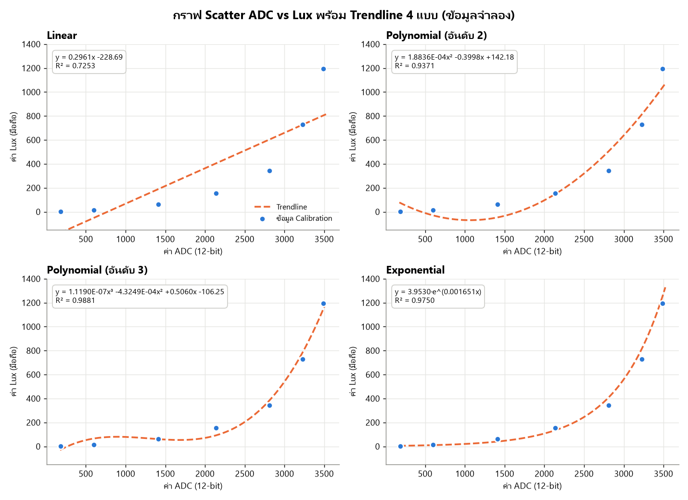
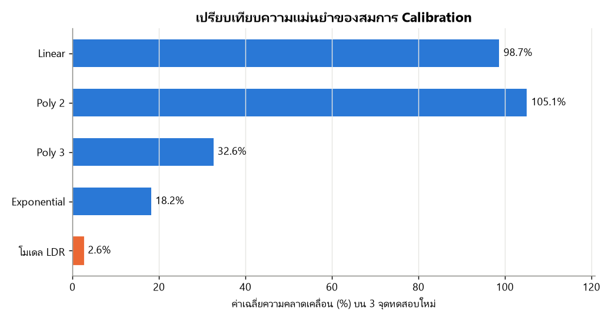

# ผลการทดลอง LAB 5 — LDR และการทำ Calibration

> ข้อมูลทั้งหมดเป็น **ข้อมูลจำลอง** (ไม่มีเซนเซอร์ LDR จริงตอนทำ) — จำลองจากวงจร LDR + R 10 kΩ, ESP32 ADC 12-bit พร้อม noise
> คำตอบและการวิเคราะห์ฉบับเต็มอยู่ในใบงาน [Week-03-Lab-sheet-03-LDR-and-calibration.md](../Week-03-Lab-sheet-03-LDR-and-calibration.md)

| ไฟล์ | รายละเอียด |
| --- | --- |
| [LDR_Calibration.xlsx](LDR_Calibration.xlsx) | ชีต `1.6 Vout` (คำนวณแรงดัน), `Raw Data` (ADC 10 ครั้ง/จุด), `Calibration` (กราฟ Scatter + Trendline + สมการ + R²), `Test` (ทดสอบ 3 จุดใหม่ + %Error) |
| [ldr_calibration.py](ldr_calibration.py) | สคริปต์จำลองข้อมูล หาสมการ และสร้างไฟล์ Excel/รูปกราฟ (`py -3.13 ldr_calibration.py`) |
| [images/](images) | รูปกราฟสำหรับรายงาน |
| [../LDR_Calibration](../LDR_Calibration) | โปรเจกต์ ESP-IDF (ESP32) อ่าน ADC แล้วแปลงเป็น Lux |

## สรุปผล

| สมการ | R² | %Error เฉลี่ยบนจุดทดสอบ |
| --- | --- | --- |
| Linear | 0.7253 | 98.7% |
| Polynomial อันดับ 2 | 0.9371 | 105.1% (ได้ Lux ติดลบ) |
| Polynomial อันดับ 3 | 0.9881 | 32.6% |
| Exponential | 0.9750 | 18.2% |
| **โมเดล LDR** $R = 510627⋅Lux^{-0.800}$ | **0.9998** | **2.6%** |

