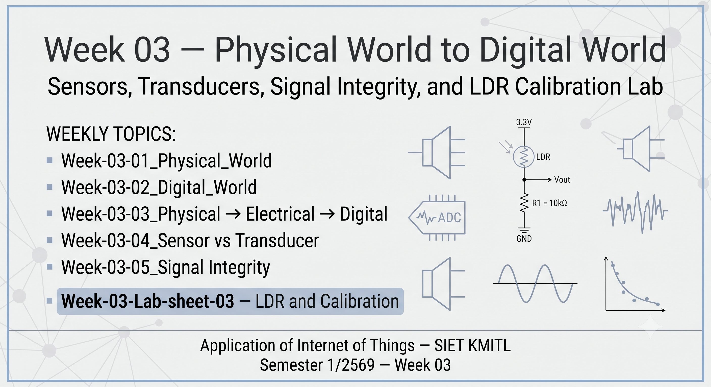
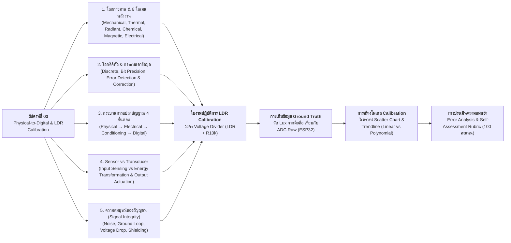

# Week 03: Physical-to-Digital Sensing, Signal Integrity & LDR Calibration



## 1. บทนำ (Introduction)
ในสัปดาห์ที่ 2 เราได้ศึกษาการเชื่อมต่อเซนเซอร์เชิงเส้น (Potentiometer) เข้ากับสถาปัตยกรรม ADC 12-bit บนบอร์ด ESP32 ตลอดจนการทำ Two-point Linear Calibration ขั้นพื้นฐาน

ในสัปดาห์ที่ 3 นี้ เราจะยกระดับความเข้าใจลงลึกสู่รากฐานทางฟิสิกส์และวิศวกรรมไฟฟ้าที่ขับเคลื่อนระบบ IoT ในหัวข้อ **"การเปลี่ยนผ่านจากโลกกายภาพสู่โลกดิจิทัล (Physical-to-Digital Transformation)"** ควบคู่กับการรักษา **"ความสมบูรณ์ของสัญญาณ (Signal Integrity)"**

โลกกายภาพ (Physical World) ขับเคลื่อนด้วยพลังงานใน **6 โดเมนหลัก** ได้แก่ กลศาสตร์ (Mechanical), ความร้อน (Thermal), แสง/รังสี (Radiant), เคมี (Chemical), แม่เหล็ก (Magnetic), และไฟฟ้า (Electrical) สัญญาณในธรรมชาติเหล่านี้มีลักษณะต่อเนื่อง (Continuous) และปะปนด้วยสัญญาณรบกวน (Noise) รอบด้าน ในขณะที่โลกดิจิทัล (Digital World) จัดการข้อมูลในรูปแบบตัวเลขไม่ต่อเนื่อง (Discrete) ที่มีความแม่นยำแน่นอน ทำซ้ำได้ และตรวจสอบความถูกต้องได้ (Deterministic)

หัวใจสำคัญของการออกแบบระบบรับสัญญาณ IoT ระดับมืออาชีพ คือ **"การรักษาความสมบูรณ์ของสัญญาณ (Signal Integrity) ตั้งแต่ต้นทาง และการสร้างโมเดลแปลงค่าที่แม่นยำ (Calibration Modeling)"** โดยในสัปดาห์นี้นักศึกษาจะได้เจาะลึก 5 แกนความรู้หลัก:

1. **6 Energy Domains & Physical World Characteristics**: ศึกษาธรรมชาติของพลังงานทั้ง 6 โดเมน และปรากฏการณ์ทางฟิสิกส์ที่เซนเซอร์ใช้จับสัญญาณ
2. **Sensor vs Transducer Taxonomy**: จำแนกความแตกต่างระหว่างเซนเซอร์ (อุปกรณ์รับสัญญาณ / Input) และทรานสดิวเซอร์ (อุปกรณ์แปลงผันพลังงานข้ามโดเมน ทั้ง Input และ Output)
3. **Physical-to-Digital Pipeline & Signal Conditioning**: กระบวนการแปลงสัญญาณเป็นขั้นตอน: *Physical Quantity $\rightarrow$ Electrical Signal $\rightarrow$ Conditioning (Amplification / Filtering) $\rightarrow$ ADC Sampling & Quantization $\rightarrow$ Digital Data*
4. **Signal Integrity & Noise Mitigation**: การวิเคราะห์และป้องกัน 5 ปัจจัยทำลายสัญญาณ ได้แก่ Noise (EMI/RFI), Ground Loop, Voltage Drop, Crosstalk, และข้อจำกัดของ ADC
5. **Non-linear Sensing & LDR Calibration Lab**: การทดลองกับตัวต้านทานไวแสง (LDR: Light Dependent Resistor) ซึ่งมีพฤติกรรมไม่เป็นเชิงเส้นแบบ Power Law ($R_{LDR} = A \cdot \text{Lux}^{-\alpha}$) การต่อวงจร Voltage Divider ร่วมกับตัวต้านทานคงที่ 10k $\Omega$ การใช้สมาร์ตโฟนเป็นเครื่องมือวัดอ้างอิง (Ground Truth Lux Meter) และการหาสมการเทียบมาตรฐาน (Linear vs 2nd-degree Polynomial Trendline)

* เอกสารประกอบการเรียนรู้ประจำสัปดาห์:
  * เอกสารทฤษฎีบทที่ 3: [Week-03-01_Physical_World.md](Week-03-01_Physical_World.md) ถึง [Week-03-05-Signal-Integrity.md](Week-03-05-Signal-Integrity.md)
  * ใบงานปฏิบัติการ: [Week-03-Lab-sheet-03-LDR-and-calibration.md](Week-03-Lab-sheet-03-LDR-and-calibration.md)
  * อ้างอิงไดรเวอร์และการสอบเทียบ ADC: [ESP-IDF ADC Calibration Driver (`esp_adc_cal`)](https://docs.espressif.com/projects/esp-idf/en/v5.3/esp32/api-reference/peripherals/adc_calibration.html)

---

## 2. แผนผังเนื้อหาการเรียนรู้ประจำสัปดาห์ (Lesson Roadmap)



---

## 3. ตารางเปรียบเทียบโดเมนพลังงานทั้ง 6 และการประยุกต์ใช้งานใน IoT (6 Energy Domains Matrix)

การแปลงปรากฏการณ์ในโลกกายภาพสู่สัญญาณไฟฟ้าในระบบ IoT จำเป็นต้องอาศัยทรานสดิวเซอร์ที่เหมาะสมกับแต่ละโดเมนพลังงาน:

| โดเมนพลังงาน (Energy Domain) | ปริมาณทางกายภาพตัวแทน | เซนเซอร์ / ทรานสดิวเซอร์ตัวแทน | รูปแบบสัญญาณไฟฟ้าขาออก | ตัวอย่างการประยุกต์ใช้งานในระบบ IoT |
| :--- | :--- | :--- | :--- | :--- |
| **1. Mechanical (กลศาสตร์)** | แรง, ความดัน, การสั่นสะเทือน, ความเร่ง | Load Cell, Strain Gauge, Piezoelectric, IMU | ความต้านทาน ($\Delta R$), แรงดัน ($\text{mV}$), ประจุไฟฟ้า | ระบบชั่งน้ำหนักอัจฉริยะ, ตรวจวัดแผ่นดินไหว, ถุงลมนิรภัย |
| **2. Thermal (ความร้อน)** | อุณหภูมิ, อัตราการไหลของความร้อน | Thermistor (NTC/PTC), RTD (Pt100), Thermocouple | ความต้านทานแปรผัน, แรงดันระดับ $\mu\text{V}$ (Seebeck Effect) | ระบบปรับอากาศอัตโนมัติ, เตาหลอมอุตสาหกรรม, Smart Farm |
| **3. Radiant (แสง / รังสี)** | ความเข้มแสง (Lux), รังสี UV, รังสีอินฟราเรด | LDR (Photoresistor), Photodiode, Phototransistor | ความต้านทาน ($\Omega$), กระแสโฟโตอิเล็กทริก ($\mu\text{A}$) | ไฟถนนอัจฉริยะ, ระบบตรวจจับควันไฟ, เซนเซอร์แสงหน้าจอ |
| **4. Chemical (เคมี)** | ความเข้มข้นก๊าซ, ค่าความเป็นกรด-ด่าง ($\text{pH}$), ความชื้น | Gas Sensor (MQ series), pH Electrode, Electrochemical | ความต้านทานสารกึ่งตัวนำ, ศักย์ไฟฟ้าเคมี ($\text{mV}$) | ตรวจวัดมลพิษทางอากาศ (PM2.5/CO), Smart Agriculture, บำบัดน้ำเสีย |
| **5. Magnetic (แม่เหล็ก)** | ความเข้มสนามแม่เหล็ก, ทิศทางขั้วแม่เหล็ก | Hall Effect Sensor, Reed Switch, Fluxgate | แรงดันไฟฟ้า ($\text{mV}$ ผ่าน Hall Voltage), สถานะ Logic | วัดความเร็วรอบมอเตอร์ (Tachometer), ตรวจการเปิด-ปิดประตูหน้าต่าง |
| **6. Electrical (ไฟฟ้า)** | แรงดัน, กระแสไฟฟ้า, กำลังงานไฟฟ้า, ประจุ | Current Transformer (CT), Shunt Resistor, Voltage Divider | สัญญาณแรงดันตกคร่อม ($V = IR$), สัญญาณเหนี่ยวนำ | มิเตอร์ไฟฟ้าอัจฉริยะ (Smart Meter), ตรวจสอบสุขภาพแบตเตอรี่ |

### การเปรียบเทียบระหว่าง Sensor และ Transducer

| คุณลักษณะ | Sensor (เซนเซอร์) | Transducer (ทรานสดิวเซอร์) |
| :--- | :--- | :--- |
| **นิยามหลัก** | อุปกรณ์ตรวจจับปริมาณทางกายภาพและแปลงเป็นสัญญาณที่วัดได้ | อุปกรณ์แปลงผันพลังงานจากโดเมนหนึ่งไปยังอีกโดเมนหนึ่ง |
| **ทิศทางการทำงาน** | ทำหน้าที่เป็นอุปกรณ์ฝั่ง **Input** ของระบบเท่านั้น | เป็นได้ทั้งอุปกรณ์ฝั่ง **Input** (Sensor) และ **Output** (Actuator) |
| **สัญญาณเอาต์พุต** | มักให้ผลลัพธ์เป็นสัญญาณไฟฟ้า (แรงดัน, กระแส, ความต้านทาน) | ไม่จำกัดเฉพาะสัญญาณไฟฟ้า (เช่น ลำโพงแปลงไฟฟ้า $\rightarrow$ คลื่นเสียงกล) |
| **ตัวอย่างอุปกรณ์** | LDR, Thermocouple, Ultrasonic Receiver, Hall Sensor | **Input:** Microphone, Piezoelectric / **Output:** Speaker, Relay, Motor, LED |

---

## 4. โครงสร้างวงจรฮาร์ดแวร์และการไหลของสัญญาณ (Hardware Circuit & Signal Conditioning Flow)

ในการทดลองใบงานที่ 3 นักศึกษาจะได้ต่อวงจร **Voltage Divider** เพื่อแปลงค่าความต้านทานของ LDR ให้เป็นแรงดันไฟฟ้าสำหรับส่งเข้าโมดูล ADC1 ช่อง 6 (GPIO 34) ของ ESP32:

| อุปกรณ์ | ขาบนตัวอุปกรณ์ | ขาต่อบนบอร์ด ESP32 | หน้าที่การทำงาน |
| :--- | :--- | :--- | :--- |
| **LDR (Photoresistor)** | ขาที่ 1 | **3.3V** | รับแรงดันไฟเลี้ยงอ้างอิงบวก ($V_{cc}$) |
| **LDR + R 10k$\Omega$** | ขาที่ 2 ของ LDR ต่อร่วมกับขาที่ 1 ของ R 10k$\Omega$ | **GPIO 34** (ADC1_CH6) | จุดแยกแรงดันสัญญาณอนาล็อก ($V_{out}$) ส่งเข้าวงจร ADC |
| **ตัวต้านทานคงที่ (10k$\Omega$)** | ขาที่ 2 | **GND** | กราวด์อ้างอิงระบบ (System Ground) |

```
         ESP32 Board                               Voltage Divider Circuit
       +--------------+                               +------------------+
       |         3.3V |------------------------------>| LDR (ขา 1)       |
       |              |                               | LDR (ขา 2)       |
       |      GPIO 34 |<--------------+---------------| (Node สัญญาณ)    |
       |   (ADC1_CH6) |               |               +------------------+
       |              |               |               +------------------+
       |              |               +-------------->| R 10k (ขา 1)     |
       |          GND |------------------------------>| R 10k (ขา 2)     |
       +--------------+                               +------------------+
```

### การคำนวณแรงดันและการเทียบสมการ Calibration

1. **สมการแรงดันตกคร่อมวงจรแบ่งแรงดัน (Voltage Divider Formula):**
   $$V_{out} = V_{cc} \times \frac{R_{fixed}}{R_{LDR} + R_{fixed}}$$
   - เมื่อแสงสว่างมาก $\rightarrow R_{LDR}$ ลดต่ำลง $\rightarrow V_{out}$ และค่า ADC Raw จะสูงขึ้นเข้าใกล้ $3.3\text{ V}$ ($4095$)
   - เมื่อแสงมืด $\rightarrow R_{LDR}$ สูงขึ้นมาก $\rightarrow V_{out}$ และค่า ADC Raw จะลดต่ำลงเข้าใกล้ $0\text{ V}$ ($0$)

2. **สมการเทียบมาตรฐาน (Calibration Equations):**
   - **Linear Fit:** $\text{Lux} = m \cdot \text{ADC} + c$
   - **Polynomial Fit (Degree 2):** $\text{Lux} = a \cdot \text{ADC}^2 + b \cdot \text{ADC} + c$
   *(เลือกรุ่นสมการที่ให้ค่าสัมประสิทธิ์การตัดสินใจ $R^2$ ใกล้เคียง $1.000$ มากที่สุด)*

---

## 5. รายการเอกสารบทเรียนและใบงานประจำสัปดาห์

1. **[Week-03-01_Physical_World.md](Week-03-01_Physical_World.md)** - โลกกายภาพ (Physical World), การจำแนกพลังงาน 6 โดเมนหลัก (กลศาสตร์, ความร้อน, แสง, เคมี, แม่เหล็ก, ไฟฟ้า) และแหล่งกำเนิดสัญญาณรบกวนในธรรมชาติ
2. **[Week-03-02-Digital-World.md](Week-03-02-Digital-World.md)** - โลกดิจิทัล (Digital World), การแทนค่าเชิงตัวเลข (Integer, Float, Boolean, Binary), ความละเอียดของบิต (Bit Precision: 8/10/12/16-bit) และกลไกตรวจจับความผิดพลาด (CRC, Checksum, ECC)
3. **[Week-03-03-Physical to Electrical to Digital.md](Week-03-03-Physical%20to%20Electrical%20to%20Digital.md)** - วงจรการแปลงสัญญาณ 4 ขั้นตอน: จากปริมาณกายภาพ สู่สัญญาณไฟฟ้า การปรับสภาพสัญญาณ (Conditioning: ขยาย, กรอง, แปลงระดับ) และการชักตัวอย่างดิจิทัล (ADC Sampling & Quantization)
4. **[Week-03-04-Sensor-vs-Transducer.md](Week-03-04-Sensor-vs-Transducer.md)** - การเปรียบเทียบเชิงวิศวกรรมระหว่าง Sensor กับ Transducer บทบาท Input Sensing vs Output Actuation และโครงสร้างทรานสดิวเซอร์สองชั้น
5. **[Week-03-05-Signal-Integrity.md](Week-03-05-Signal-Integrity.md)** - ความสมบูรณ์ของสัญญาณ (Signal Integrity) และ 5 ปัจจัยทำลายสัญญาณ (Noise, Ground Loop, Voltage Drop, Crosstalk, ADC Limitation) พร้อมระเบียบวิธีแก้ไขเชิงฮาร์ดแวร์
6. **[Week-03-Lab-sheet-03-LDR-and-calibration.md](Week-03-Lab-sheet-03-LDR-and-calibration.md)** - **ใบงานปฏิบัติการที่ 3: การประยุกต์ใช้งานเซนเซอร์แสง LDR วงจรแบ่งแรงดัน การอ่านค่า ADC ผ่าน ESP-IDF และการสร้างสมการ Calibration เปรียบเทียบกับค่า Lux อ้างอิงจากสมาร์ตโฟน**

---

## 6. เครื่องมือและอุปกรณ์ที่จำเป็น (Prerequisites & Equipment)

* **ฮาร์ดแวร์และอุปกรณ์ต่อวงจร**:
  * บอร์ดไมโครคอนโทรลเลอร์ **ESP32** จำนวน 1 บอร์ด
  * ตัวต้านทานไวแสง **LDR (Photoresistor)** ขนาด 5 มม. จำนวน 1 ตัว
  * ตัวต้านทานค่าคงที่ **$10\text{ k}\Omega$ (1/4W)** จำนวน 1 ตัว
  * เบรดบอร์ด (Breadboard) และสายต่อวงจร (Jumper Wires) แบบ Male-to-Male
* **เครื่องมือวัดอ้างอิง (Reference Ground Truth Instrument)**:
  * สมาร์ตโฟน (iOS หรือ Android) ติดตั้งแอปพลิเคชัน **Lux Meter** หรือ **Light Meter** เพื่อใช้วัดค่าความสว่างอ้างอิงในสภาพแสงจริง
* **ซอฟต์แวร์และการวิเคราะห์ข้อมูล**:
  * สภาพแวดล้อมการพัฒนา **ESP-IDF v5.x / v6.x** หรือ VS Code
  * โปรแกรมสร้างแผนภูมิและวิเคราะห์ความถดถอยเชิงตัวเลข เช่น **Microsoft Excel** หรือ **Google Sheets** (สำหรับพล็อตกราฟ Scatter Chart, เส้นแนวโน้ม Trendline, และอ่านค่า $R^2$)
