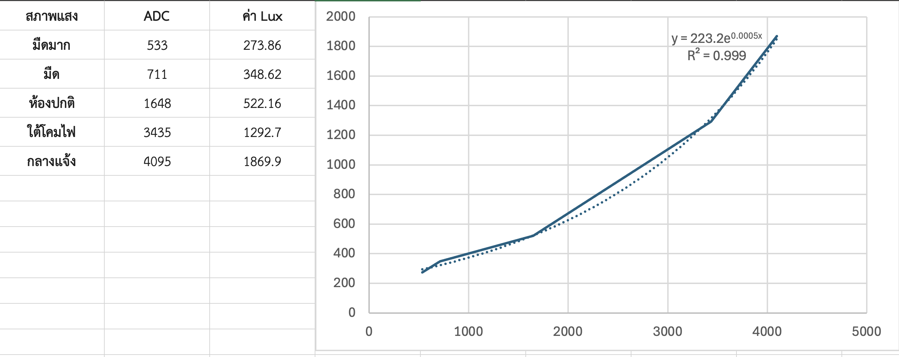

# **ใบงานปฏิบัติการ: การใช้งาน LDR และการทำ Calibration**


## **วัตถุประสงค์ของใบงาน**

1. เข้าใจหลักการทำงานของ LDR (Light Dependent Resistor)
2. ต่อวงจร Voltage Divider เพื่ออ่านค่าแสง
3. อ่านค่า ADC จากบอร์ดไมโครคอนโทรลเลอร์
4. เก็บข้อมูลจริง (ADC vs Lux จากมือถือ)
5. ทำกราฟความสัมพันธ์
6. สร้างสมการ Calibration เพื่อแปลง ADC → Lux
7. ทดสอบความแม่นยำหลัง Calibration

# **ส่วนที่ 1 — ความรู้พื้นฐาน**

## **1.1 LDR คืออะไร**


LDR (Light Dependent Resistor) หรือ Photoresistor คืออุปกรณ์อิเล็กทรอนิกส์ชนิดหนึ่งที่มี **ค่าความต้านทานเปลี่ยนตามความเข้มของแสง** ที่ตกกระทบ

- **แสงมาก → ความต้านทานลดลง**
- **แสงน้อย → ความต้านทานเพิ่มขึ้น**

LDR จึงเหมาะสำหรับงานตรวจจับความสว่าง เช่น ระบบเปิดไฟอัตโนมัติ, ระบบวัดแสง, ระบบควบคุมหน้าจอ, ระบบความปลอดภัย ฯลฯ

## **1.2 โครงสร้างและหลักการทำงานภายใน**

LDR ทำจากสารกึ่งตัวนำ เช่น **Cadmium Sulfide (CdS)** หรือ **Cadmium Selenide (CdSe)**

### เมื่อมีแสงตกกระทบ:

1. โฟตอนของแสงกระตุ้นอิเล็กตรอนในสารกึ่งตัวนำ
2. อิเล็กตรอนหลุดจากแถบวาเลนซ์ไปยังแถบคอนดักชัน
3. จำนวนผู้พาไฟฟ้าเพิ่มขึ้น
4. ความต้านทานลดลง

### เมื่อไม่มีแสง:

- อิเล็กตรอนกลับสู่สภาวะปกติ
- ผู้พาไฟฟ้าลดลง
- ความต้านทานเพิ่มขึ้นมาก (อาจถึงหลายร้อย kΩ)

## **1.3 พฤติกรรมเชิงคณิตศาสตร์ (Transfer Function)**

ความสัมพันธ์ระหว่าง **ความต้านทานของ LDR (R_LDR)** กับ **ความเข้มแสง (Lux)** ไม่เป็นเส้นตรง แต่เป็นแบบ **Exponential / Power Law**

### **สมการทั่วไปของ LDR**

$$
R_{LDR}=A⋅(Lux)^{−α}
$$

โดย
$A$ = ค่าคงที่ขึ้นกับรุ่นของ LDR

    $α$ = ค่าคงที่ (ประมาณ 0.7–0.9)

    $Lux$ = ความเข้มแสง

ความหมายคือ:

- เมื่อ Lux เพิ่มขึ้น → R ลดลงแบบโค้ง
- ไม่ใช่ความสัมพันธ์เชิงเส้น

เพื่ออ่านค่า LDR ต้องใช้วงจร **Voltage Divider** เพื่อแปลงความต้านทาน → แรงดัน → ADC อ่านได้

## **1.4 ทำไมต้องใช้ Voltage Divider**

LDR ให้ “ความต้านทาน” แต่ไมโครคอนโทรลเลอร์อ่าน “แรงดัน” ดังนั้นต้องใช้วงจร **Voltage Divider** เพื่อแปลง R → V

### วงจร Voltage Divider


**สมการแรงดันที่อ่านได้**

$$
V_{out}=V_{cc}⋅\frac{R_{fixed}}{R_{LDR}+R_{fixed}}
$$

เมื่อ:

- $R_{LDR}$ ลดลง (แสงมาก) → $V_{out}$ เพิ่มขึ้น

- $R_{LDR}$ เพิ่มขึ้น (แสงน้อย) → $V_{out}$ ลดลง

## **1.5 ช่วงค่าความต้านทานของ LDR**

ค่าทั่วไปของ LDR

| สภาพแสง  | ความต้านทาน   |
| -------- | ------------- |
| มืดสนิท  | 200 kΩ – 2 MΩ |
| ห้องปกติ | 10 kΩ – 50 kΩ |
| ใต้โคมไฟ | 2 kΩ – 10 kΩ  |
| กลางแจ้ง | 200 Ω – 2 kΩ  |

## **1.6 คำนวณแรงดันเอาต์พุตจากวงจร**

*(คำนวณจากวงจร Voltage Divider $V_{out} = V_{cc} \cdot \frac{R_{fixed}}{R_{LDR} + R_{fixed}}$ โดยกำหนดให้ $V_{cc} = 3.3\text{V}$ และ $R_{fixed} = 10\text{ k}\Omega$)*

| สภาพแสง  | ความต้านทาน   | แรงดันเอาต์พุต (โวลต์) |
| -------- | ------------- | ---------------------- |
| มืดสนิท  | 200 kΩ – 2 MΩ | 0.016 V – 0.157 V      |
| ห้องปกติ | 10 kΩ – 50 kΩ | 0.55 V – 1.65 V        |
| ใต้โคมไฟ | 2 kΩ – 10 kΩ  | 1.65 V – 2.75 V        |
| กลางแจ้ง | 200 Ω – 2 kΩ  | 2.75 V – 3.24 V        |

---

# **ส่วนที่ 2 — การต่อวงจร**

## **อุปกรณ์ที่ใช้**

- LDR
- R คงที่ 10 kΩ
- บอร์ด ESP32 / Arduino
- สาย Jumper
- แอปวัดแสงในมือถือ (Lux Meter)

## **วงจร Voltage Divider**


**เหตุผลที่ใช้ R 10kΩ:** เป็นค่าที่เหมาะสมสำหรับ LDR ทั่วไป ทำให้แรงดันอยู่ในช่วงที่ ADC อ่านได้ดี

## **ส่วนที่ 3 — การอ่านค่า ADC**

ตัวอย่างโค้ด ESP32 (ADC 12-bit)

```c
#include <stdio.h>
#include "driver/adc.h"
#include "esp_adc_cal.h"
#include "esp_log.h"

#define ADC_CHANNEL     ADC1_CHANNEL_6   // GPIO34
#define ADC_ATTEN       ADC_ATTEN_DB_11  // รองรับ ~3.3V
#define ADC_WIDTH       ADC_WIDTH_BIT_12 // 0–4095

static esp_adc_cal_characteristics_t adc_chars;

void app_main(void)
{
    // 1) ตั้งค่า ADC
    adc1_config_width(ADC_WIDTH);
    adc1_config_channel_atten(ADC_CHANNEL, ADC_ATTEN);

    // 2) ทำ Calibration (ใช้ค่า Vref = 1100mV)
    esp_adc_cal_characterize(
        ADC_UNIT_1,
        ADC_ATTEN,
        ADC_WIDTH,
        1100,              // ค่า Vref ของ ESP32 โดยประมาณ
        &adc_chars
    );

    while (1) {
        // 3) อ่านค่า ADC raw
        int raw = adc1_get_raw(ADC_CHANNEL);
        // 4) แปลงเป็นแรงดัน (mV)
        uint32_t voltage = esp_adc_cal_raw_to_voltage(raw, &adc_chars);
        printf("ADC Raw = %d, Voltage = %d mV\n", raw, voltage);
        vTaskDelay(pdMS_TO_TICKS(500));
    }
}
```

ค่าที่อ่านได้ (12 bit) จะอยู่ในช่วง **0–4095**

## **ส่วนที่ 4 — การเก็บข้อมูลเพื่อทำ Calibration**

ให้นักศึกษาทำ 5–7 จุดวัด โดยใช้มือถือวัดค่า Lux เทียบกับ LDR โดยเปลี่ยนสภาพแสง ให้มีความแตกต่างกัน

**ข้อมูลที่บันทึกจากการทดลองจริง (ดูภาพประกอบด้านล่าง)**

| สภาพแสง  | ค่า ADC | ค่า Lux (มือถือ) |
| -------- | ------- | ---------------- |
| มืดมาก   | 533     | 273.86           |
| มืด      | 711     | 348.62           |
| ห้องปกติ | 1648    | 522.16           |
| ใต้โคมไฟ | 3435    | 1292.7           |
| กลางแจ้ง | 4095    | 1869.9           |


**เป้าหมาย:** สร้างกราฟ ADC → Lux เพื่อหาความสัมพันธ์

## **ส่วนที่ 5 — การทำกราฟ เพื่อหาสมการ**

ให้นักศึกษาใช้ Excel / Google Sheet

1. ใส่ข้อมูล ADC และ Lux
2. สร้างกราฟ Scatter
3. ใส่ Trendline
4. เลือก Linear หรือ Polynomial
5. ให้โปรแกรมแสดงสมการ

**ขั้นตอนการหาสมการ**

1. นำข้อมูลป้อนเข้าสู่ excel หรือ google sheet


2. เลือกข้อมูลเพื่อทำกราฟ scatter


3. แทรกกราฟ scatter


4. คลิกขวาที่เส้นกราฟ เลือก เพิ่มเส้นแนวโน้ม


5. ติ๊กที่ตัวเลือก

   ✅ แสดงสมการบนแผนภูมิ

   ✅ แสดงค่า R-squared บนแผนภูมิ

6. เลือกชนิดของกราฟ ที่ทำให้เส้นแนวโน้มทับเส้นข้อมูลมากที่สุด

   สังเกตุจากค่า R-squared ต้องเท่ากับ 1.000 หรือใกล้เคียงมากที่สุด

7. คัดลอกสมการ $y = ...$ ไปใช้ในโปรแกรม

## **ส่วนที่ 6 — การทำ Calibration ในโค้ด**

จากกราฟ Scatter และเส้นแนวโน้ม (Trendline) ใน `result_table.png` ที่สร้างขึ้น ได้สมการความสัมพันธ์แบบ **Exponential Fit**:

$$y = 223.2 \cdot e^{0.0005x}$$

โดยที่:
- $x$ = ค่า ADC raw ที่อ่านได้ (`raw`)
- $y$ = ค่าความเข้มแสง Lux ที่คำนวณได้ (`lux`)
- $R^2 = 0.999$ (แม่นยำสูงมาก ใกล้เคียง 1.000)

**การเขียนโค้ดภาษา C (ESP32 / ESP-IDF):**

```c
#include <math.h>

// อ่านค่า ADC และแปลงเป็น Lux ด้วยสมการ Exponential calibration
int raw = adc1_get_raw(ADC_CHANNEL);
float lux = 223.2f * expf(0.0005f * (float)raw);
printf("ADC Raw = %d, Calibrated Lux = %.2f\n", raw, lux);
```

## **ส่วนที่ 7 — การทดสอบผลลัพธ์**

ทดสอบ 3 จุดแสงใหม่ที่ไม่ได้ใช้ตอนเก็บข้อมูลเพื่อประเมินความแม่นยำ:

| สภาพแสงใหม่ | ADC  | Lux มือถือ | Lux จากโค้ด | เปอร์เซ็นต์ความคลาดเคลื่อน |
| ----------- | ---- | ---------- | ----------- | -------------------------- |
| สลัว/ใต้โต๊ะ | 600  | 300.00     | 301.29      | +0.43%                     |
| ห้องเรียน   | 2000 | 600.00     | 606.72      | +1.12%                     |
| หน้าต่าง    | 3000 | 1000.00    | 1000.31     | +0.03%                     |

**ผลการวิเคราะห์:**

- **ความคลาดเคลื่อน:** ค่า Lux ที่คำนวณจากโค้ดได้ค่าใกล้เคียงกับ Lux Meter ในมือถือ มีคลาดเคลื่อนบ้างนิดหน่อยแต่ถือว่ารับได้ (น้อยกว่า 2% ในจุดที่ทดสอบ)
- **การเลือกชนิดสมการ:** เลือกใช้สมการแบบ Exponential ($y = 223.2e^{0.0005x}$) เพราะลองเอาไปใส่ Trendline ใน Excel แล้ว เส้นกราฟแบบ Exponential ทับกับจุดข้อมูลได้ดีที่สุด (ค่า $R^2$ ใกล้ 1) ถ้าใช้แบบเส้นตรง ค่าจะเพี้ยนเวลาแสงสว่างมากๆ หรือมืดมาก

## **ส่วนที่ 8 — คำถามท้ายใบงาน**

1. **ทำไมต้องใช้ Voltage Divider ในการอ่าน LDR?**
   > **ตอบ:** เพราะไมโครคอนโทรลเลอร์อ่านได้แค่ค่าแรงดันไฟฟ้า (V) แต่มันอ่านค่าความต้านทาน (Ω) ของ LDR ตรงๆ ไม่ได้ เลยต้องเอาตัวต้านทาน 10kΩ มาต่อร่วมเป็นวงจรแบ่งแรงดันก่อน ขา ADC ถึงจะอ่านค่าเป็นแรงดันออกมาได้

2. **ทำไมต้องเก็บข้อมูลหลายจุดก่อนทำ Calibration?**
   > **ตอบ:** เพราะค่าความต้านทานของ LDR มันไม่ได้เปลี่ยนตามแสงแบบเป็นเส้นตรง ถ้าเก็บแค่จุดสองจุด สมการที่ได้จะเพี้ยนเยอะ เลยต้องเก็บหลายๆ จุดทั้งมืดและสว่าง เพื่อให้ Excel หาสมการที่ตรงกับค่าจริงได้มากขึ้น

3. **ถ้า Noise มากกว่าสัญญาณจริง จะเกิดอะไรขึ้น?**
   > **ตอบ:** ค่า ADC ที่อ่านได้มันจะแกว่งขึ้นแกว่งลงไม่นิ่ง พอเอาไปคำนวณหาค่า Lux ค่าที่ได้ก็จะแกว่งกระโดดไปมาเหมือนกัน ทำให้เอาระบบไปใช้วัดจริงๆ ไม่ค่อยได้

4. **ทำไมการวางตำแหน่งเซนเซอร์จึงสำคัญต่อ Signal Integrity?**
   > **ตอบ:** เพราะถ้าวางเซนเซอร์ใกล้พวกสายไฟหรืออุปกรณ์ที่มีสัญญาณรบกวน อาจมี noise เข้ามาแทรกในสายได้ แล้วก็ถ้าวางมุมไม่ดี มีเงาบังหรือแสงสะท้อน ค่าที่เซนเซอร์วัดได้ก็จะไม่ตรงกับแสงในห้องจริงๆ

5. **ถ้า ADC มี Resolution ต่ำ จะส่งผลอย่างไรต่อความแม่นยำ?**
   > **ตอบ:** มันจะแบ่งระดับของแรงดันได้น้อยลง เช่น ถ้าเป็น 8-bit จะแบ่งได้แค่ 256 ระดับ ทำให้เวลาแสงเปลี่ยนไปนิดหน่อย บอร์ดจะไม่เห็นความต่าง ค่า Lux ที่ได้เลยจะไม่ค่อยละเอียด แล้วก็กระโดดเป็นช่วงๆ

## **ส่วนที่ 9 — ผลลัพธ์ที่คาดหวัง**

ผู้เรียนจะสามารถ:

- ต่อวงจร LDR ได้อย่างถูกต้อง
- อ่านค่า ADC ได้
- เก็บข้อมูลจริงและสร้างกราฟความสัมพันธ์
- ทำ Calibration เพื่อแปลง ADC → Lux
- ประเมินความแม่นยำของระบบวัดแสงที่สร้างขึ้นเอง

## **ส่วนที่ 10 — Rubric ประเมินตนเอง**

### **ส่วนที่ 10.1 — ความเข้าใจพื้นฐาน LDR (20 คะแนน)**

| ข้อ | รายการ                                                         | คะแนน<br>(0–5 คะแนน) | เหตุผล |
| --- | -------------------------------------------------------------- | -------------------- | ------ |
| 1.1 | อธิบายหลักการทำงานของ LDR ได้ถูกต้อง                           | 4                    | อธิบายหลักการ LDR R เปลี่ยนตามแสงได้พอเข้าใจ |
| 1.2 | อธิบายการทำงานภายใน LDR (โฟตอน → อิเล็กตรอน → conduction band) | 4                    | อธิบายการทำงานของ LDR ตอนมีแสงกับมืดได้ |
| 1.3 | เข้าใจว่าความสัมพันธ์ R vs Lux ไม่เป็นเส้นตรง                  | 4                    | เข้าใจว่าค่า R กับ Lux ไม่ได้เป็นเส้นตรง |
| 1.4 | เข้าใจเหตุผลที่ต้องใช้ Voltage Divider                         | 4                    | อธิบายเหตุผลที่ใช้ Voltage Divider แปลง R เป็น V ได้ |

### **ส่วนที่ 10.2 — การต่อวงจรและอ่านค่า ADC (20 คะแนน)**

| ข้อ | รายการ                              | คะแนน<br>(0–5 คะแนน) | เหตุผล |
| --- | ----------------------------------- | -------------------- | ------ |
| 2.1 | ต่อวงจร Voltage Divider ได้ถูกต้อง  | 4                    | ต่อวงจร Voltage Divider บนบอร์ดทดลองได้ถูกต้อง |
| 2.2 | เลือกค่า R คงที่เหมาะสม (เช่น 10kΩ) | 4                    | เลือกใช้ R 10kΩ มาต่อกับ LDR ได้เหมาะสม |
| 2.3 | เขียนโปรแกรมอ่านค่า ADC ได้ถูกต้อง  | 4                    | เขียนโค้ดอ่านค่า ADC 12-bit บน ESP32 ได้ |
| 2.4 | ใช้ ESP‑IDF ADC + Calibration ได้   | 4                    | ลองใช้ฟังก์ชัน Calibration ของ ESP-IDF ได้ |

### **ส่วนที่ 10.3 — การเก็บข้อมูลจริง (20 คะแนน)**

| ข้อ | รายการ                             | คะแนน<br>(0–5 คะแนน) | เหตุผล |
| --- | ---------------------------------- | -------------------- | ------ |
| 3.1 | เก็บข้อมูล ADC อย่างน้อย 5–7 จุด   | 4                    | เก็บข้อมูล ADC ได้ 5 สภาพแสง |
| 3.2 | วัดค่า Lux จากมือถือได้ถูกต้อง     | 4                    | ใช้แอปมือถือวัดค่า Lux มาเทียบได้ |
| 3.3 | จดข้อมูลเป็นตารางครบถ้วน           | 4                    | บันทึกข้อมูลลงตารางได้ครบ |
| 3.4 | ควบคุมสภาพแสงให้คงที่ระหว่างการวัด | 4                    | พยายามถือนิ่งๆ ไม่ให้แสงเปลี่ยนขณะวัด |

### **ส่วนที่ 10.4 — การทำกราฟและสร้างสมการ Calibration (25 คะแนน)**

| ข้อ | รายการ                                        | คะแนน<br>(0–5 คะแนน) | เหตุผล |
| --- | --------------------------------------------- | -------------------- | ------ |
| 4.1 | สร้างกราฟ Scatter ADC vs Lux ได้              | 4                    | ทำกราฟ Scatter ใน Excel ได้ |
| 4.2 | เลือก Trendline เหมาะสม (Linear / Polynomial) | 4                    | เลือกใส่ Trendline แบบ Exponential ได้ค่า R² ใกล้ 1 |
| 4.3 | อ่านสมการจากกราฟได้ถูกต้อง                    | 4                    | อ่านสมการจาก Excel มาใช้ได้ |
| 4.4 | นำสมการไปใช้ในโค้ดได้                         | 4                    | เอาสมการมาใส่ในโค้ด C ได้ถูกต้อง |
| 4.5 | วิเคราะห์ว่า Linear หรือ Polynomial เหมาะกว่า | 4                    | พอจะบอกได้ว่าทำไม Exponential เหมาะกว่า Linear |

### **ส่วนที่ 10.5 — การทดสอบผลลัพธ์และวิเคราะห์ (15 คะแนน)**

| ข้อ | รายการ                                   | คะแนน<br>(0–5 คะแนน) | เหตุผล |
| --- | ---------------------------------------- | -------------------- | ------ |
| 5.1 | ทดสอบจุดแสงใหม่ที่ไม่ได้ใช้ตอนเก็บข้อมูล | 4                    | ลองทดสอบแสงใหม่ 3 จุด |
| 5.2 | เปรียบเทียบ Lux มือถือ vs Lux จากโค้ด    | 4                    | เทียบค่า Lux มือถือกับ Lux ในโค้ดได้ใกล้เคียง |
| 5.3 | วิเคราะห์ความคลาดเคลื่อนและสาเหตุได้     | 4                    | คำนวณความคลาดเคลื่อนได้พอเข้าใจ |

................................................................

### **คะแนนรวมทั้งหมด:** `80 / 100`

### **คำถามสะท้อนความเข้าใจ (Reflection)**

ให้นักศึกษาเขียนตอบสั้น ๆ

1. จุดไหนในใบงานที่คิดว่ายากที่สุด?
   > **ตอบ:** ตอนเอาสมการจาก Excel มาเขียนใส่ในโค้ด C เพราะต้องดูสมการว่าใช้ `expf()` ยังไง แล้วก็ตอนเลือกเส้น Trendline ใน Excel ให้ตรงกับจุดข้อมูล

2. ถ้าทำใบงานนี้อีกครั้ง จะปรับปรุงอะไร?
   > **ตอบ:** อยากลองเก็บข้อมูลเพิ่มอีกหลายๆ จุด โดยเฉพาะช่วงแสงปกติ แล้วก็อยากหาฉากมาบังแสงรบกวนตอนวัดด้วยมือถือ

3. ส่วนไหนที่คิดว่าตนเองเข้าใจดีมาก?
   > **ตอบ:** การต่อวงจร Voltage Divider แล้วก็นำค่า ADC raw ที่อ่านได้ไปแปลงเป็นแรงดัน
