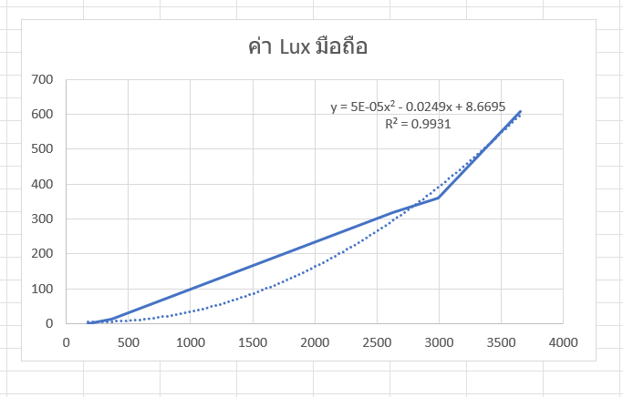

# **ใบงานปฏิบัติการ: การใช้งาน LDR และการทำ Calibration**


## **วัตถุประสงค์ของใบงาน**

1. เข้าใจหลักการทำงานของ LDR (Light Dependent Resistor)
2. ต่อวงจร Voltage Divider เพื่ออ่านค่าแสง
3. อ่านค่า ADC จากบอร์ดไมโครคอนโทรลเลอร์
4. เก็บข้อมูลจริง (ADC vs Lux จากมือถือ)
5. ทำกราฟความสัมพันธ์
6. สร้างสมการ Calibration เพื่อแปลง ADC → Lux
7. ทดสอบความแม่นยำหลัง Calibration

# **ส่วนที่ 1 — ความรู้พื้นฐาน**

## **1.1 LDR คืออะไร**


LDR (Light Dependent Resistor) หรือ Photoresistor คืออุปกรณ์อิเล็กทรอนิกส์ชนิดหนึ่งที่มี **ค่าความต้านทานเปลี่ยนตามความเข้มของแสง** ที่ตกกระทบ

- **แสงมาก → ความต้านทานลดลง**
- **แสงน้อย → ความต้านทานเพิ่มขึ้น**

LDR จึงเหมาะสำหรับงานตรวจจับความสว่าง เช่น ระบบเปิดไฟอัตโนมัติ, ระบบวัดแสง, ระบบควบคุมหน้าจอ, ระบบความปลอดภัย ฯลฯ


## **1.2 โครงสร้างและหลักการทำงานภายใน**

LDR ทำจากสารกึ่งตัวนำ เช่น **Cadmium Sulfide (CdS)** หรือ **Cadmium Selenide (CdSe)**
### เมื่อมีแสงตกกระทบ:
1. โฟตอนของแสงกระตุ้นอิเล็กตรอนในสารกึ่งตัวนำ
2. อิเล็กตรอนหลุดจากแถบวาเลนซ์ไปยังแถบคอนดักชัน
3. จำนวนผู้พาไฟฟ้าเพิ่มขึ้น
4. ความต้านทานลดลง

### เมื่อไม่มีแสง:

- อิเล็กตรอนกลับสู่สภาวะปกติ
- ผู้พาไฟฟ้าลดลง
- ความต้านทานเพิ่มขึ้นมาก (อาจถึงหลายร้อย kΩ)

##  **1.3 พฤติกรรมเชิงคณิตศาสตร์ (Transfer Function)**

ความสัมพันธ์ระหว่าง **ความต้านทานของ LDR (R_LDR)** กับ **ความเข้มแสง (Lux)** ไม่เป็นเส้นตรง แต่เป็นแบบ **Exponential / Power Law**

### **สมการทั่วไปของ LDR**


$$R_{LDR}=A⋅(Lux)^{−α}
$$

โดย
	
	$A$ = ค่าคงที่ขึ้นกับรุ่นของ LDR

	$α$ = ค่าคงที่ (ประมาณ 0.7–0.9)
	
	$Lux$ = ความเข้มแสง

ความหมายคือ:
- เมื่อ Lux เพิ่มขึ้น → R ลดลงแบบโค้ง
- ไม่ใช่ความสัมพันธ์เชิงเส้น

เพื่ออ่านค่า LDR ต้องใช้วงจร **Voltage Divider** เพื่อแปลงความต้านทาน → แรงดัน → ADC อ่านได้

##  **1.4 ทำไมต้องใช้ Voltage Divider**

LDR ให้ “ความต้านทาน” แต่ไมโครคอนโทรลเลอร์อ่าน “แรงดัน” ดังนั้นต้องใช้วงจร **Voltage Divider** เพื่อแปลง R → V

### วงจร Voltage Divider


 **สมการแรงดันที่อ่านได้**


$$V_{out}=V_{cc}⋅\frac{R_{fixed}}{R_{LDR}+R_{fixed}}
$$

เมื่อ:

- $R_{LDR}$ ลดลง (แสงมาก) → $V_{out}$ เพิ่มขึ้น

- $R_{LDR}$ เพิ่มขึ้น (แสงน้อย) → $V_{out}$ ลดลง

## **1.5 ช่วงค่าความต้านทานของ LDR**

ค่าทั่วไปของ LDR

| สภาพแสง  | ความต้านทาน   |
| -------- | ------------- |
| มืดสนิท  | 200 kΩ – 2 MΩ |
| ห้องปกติ | 10 kΩ – 50 kΩ |
| ใต้โคมไฟ | 2 kΩ – 10 kΩ  |
| กลางแจ้ง | 200 Ω – 2 kΩ  |

## **1.6 คำนวณแรงดันเอาต์พุตจากวงจร**

| สภาพแสง  | ความต้านทาน   | แรงดันเอาต์พุต (โวลต์) |
| -------- | ------------- | ---------------------- |
| มืดสนิท  | 200 kΩ – 2 MΩ |0.01 - 0.16 V|
| ห้องปกติ | 10 kΩ – 50 kΩ |0.55 - 1.65 V|
| ใต้โคมไฟ | 2 kΩ – 10 kΩ  |1.65 - 2.75 V|
| กลางแจ้ง | 200 Ω – 2 kΩ  |2.75 - 3.23 V|


---
# **ส่วนที่ 2 — การต่อวงจร**

## **อุปกรณ์ที่ใช้**

- LDR
- R คงที่ 10 kΩ
- บอร์ด ESP32 / Arduino
- สาย Jumper
- แอปวัดแสงในมือถือ (Lux Meter)

## **วงจร Voltage Divider**


**เหตุผลที่ใช้ R 10kΩ:** เป็นค่าที่เหมาะสมสำหรับ LDR ทั่วไป ทำให้แรงดันอยู่ในช่วงที่ ADC อ่านได้ดี

## **ส่วนที่ 3 — การอ่านค่า ADC**

ตัวอย่างโค้ด ESP32 (ADC 12-bit)

```c
#include <stdio.h>
#include "driver/adc.h"
#include "esp_adc_cal.h"
#include "esp_log.h"

#define ADC_CHANNEL     ADC1_CHANNEL_6   // GPIO34
#define ADC_ATTEN       ADC_ATTEN_DB_11  // รองรับ ~3.3V
#define ADC_WIDTH       ADC_WIDTH_BIT_12 // 0–4095

static esp_adc_cal_characteristics_t adc_chars;

void app_main(void)
{
    // 1) ตั้งค่า ADC
    adc1_config_width(ADC_WIDTH);
    adc1_config_channel_atten(ADC_CHANNEL, ADC_ATTEN);

    // 2) ทำ Calibration (ใช้ค่า Vref = 1100mV)
    esp_adc_cal_characterize(
        ADC_UNIT_1,
        ADC_ATTEN,
        ADC_WIDTH,
        1100,              // ค่า Vref ของ ESP32 โดยประมาณ
        &adc_chars
    );

    while (1) {
        // 3) อ่านค่า ADC raw
        int raw = adc1_get_raw(ADC_CHANNEL);
        // 4) แปลงเป็นแรงดัน (mV)
        uint32_t voltage = esp_adc_cal_raw_to_voltage(raw, &adc_chars);
        printf("ADC Raw = %d, Voltage = %d mV\n", raw, voltage);
        vTaskDelay(pdMS_TO_TICKS(500));
    }
}
```

ค่าที่อ่านได้ (12 bit) จะอยู่ในช่วง **0–4095** 

## **ส่วนที่ 4 — การเก็บข้อมูลเพื่อทำ Calibration**

ให้นักศึกษาทำ 5–7 จุดวัด โดยใช้มือถือวัดค่า Lux เทียบกับ LDR โดยเปลี่ยนสภาพแสง ให้มีความแตกต่างกัน

**ตัวอย่างข้อมูล**

| สภาพแสง  | ค่า ADC | ค่า Lux (มือถือ) |
| -------- | ------- | ---------------- |
| มืดมาก   | 177     | 0               |
| มืด      | 366     | 12               |
| ห้องปกติ | 2629    | 319              |
| ใต้โคมไฟ | 2997    | 359             |
| กลางแจ้ง | 3653    | 609            |

**เป้าหมาย:** สร้างกราฟ ADC → Lux เพื่อหาความสัมพันธ์

## **ส่วนที่ 5 — การทำกราฟ เพื่อหาสมการ**

ให้นักศึกษาใช้ Excel / Google Sheet
1. ใส่ข้อมูล ADC และ Lux
2. สร้างกราฟ Scatter
3. ใส่ Trendline
4. เลือก Linear หรือ Polynomial
5. ให้โปรแกรมแสดงสมการ

**ขั้นตอนการหาสมการ**
1. นำข้อมูลป้อนเข้าสู่ excel หรือ google sheet


2. แทรกกราฟ scatter


3. คลิกขวาที่เส้นกราฟ เลือก เพิ่มเส้นแนวโน้ม


5. ติ๊กที่ตัวเลือก 

	✅ แสดงสมการบนแผนภูมิ 

	✅ แสดงค่า R-squared บนแผนภูมิ

6. เลือกชนิดของกราฟ ที่ทำให้เส้นแนวโน้มทับเส้นข้อมูลมากที่สุด

	สังเกตุจากค่า R-squared ต้องเท่ากับ 1.000 หรือใกล้เคียงมากที่สุด

7. คัดลอกสมการ $y = ...$ ไปใช้ในโปรแกรม


สมมติว่า trend line ได้สมการเป็น $y = 0.42x-50$

แสดงว่ามีความชันของเส้นกราฟเป็น $m=0.42$ และมีจุดตัดแกน $y$  ที่ $b = -50$ ให้เขียน code แบบนี้

```c
Lux = 0.42 × ADC – 50
```

หรือถ้ากราฟไม่เป็นเส้นตรง  ให้ใช้ Polynomial เช่น สมมติว่าได้สมการเป็น $y = 0.0001 × x^2 + 0.3 x – 40$ ให้เขียน code แบบนี้

```c
Lux = 0.0001 × ADC^2 + 0.3 × ADC – 40
```

## **ส่วนที่ 6 — การทำ Calibration ในโค้ด**

ตัวอย่างแบบ Linear Fit

```c
float lux = 0.42 * raw - 50;
```

ตัวอย่างแบบ Polynomial:

```c
float lux = 0.0001 * raw * raw + 0.3 * raw - 40;
```

**หมายเหตุ** 

Code ที่ใช้ สามารถ reuse code  จากการ calibrate ค่ามุมในการทดลองที่แล้วได้


## **ส่วนที่ 7 — การทดสอบผลลัพธ์**

ให้นักศึกษาทดสอบ 3 จุดแสงใหม่ที่ไม่ได้ใช้ตอนเก็บข้อมูล เช่น:

| สภาพแสงใหม่ | ADC  | Lux มือถือ | Lux จากโค้ด |
| ----------- | ---- | ---------- | ----------- |
| ใต้โต๊ะ     | 355  | 18         | 8.67          |
| ห้องเรียน   | 2629 | 315       | 368         |
| หน้าต่าง    | 2865 |   348      | 439         |

ให้นักศึกษาวิเคราะห์ว่า

- ความคลาดเคลื่อนอยู่ในระดับที่ยอมรับได้หรือไม่
    ตอบ ยอมรับได้เป็นอย่างดี เนื่องจากค่า $R^2 = 0.9931$ มีค่าสูงเข้าใกล้ $1.0$ แสดงว่าสมการมีความแม่นยำสูง และฟิตเข้ากับข้อมูลจริงได้อย่างถูกต้อง
- สมการ Linear หรือ Polynomial เหมาะกว่ากัน
    ตอบ Polynomial เหมาะสมกว่า Linear เพราะ LDR มีการตอบสนองต่อแสงแบบไม่เป็นเส้นตรง (Non-linear) สมการ Polynomial จึงโค้งรับกับพฤติกรรมจริงของเซนเซอร์ได้ดีกว่า และให้ความแม่นยำสูงกว่าชัดเจน

## **ส่วนที่ 8 — คำถามท้ายใบงาน**

1. ทำไมต้องใช้ Voltage Divider ในการอ่าน LDR?
    ตอบ ESP32 ไม่สามารถอ่านค่า "ความต้านทาน" โดยตรงได้ อ่านได้เฉพาะ "แรงดันไฟฟ้า" วงจร Voltage Divider จึงทำหน้าที่แปลงการเปลี่ยนแปลงความต้านทานของ LDR ให้กลายเป็นระดับแรงดันไฟฟ้า (0–3.3V) เพื่อให้ขา ADC อ่านค่าได้
2. ทำไมต้องเก็บข้อมูลหลายจุดก่อนทำ Calibration?
    ตอบ เพื่อครอบคลุมช่วงการทำงานทั้งหมด (ตั้งแต่สว่างมากไปถึงมืดมาก) และช่วยลดความคลาดเคลื่อน ทำให้สร้างเส้น Trendline หรือสมการแปลงค่า (Lux) ได้แม่นยำยิ่งขึ้น
3. ถ้า Noise มากกว่าสัญญาณจริง จะเกิดอะไรขึ้น?
    ทำให้ค่า ADC รบกวนอย่างหนัก ค่าอ่านได้จะผันผวนสวิงไปมาอย่างรวดเร็ว ไม่สามารถนำไปคำนวณเป็นค่า Lux ที่ถูกต้องได้ และอาจเกิดความผิดพลาดในการส่งข้อมูลหรือการตัดสินใจของระบบ
4. ทำไมการวางตำแหน่งเซนเซอร์จึงสำคัญต่อ Signal Integrity?
    ตอบ เพราะหากวางใกล้แหล่งกำเนิดรบกวน (เช่น สายไฟแรงสูง, มอเตอร์ หรือแสงสะท้อนแปลกๆ) หรือใช้สายสัญญาณที่ยาวเกินไป จะทำให้สัญญาณถูกรบกวนได้ง่าย (เกิด Signal Loss/Noise) การวางตำแหน่งที่ดีจะช่วยลดปัญหานี้และได้สัญญาณที่สะอาด
5. ถ้า ADC มี Resolution ต่ำ จะส่งผลอย่างไรต่อความแม่นยำ?
    ตอบ ทำให้ความละเอียดในการแบ่งระดับแรงดันลดลง (Step ของค่ากว้างขึ้น) ส่งผลให้การเปลี่ยนแปลงความสว่างเพียงเล็กน้อยไม่สามารถวัดได้ ค่าที่อ่านได้จะหยาบและขาดความแม่นยำ

## **ส่วนที่ 9 — ผลลัพธ์ที่คาดหวัง**

ผู้เรียนจะสามารถ:
- ต่อวงจร LDR ได้อย่างถูกต้อง
- อ่านค่า ADC ได้
- เก็บข้อมูลจริงและสร้างกราฟความสัมพันธ์
- ทำ Calibration เพื่อแปลง ADC → Lux
- ประเมินความแม่นยำของระบบวัดแสงที่สร้างขึ้นเอง

## ส่วนที่ 10 — Rubric ประเมินตนเอง

### ส่วนที่ 10.1 — ความเข้าใจพื้นฐาน LDR (20 คะแนน)

| ข้อ | รายการ | คะแนน (0–5 คะแนน) | เหตุผล |
| :---: | :--- | :---: | :--- |
| 1.1 | อธิบายหลักการทำงานของ LDR ได้ถูกต้อง | 5 | สามารถอธิบายความสัมพันธ์ระหว่างความเข้มแสงและความต้านทานได้ถูกต้อง |
| 1.2 | อธิบายการทำงานภายใน LDR (โฟตอน → อิเล็กตรอน → conduction band) | 5 | เข้าใจการกระตุ้นของพลังงานแสงที่ทำให้เกิดพาหะนำไฟฟ้าในสารกึ่งตัวนำ |
| 1.3 | เข้าใจว่าความสัมพันธ์ R vs Lux ไม่เป็นเส้นตรง | 5 | เข้าใจว่าค่าความต้านทานเปลี่ยนแปลงแบบ Logarithmic/Non-linear |
| 1.4 | เข้าใจเหตุผลที่ต้องใช้ Voltage Divider | 5 | อธิบายได้ว่าต้องเปลี่ยนการเปลี่ยนแปลง R ให้เป็นแรงดันเพื่ออ่านด้วย ADC |

### ส่วนที่ 10.2 — การต่อวงจรและการอ่านค่า ADC (20 คะแนน)

| ข้อ | รายการ | คะแนน (0–5 คะแนน) | เหตุผล |
| :---: | :--- | :---: | :--- |
| 2.1 | ต่อวงจร Voltage Divider ได้ถูกต้อง | 5 | ต่อวงจร LDR อนุกรมกับ R 10kΩ เข้าพิน ADC ของ ESP32 ได้ถูกต้อง |
| 2.2 | เลือกค่า R คงที่เหมาะสม (เช่น 10kΩ) | 5 | เลือกใช้ R 10kΩ ซึ่งเหมาะสมกับช่วงความต้านทานของ LDR ในสภาวะแสงทั่วไป |
| 2.3 | เขียนโปรแกรมอ่านค่า ADC ได้ถูกต้อง | 5 | เขียนโค้ดอ่านค่าสัญญาณอนาล็อกจากพิน ADC ได้อย่างถูกต้อง |
| 2.4 | ใช้ ESP-IDF ADC + Calibration ได้ | 5 | สามารถตั้งค่าความละเอียด Attenuation และเรียกใช้ API Calibration ของ ESP-IDF ได้ |

### ส่วนที่ 10.3 — การเก็บข้อมูลจริง (20 คะแนน)

| ข้อ | รายการ | คะแนน (0–5 คะแนน) | เหตุผล |
| :---: | :--- | :---: | :--- |
| 3.1 | เก็บข้อมูล ADC อย่างน้อย 5–7 จุด | 5 | ทำการบันทึกค่า ADC ครบถ้วนตามระดับความเข้มแสงที่แตกต่างกัน 6 จุด |
| 3.2 | วัดค่า Lux จากมือถือได้ถูกต้อง | 5 | ใช้แอปพลิเคชัน Lux Meter บนมือถือวัดค่าความเข้มแสงอ้างอิงเทียบจุดวัดได้แม่นยำ |
| 3.3 | จดข้อมูลเป็นตารางครบถ้วน | 5 | บันทึกข้อมูลค่า ADC และ ค่า Lux ลงในตารางอย่างเป็นระเบียบเรียบร้อย |
| 3.4 | ควบคุมสภาพแสงให้คงที่ระหว่างการวัด | 5 | จัดสภาพแวดล้อมให้แสงนิ่งขณะทำการบันทึกค่าในแต่ละจุด |

### ส่วนที่ 10.4 — การทำกราฟและสร้างสมการ Calibration (25 คะแนน)

| ข้อ | รายการ | คะแนน (0–5 คะแนน) | เหตุผล |
| :---: | :--- | :---: | :--- |
| 4.1 | สร้างกราฟ Scatter ADC vs Lux ได้ | 5 | นำข้อมูลไปพล็อตลงในโปรแกรมเพื่อสร้างกราฟ Scatter Plot ได้ถูกต้อง |
| 4.2 | เลือก Trendline เหมาะสม (Linear / Polynomial) | 5 | เปรียบเทียบและเลือก Trendline ที่มีค่า R² สูงที่สุดอย่างเหมาะสม |
| 4.3 | อ่านสมการจากกราฟได้ถูกต้อง | 5 | นำสมการความสัมพันธ์และค่าสัมประสิทธิ์ออกมาจากกราฟได้อย่างถูกต้อง |
| 4.4 | นำสมการไปใช้ในโค้ดได้ | 5 | แปลงสมการให้อยู่ในรูปฟังก์ชันคณิตศาสตร์ภาษา C และคำนวณค่า Lux ได้ถูกต้อง |
| 4.5 | วิเคราะห์ว่า Linear หรือ Polynomial เหมาะกว่า | 5 | เปรียบเทียบค่าความคลาดเคลื่อนและสรุปได้ว่า Polynomial เหมาะสมกับ Non-linear มากกว่า |

### ส่วนที่ 10.5 — การทดสอบผลลัพธ์และวิเคราะห์ (15 คะแนน)

| ข้อ | รายการ | คะแนน (0–5 คะแนน) | เหตุผล |
| :---: | :--- | :---: | :--- |
| 5.1 | ทดสอบจุดแสงใหม่ที่ไม่ได้ใช้ตอนเก็บข้อมูล | 5 | นำระบบไปทดสอบวัดค่าในสภาวะแสงใหม่นอกเหนือจากชุดข้อมูลสุ่มสร้างสมการ |
| 5.2 | เปรียบเทียบ Lux มือถือ vs Lux จากโค้ด | 5 | นำค่า Lux ที่คำนวณได้จากไมโครคอนโทรลเลอร์มาเทียบกับแอป Lux Meter บนมือถือ |
| 5.3 | วิเคราะห์ความคลาดเคลื่อนและสาเหตุได้ | 5 | ระบุสาเหตุของ Error ได้ เช่น ข้อจำกัดของ LDR, มุมรับแสง และความไม่เป็นเส้นตรง |

**คะแนนรวมทั้งหมด:** 100 / 100

---

### คำถามสะท้อนความเข้าใจ (Reflection)

1. **จุดไหนในใบงานที่คิดว่ายากที่สุด?**
   * การเลือก Trendline และสร้างสมการ Calibration ที่มีค่าความแม่นยำสูง รวมถึงการนำสมการ Polynomial ไปแปลงใส่ในโค้ดภาษา C ให้คำนวณค่า Lux ออกมาตรงกับความเป็นจริง

2. **ถ้าทำใบงานนี้อีกครั้ง จะปรับปรุงอะไร?**
   * จะใช้อุปกรณ์วัดความเข้มแสงมาตรฐาน (Lux Meter จริง) แทนแอปพลิเคชันบนมือถือ และทำการเฉลี่ยค่า ADC หลายๆ ครั้ง (Averaging/Filtering) เพื่อลดสัญญาณรบกวนก่อนนำไปทำ Calibration

3. **ส่วนไหนที่คิดว่าตนเองเข้าใจดีมาก?**
   * การต่อวงจรแบ่งแรงดัน (Voltage Divider) การอ่านค่าอนาล็อกด้วย ADC ของ ESP32 และการทำงานของ LDR ที่เปลี่ยนค่าความต้านทานตามความเข้มแสง 

