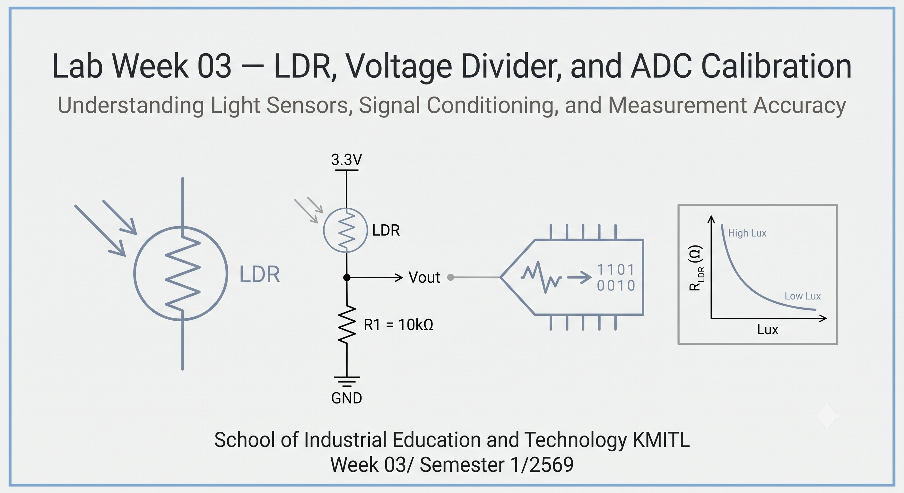
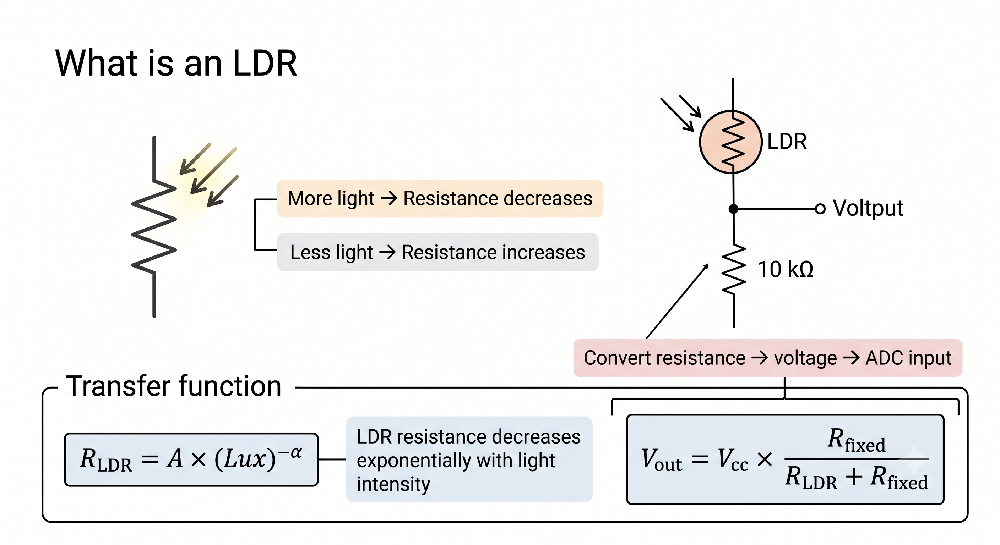
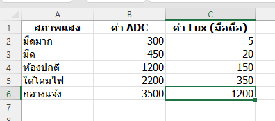
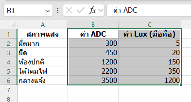
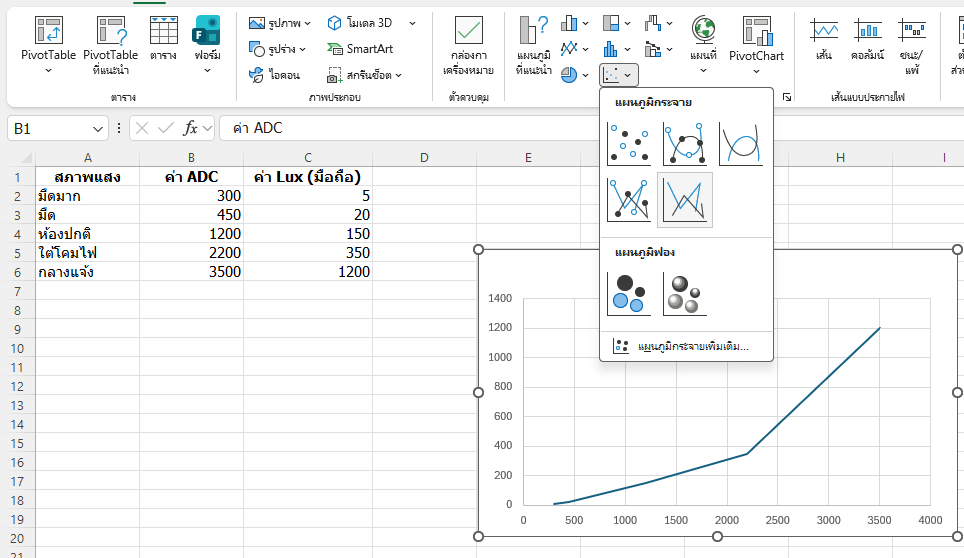
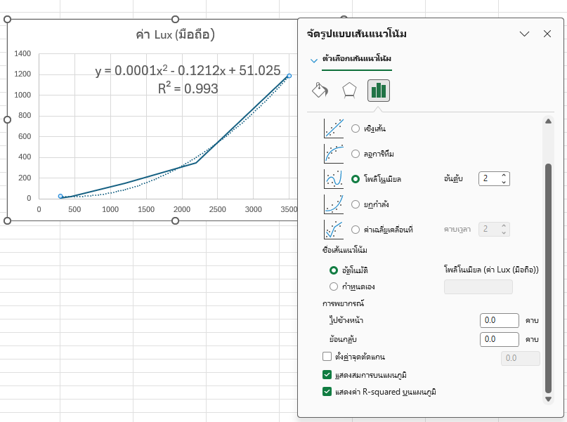
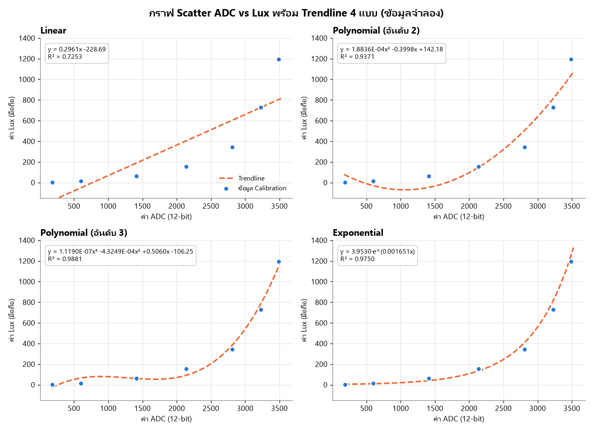
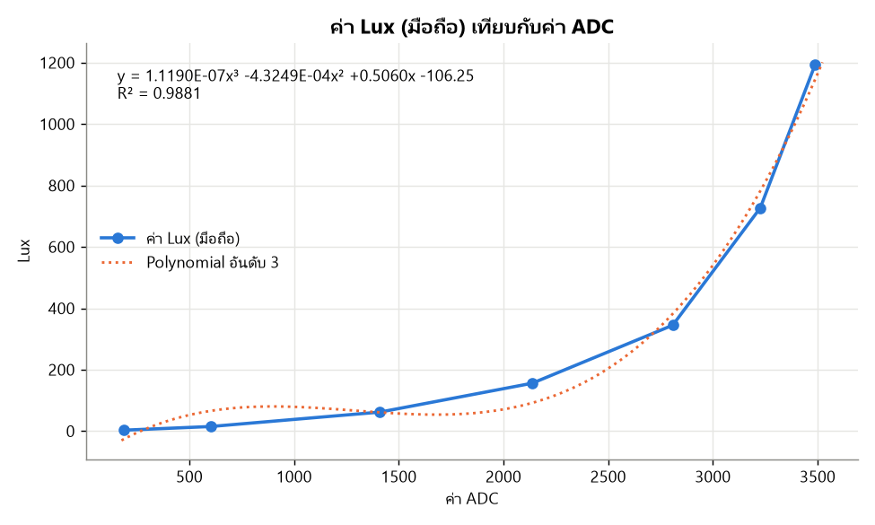
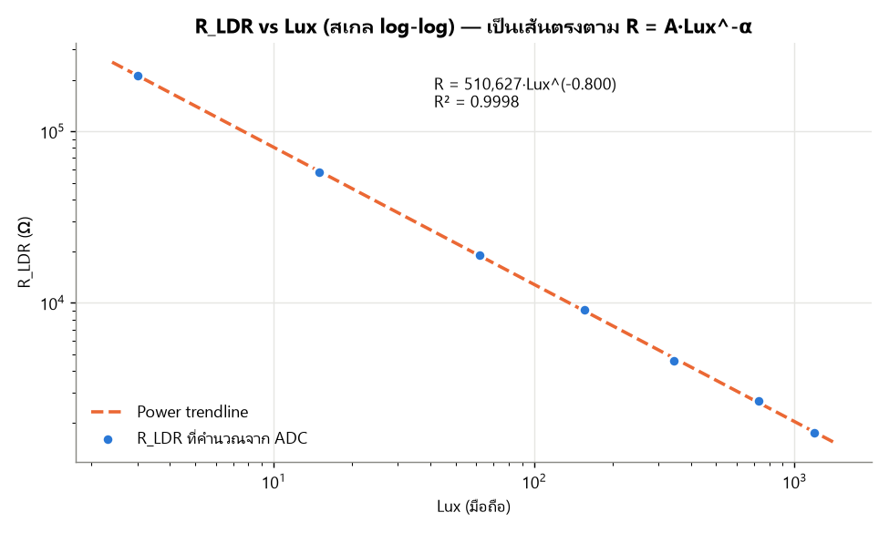
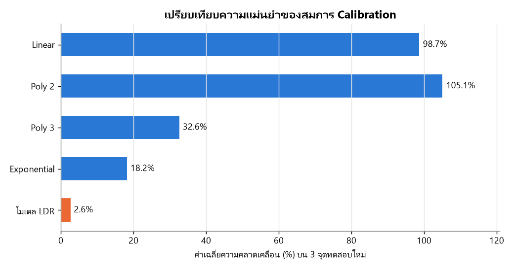

# **ใบงานปฏิบัติการ: การใช้งาน LDR และการทำ Calibration**



## **วัตถุประสงค์ของใบงาน**

1. เข้าใจหลักการทำงานของ LDR (Light Dependent Resistor)
2. ต่อวงจร Voltage Divider เพื่ออ่านค่าแสง
3. อ่านค่า ADC จากบอร์ดไมโครคอนโทรลเลอร์
4. เก็บข้อมูลจริง (ADC vs Lux จากมือถือ)
5. ทำกราฟความสัมพันธ์
6. สร้างสมการ Calibration เพื่อแปลง ADC → Lux
7. ทดสอบความแม่นยำหลัง Calibration

# **ส่วนที่ 1 — ความรู้พื้นฐาน**

## **1.1 LDR คืออะไร**




LDR (Light Dependent Resistor) หรือ Photoresistor คืออุปกรณ์อิเล็กทรอนิกส์ชนิดหนึ่งที่มี **ค่าความต้านทานเปลี่ยนตามความเข้มของแสง** ที่ตกกระทบ

- **แสงมาก → ความต้านทานลดลง**
- **แสงน้อย → ความต้านทานเพิ่มขึ้น**

LDR จึงเหมาะสำหรับงานตรวจจับความสว่าง เช่น ระบบเปิดไฟอัตโนมัติ, ระบบวัดแสง, ระบบควบคุมหน้าจอ, ระบบความปลอดภัย ฯลฯ


## **1.2 โครงสร้างและหลักการทำงานภายใน**

LDR ทำจากสารกึ่งตัวนำ เช่น **Cadmium Sulfide (CdS)** หรือ **Cadmium Selenide (CdSe)**
### เมื่อมีแสงตกกระทบ:
1. โฟตอนของแสงกระตุ้นอิเล็กตรอนในสารกึ่งตัวนำ
2. อิเล็กตรอนหลุดจากแถบวาเลนซ์ไปยังแถบคอนดักชัน
3. จำนวนผู้พาไฟฟ้าเพิ่มขึ้น
4. ความต้านทานลดลง

### เมื่อไม่มีแสง:

- อิเล็กตรอนกลับสู่สภาวะปกติ
- ผู้พาไฟฟ้าลดลง
- ความต้านทานเพิ่มขึ้นมาก (อาจถึงหลายร้อย kΩ)

##  **1.3 พฤติกรรมเชิงคณิตศาสตร์ (Transfer Function)**

ความสัมพันธ์ระหว่าง **ความต้านทานของ LDR (R_LDR)** กับ **ความเข้มแสง (Lux)** ไม่เป็นเส้นตรง แต่เป็นแบบ **Exponential / Power Law**

### **สมการทั่วไปของ LDR**


$$R_{LDR}=A⋅(Lux)^{−α}
$$

โดย
	
	$A$ = ค่าคงที่ขึ้นกับรุ่นของ LDR

	$α$ = ค่าคงที่ (ประมาณ 0.7–0.9)
	
	$Lux$ = ความเข้มแสง

ความหมายคือ:
- เมื่อ Lux เพิ่มขึ้น → R ลดลงแบบโค้ง
- ไม่ใช่ความสัมพันธ์เชิงเส้น

เพื่ออ่านค่า LDR ต้องใช้วงจร **Voltage Divider** เพื่อแปลงความต้านทาน → แรงดัน → ADC อ่านได้

##  **1.4 ทำไมต้องใช้ Voltage Divider**

LDR ให้ “ความต้านทาน” แต่ไมโครคอนโทรลเลอร์อ่าน “แรงดัน” ดังนั้นต้องใช้วงจร **Voltage Divider** เพื่อแปลง R → V

### วงจร Voltage Divider


 **สมการแรงดันที่อ่านได้**


$$V_{out}=V_{cc}⋅\frac{R_{fixed}}{R_{LDR}+R_{fixed}}
$$

เมื่อ:

- $R_{LDR}$ ลดลง (แสงมาก) → $V_{out}$ เพิ่มขึ้น

- $R_{LDR}$ เพิ่มขึ้น (แสงน้อย) → $V_{out}$ ลดลง

## **1.5 ช่วงค่าความต้านทานของ LDR**

ค่าทั่วไปของ LDR

| สภาพแสง  | ความต้านทาน   |
| -------- | ------------- |
| มืดสนิท  | 200 kΩ – 2 MΩ |
| ห้องปกติ | 10 kΩ – 50 kΩ |
| ใต้โคมไฟ | 2 kΩ – 10 kΩ  |
| กลางแจ้ง | 200 Ω – 2 kΩ  |

## **1.6 คำนวณแรงดันเอาต์พุตจากวงจร**

| สภาพแสง  | ความต้านทาน   | แรงดันเอาต์พุต (โวลต์) |
| -------- | ------------- | ---------------------- |
| มืดสนิท  | 200 kΩ – 2 MΩ | 0.016 – 0.157 V        |
| ห้องปกติ | 10 kΩ – 50 kΩ | 0.550 – 1.650 V        |
| ใต้โคมไฟ | 2 kΩ – 10 kΩ  | 1.650 – 2.750 V        |
| กลางแจ้ง | 200 Ω – 2 kΩ  | 2.750 – 3.235 V        |

**วิธีคำนวณ** ($V_{cc}$ = 3.3 V, $R_{fixed}$ = 10 kΩ) เช่น ห้องปกติ ที่ $R_{LDR}$ = 50 kΩ

$$V_{out}=3.3⋅\frac{10k}{50k+10k}=0.550\ V$$

และที่ $R_{LDR}$ = 10 kΩ → $V_{out}$ = 3.3 · 10k / 20k = 1.650 V

> สังเกต: ช่วง "มืดสนิท" แรงดันต่ำมาก (ADC ≈ 20–195) และช่วง "กลางแจ้ง" แรงดันเข้าใกล้ 3.3 V (ADC ≈ 3413–4015) แปลว่าที่ปลายทั้งสองข้างค่า ADC เปลี่ยนน้อยเมื่อแสงเปลี่ยนมาก → ความละเอียดในการวัดลดลง (ตารางคำนวณอยู่ในชีต `1.6 Vout` ของไฟล์ [LDR_Calibration.xlsx](Lab-Results/LDR_Calibration.xlsx))


---
# **ส่วนที่ 2 — การต่อวงจร**

## **อุปกรณ์ที่ใช้**

- LDR
- R คงที่ 10 kΩ
- บอร์ด ESP32 / Arduino
- สาย Jumper
- แอปวัดแสงในมือถือ (Lux Meter)

## **วงจร Voltage Divider**


**เหตุผลที่ใช้ R 10kΩ:** เป็นค่าที่เหมาะสมสำหรับ LDR ทั่วไป ทำให้แรงดันอยู่ในช่วงที่ ADC อ่านได้ดี

## **ส่วนที่ 3 — การอ่านค่า ADC**

ตัวอย่างโค้ด ESP32 (ADC 12-bit)

```c
#include <stdio.h>
#include "driver/adc.h"
#include "esp_adc_cal.h"
#include "esp_log.h"

#define ADC_CHANNEL     ADC1_CHANNEL_6   // GPIO34
#define ADC_ATTEN       ADC_ATTEN_DB_11  // รองรับ ~3.3V
#define ADC_WIDTH       ADC_WIDTH_BIT_12 // 0–4095

static esp_adc_cal_characteristics_t adc_chars;

void app_main(void)
{
    // 1) ตั้งค่า ADC
    adc1_config_width(ADC_WIDTH);
    adc1_config_channel_atten(ADC_CHANNEL, ADC_ATTEN);

    // 2) ทำ Calibration (ใช้ค่า Vref = 1100mV)
    esp_adc_cal_characterize(
        ADC_UNIT_1,
        ADC_ATTEN,
        ADC_WIDTH,
        1100,              // ค่า Vref ของ ESP32 โดยประมาณ
        &adc_chars
    );

    while (1) {
        // 3) อ่านค่า ADC raw
        int raw = adc1_get_raw(ADC_CHANNEL);
        // 4) แปลงเป็นแรงดัน (mV)
        uint32_t voltage = esp_adc_cal_raw_to_voltage(raw, &adc_chars);
        printf("ADC Raw = %d, Voltage = %d mV\n", raw, voltage);
        vTaskDelay(pdMS_TO_TICKS(500));
    }
}
```

ค่าที่อ่านได้ (12 bit) จะอยู่ในช่วง **0–4095** 

## **ส่วนที่ 4 — การเก็บข้อมูลเพื่อทำ Calibration**

ให้นักศึกษาทำ 5–7 จุดวัด โดยใช้มือถือวัดค่า Lux เทียบกับ LDR โดยเปลี่ยนสภาพแสง ให้มีความแตกต่างกัน

**ตัวอย่างข้อมูล**

| สภาพแสง  | ค่า ADC | ค่า Lux (มือถือ) |
| -------- | ------- | ---------------- |
| มืดมาก   | 300     | 5                |
| มืด      | 450     | 20               |
| ห้องปกติ | 1200    | 150              |
| ใต้โคมไฟ | 2200    | 350              |
| กลางแจ้ง | 3500    | 1200             |

**เป้าหมาย:** สร้างกราฟ ADC → Lux เพื่อหาความสัมพันธ์

### ✍️ ผลการทดลอง — ข้อมูล Calibration (7 จุด)

> ⚠️ **หมายเหตุ:** ข้อมูลชุดนี้เป็น **ข้อมูลจำลอง (simulation)** เพราะไม่มีเซนเซอร์ LDR จริงตอนทำใบงาน
> จำลองจากแบบจำลองวงจรจริง: LDR $R = A⋅Lux^{-0.8}$ (80 kΩ ที่ 10 lux) + R 10 kΩ, $V_{cc}$ = 3.3 V, ADC 12-bit
> ใส่ noise ของ ADC (SD ≈ 12 count) และความคลาดเคลื่อนของแอปมือถือ (±3 %) — สคริปต์อยู่ที่ [Lab-Results/ldr_calibration.py](Lab-Results/ldr_calibration.py)

แต่ละจุดอ่านค่า ADC 10 ครั้ง (ห่างกัน 500 ms) แล้วหาค่าเฉลี่ย (ข้อมูลดิบอยู่ในชีต `Raw Data`)

| สภาพแสง                     | ค่า ADC (เฉลี่ย) | SD   | ค่า Lux (มือถือ) | R_LDR ที่คำนวณได้ (Ω) |
| --------------------------- | ---------------- | ---- | ---------------- | --------------------- |
| มืดมาก (ปิดไฟ ปิดผ้าม่าน)   | 185              | 10.3 | 3                | 211,351               |
| มืด (ในลิ้นชัก)             | 601              | 6.9  | 15               | 58,136                |
| ห้องแสงสลัว                 | 1410             | 13.0 | 62               | 19,043                |
| ห้องปกติ (ไฟเพดาน)          | 2137             | 9.1  | 156              | 9,162                 |
| ใต้โคมไฟโต๊ะ                | 2808             | 15.5 | 345              | 4,583                 |
| ข้างหน้าต่าง                | 3226             | 9.8  | 727              | 2,694                 |
| กลางแจ้ง (ในร่ม)            | 3488             | 14.0 | 1194             | 1,740                 |

$R_{LDR}$ คำนวณย้อนจากสมการ Voltage Divider: $R_{LDR}=R_{fixed}⋅\left(\frac{4095}{ADC}-1\right)$

## **ส่วนที่ 5 — การทำกราฟ เพื่อหาสมการ**

ให้นักศึกษาใช้ Excel / Google Sheet
1. ใส่ข้อมูล ADC และ Lux
2. สร้างกราฟ Scatter
3. ใส่ Trendline
4. เลือก Linear หรือ Polynomial
5. ให้โปรแกรมแสดงสมการ

**ขั้นตอนการหาสมการ**
1. นำข้อมูลป้อนเข้าสู่ excel หรือ google sheet





2. เลือกข้อมูลเพื่อทำกราฟ scatter





3. แทรกกราฟ scatter




4. คลิกขวาที่เส้นกราฟ เลือก เพิ่มเส้นแนวโน้ม



5. ติ๊กที่ตัวเลือก 

	✅ แสดงสมการบนแผนภูมิ 

	✅ แสดงค่า R-squared บนแผนภูมิ

6. เลือกชนิดของกราฟ ที่ทำให้เส้นแนวโน้มทับเส้นข้อมูลมากที่สุด

	สังเกตุจากค่า R-squared ต้องเท่ากับ 1.000 หรือใกล้เคียงมากที่สุด

7. คัดลอกสมการ $y = ...$ ไปใช้ในโปรแกรม


สมมติว่า trend line ได้สมการเป็น $y = 0.42x-50$

แสดงว่ามีความชันของเส้นกราฟเป็น $m=0.42$ และมีจุดตัดแกน $y$  ที่ $b = -50$ ให้เขียน code แบบนี้

```c
Lux = 0.42 × ADC – 50
```

หรือถ้ากราฟไม่เป็นเส้นตรง  ให้ใช้ Polynomial เช่น สมมติว่าได้สมการเป็น $y = 0.0001 × x^2 + 0.3 x – 40$ ให้เขียน code แบบนี้

```c
Lux = 0.0001 × ADC^2 + 0.3 × ADC – 40
```

### ✍️ ผลการทดลอง — กราฟและสมการ Calibration

ทำกราฟ Scatter + Trendline ใน Excel ครบทุกแบบ (ชีต `Calibration` ในไฟล์ [LDR_Calibration.xlsx](Lab-Results/LDR_Calibration.xlsx))



| Trendline               | สมการ (x = ADC, y = Lux)                                       | R²     |
| ----------------------- | -------------------------------------------------------------- | ------ |
| Linear                  | $y = 0.2961x - 228.69$                                         | 0.7253 |
| Polynomial อันดับ 2     | $y = 1.8836×10^{-4}x^2 - 0.3998x + 142.18$                     | 0.9371 |
| **Polynomial อันดับ 3** | $y = 1.1190×10^{-7}x^3 - 4.3249×10^{-4}x^2 + 0.5060x - 106.25$ | **0.9881** |
| Exponential             | $y = 3.9530⋅e^{0.0016514x}$                                    | 0.9750 |

- **Linear ใช้ไม่ได้** (R² = 0.73) เพราะความสัมพันธ์ ADC → Lux โค้งชันขึ้นมากตอนแสงจ้า
- ในกลุ่มที่ใบงานแนะนำ (Linear / Polynomial) **Polynomial อันดับ 3 ให้ R² ใกล้ 1 ที่สุด (0.9881)**
- ข้อควรระวัง: Polynomial อันดับ 3 มี "หลังเต่า" ช่วง ADC 600–1700 (เส้นโค้งขึ้นลง) ทำให้ช่วงแสงน้อยยังเพี้ยน



**ต่อยอด — ใช้สมการ LDR จากส่วน 1.3 โดยตรง:** คำนวณ $R_{LDR}$ จาก ADC แล้วทำกราฟ $R_{LDR}$ vs Lux ด้วย Trendline แบบ **Power (ยกกำลัง)** บนสเกล log-log จะได้เส้นตรงเกือบสมบูรณ์

$$R_{LDR} = 510{,}627⋅Lux^{-0.8001} \qquad (R^2 = 0.9998)$$

ได้ $α ≈ 0.80$ ตรงกับช่วง 0.7–0.9 ในทฤษฎี แล้วกลับสมการเพื่อหา Lux:

$$Lux = \left(\frac{R_{LDR}}{A}\right)^{-1/α},\qquad R_{LDR}=10000⋅\left(\frac{4095}{ADC}-1\right)$$



## **ส่วนที่ 6 — การทำ Calibration ในโค้ด**

ตัวอย่างแบบ Linear Fit

```c
float lux = 0.42 * raw - 50;
```

ตัวอย่างแบบ Polynomial:

```c
float lux = 0.0001 * raw * raw + 0.3 * raw - 40;
```

**หมายเหตุ** 

Code ที่ใช้ สามารถ reuse code  จากการ calibrate ค่ามุมในการทดลองที่แล้วได้

### ✍️ ผลการทดลอง — โค้ดที่ใช้

โปรเจกต์ ESP-IDF อยู่ที่ [LDR_Calibration/main/main.c](LDR_Calibration/main/main.c)
(ESP-IDF v6.x ไม่มี `driver/adc.h` / `esp_adc_cal.h` แบบในส่วนที่ 3 แล้ว จึงใช้ `adc_oneshot` + `adc_cali` แทน หลักการเหมือนเดิม)
โค้ดอ่าน ADC 10 ครั้งแล้วเฉลี่ย จากนั้นแปลงเป็น Lux ทั้ง 3 สมการเพื่อเปรียบเทียบ ส่วนที่เป็น Calibration คือ

```c
// Polynomial อันดับ 3 (R² = 0.9881)
float lux = 1.1190482e-07f*adc*adc*adc - 4.3248733e-04f*adc*adc + 0.50596726f*adc - 106.24519f;

// Exponential (R² = 0.9750)
float lux = 3.9529574f * expf(1.6513851e-03f * adc);

// โมเดล LDR: R = A·Lux^-α  (R² = 0.9998)  ← ใช้ตัวนี้เป็นค่าหลัก
float r_ldr = 10000.0f * (4095.0f / adc - 1.0f);
float lux   = powf(r_ldr / 510626.9f, -1.0f / 0.8000936f);
```

build / flash:

```bash
cd LDR_Calibration
idf.py set-target esp32
idf.py build flash monitor
```


## **ส่วนที่ 7 — การทดสอบผลลัพธ์**

ให้นักศึกษาทดสอบ 3 จุดแสงใหม่ที่ไม่ได้ใช้ตอนเก็บข้อมูล เช่น:

| สภาพแสงใหม่ | ADC  | Lux มือถือ | Lux จากโค้ด |
| ----------- | ---- | ---------- | ----------- |
| ใต้โต๊ะ     | 600  | 40         | 38          |
| ห้องเรียน   | 1500 | 180        | 175         |
| หน้าต่าง    | 2800 | 500        | 520         |

ให้นักศึกษาวิเคราะห์ว่า

- ความคลาดเคลื่อนอยู่ในระดับที่ยอมรับได้หรือไม่
- สมการ Linear หรือ Polynomial เหมาะกว่ากัน

### ✍️ ผลการทดลอง — ทดสอบ 3 จุดแสงใหม่ (ข้อมูลจำลอง)

| สภาพแสงใหม่        | ADC  | Lux มือถือ | Lux (Linear) | Lux (Poly 2) | Lux (Poly 3) | Lux (Exp) | Lux (โมเดล LDR) |
| ------------------ | ---- | ---------- | ------------ | ------------ | ------------ | --------- | --------------- |
| ใต้โต๊ะ            | 1126 | 40         | 104.7        | −69.2        | 74.9         | 25.4      | **40.6**        |
| ห้องเรียน          | 2542 | 242        | 524.1        | 343.0        | 223.4        | 263.0     | **252.6**       |
| หน้าต่าง (แดดอ่อน) | 3361 | 931        | 766.6        | 926.2        | 957.5        | 1017.2    | **913.6**       |

**ความคลาดเคลื่อน (%Error = |Lux โค้ด − Lux มือถือ| / Lux มือถือ)**

| สภาพแสงใหม่        | Linear | Poly 2 | Poly 3 | Exp   | โมเดล LDR |
| ------------------ | ------ | ------ | ------ | ----- | --------- |
| ใต้โต๊ะ            | 161.9% | 273.0% | 87.2%  | 36.6% | **1.5%**  |
| ห้องเรียน          | 116.6% | 41.7%  | 7.7%   | 8.7%  | **4.4%**  |
| หน้าต่าง (แดดอ่อน) | 17.7%  | 0.5%   | 2.8%   | 9.3%  | **1.9%**  |
| **เฉลี่ย (MAPE)**  | 98.7%  | 105.1% | 32.6%  | 18.2% | **2.6%**  |



**วิเคราะห์ผล**

1. **ความคลาดเคลื่อนยอมรับได้หรือไม่**
   - **Linear: ยอมรับไม่ได้** ผิดเฉลี่ย ~99% ที่แสงน้อยให้ค่าเกินจริงเกือบ 3 เท่า
   - **Polynomial อันดับ 2: ยอมรับไม่ได้** ที่ใต้โต๊ะได้ Lux **ติดลบ** (−69) ซึ่งเป็นไปไม่ได้ทางฟิสิกส์ แม้ที่หน้าต่างจะแม่นมาก (0.5%)
   - **Polynomial อันดับ 3: ยอมรับได้เฉพาะช่วงแสงปานกลาง–มาก** (ผิด 3–8%) แต่ช่วงแสงน้อยยังผิด 87% เพราะเส้นโค้งมี "หลังเต่า" ช่วง ADC ต่ำ
   - **โมเดล LDR: ยอมรับได้ทุกช่วง** ผิดไม่เกิน 5% (เฉลี่ย 2.6%) ใกล้เคียงความแม่นของแอปมือถือเอง (±3%)
2. **Linear หรือ Polynomial เหมาะกว่ากัน** → **Polynomial เหมาะกว่า Linear ชัดเจน** (R² 0.988 vs 0.725) เพราะ LDR เป็นความสัมพันธ์แบบ Power law ไม่ใช่เส้นตรง (ส่วน 1.3) และวงจร Voltage Divider ทำให้ ADC อิ่มตัวเข้าหา 4095 ตอนแสงจ้า ข้อมูลจึงโค้งชันขึ้นมาก
3. แต่ **สมการที่ดีที่สุดคือสมการที่ตรงกับฟิสิกส์ของเซนเซอร์** — แปลง ADC → $R_{LDR}$ → Lux ด้วย $R = A⋅Lux^{-α}$ ใช้แค่ 2 ค่าคงที่ ไม่แกว่งนอกจุดข้อมูล และกำหนดค่าได้ทั่วทั้งช่วง
4. **สาเหตุความคลาดเคลื่อน**: noise ของ ADC (SD 7–16 count), ความคลาดเคลื่อนของเซนเซอร์แสงในมือถือ (ตำแหน่ง/มุมไม่ตรงกับ LDR), ความไม่เป็นเชิงเส้นของ ADC ESP32 ที่ปลายช่วง, และความละเอียดที่ลดลงตอนแสงจ้า (ADC ใกล้ 4095 เปลี่ยนนิดเดียว Lux เปลี่ยนเยอะ)
5. **R² สูงไม่ได้แปลว่าแม่นเสมอ** — Poly 3 มี R² = 0.988 แต่ทดสอบจุดใหม่ผิด 87% ต้องทดสอบด้วยจุดที่ไม่ได้ใช้ fit เสมอ

## **ส่วนที่ 8 — คำถามท้ายใบงาน**

1. ทำไมต้องใช้ Voltage Divider ในการอ่าน LDR?
2. ทำไมต้องเก็บข้อมูลหลายจุดก่อนทำ Calibration?
3. ถ้า Noise มากกว่าสัญญาณจริง จะเกิดอะไรขึ้น?
4. ทำไมการวางตำแหน่งเซนเซอร์จึงสำคัญต่อ Signal Integrity?
5. ถ้า ADC มี Resolution ต่ำ จะส่งผลอย่างไรต่อความแม่นยำ?

### ✍️ คำตอบ

1. **ทำไมต้องใช้ Voltage Divider** — LDR เปลี่ยนแปลง "ความต้านทาน" แต่ ADC ของไมโครคอนโทรลเลอร์วัดได้แค่ "แรงดัน" จึงต้องต่อ LDR อนุกรมกับ R คงที่ 10 kΩ เพื่อแปลงการเปลี่ยน R เป็นการเปลี่ยนแรงดัน $V_{out}=V_{cc}⋅R_{fixed}/(R_{LDR}+R_{fixed})$ ทั้งยังจำกัดกระแสและทำให้แรงดันอยู่ในช่วง 0–3.3 V ที่ ADC รับได้ เลือก 10 kΩ เพราะใกล้กับค่า $R_{LDR}$ ในห้องปกติ ทำให้แรงดันเปลี่ยนไวที่สุดช่วงนั้น
2. **ทำไมต้องเก็บข้อมูลหลายจุด** — ความสัมพันธ์ ADC–Lux ไม่เป็นเส้นตรง ถ้ามีแค่ 2 จุดจะได้เส้นตรงที่ผิดเกือบทั้งช่วง ต้องมีหลายจุดกระจายตั้งแต่มืดถึงสว่างเพื่อให้เห็นรูปร่างกราฟ เลือกชนิด Trendline ได้ถูก หาค่า R² ได้ และลดผลจาก noise ของแต่ละจุด (เหมือนในการทดลองที่ Linear ได้ R² แค่ 0.73)
3. **ถ้า Noise มากกว่าสัญญาณจริง** — (SNR < 1) ค่า ADC จะแกว่งมากจนแยกไม่ออกว่าแสงเปลี่ยนจริงหรือเป็น noise ค่า Lux ที่คำนวณจะกระโดดไปมา สมการ Calibration ที่ได้ก็ผิด เพราะ fit ไปกับ noise แก้โดยเฉลี่ยหลายครั้ง (โค้ดเฉลี่ย 10 ครั้ง), ใช้ตัวเก็บประจุกรอง, สายสั้น, ต่อกราวด์ให้ดี
4. **ทำไมตำแหน่งเซนเซอร์สำคัญต่อ Signal Integrity** — สายยาวจะรับสัญญาณรบกวน (crosstalk, EMI จากสายไฟ AC/มอเตอร์) และมี voltage drop, ground loop ถ้าอยู่ใกล้แหล่งแสงอื่น/เงาก็วัดแสงไม่ตรงกับจุดที่ต้องการ ในการ Calibration ต้องวาง LDR กับเซนเซอร์มือถือใกล้กันและหันทิศเดียวกัน ไม่งั้นค่าอ้างอิงจะไม่ตรงกัน
5. **ถ้า ADC Resolution ต่ำ** — แต่ละขั้นของ ADC กว้างขึ้น (12-bit: 3.3/4096 ≈ 0.8 mV, 8-bit: 3.3/256 ≈ 12.9 mV) ทำให้การเปลี่ยนแปลงแสงเล็ก ๆ ไม่ถูกตรวจจับ (quantization error) โดยเฉพาะช่วงแสงจ้าที่ ADC เข้าใกล้ค่าสูงสุด เช่น จากสมการที่ได้ ที่ ~1200 Lux ADC 12-bit 1 ขั้น ≈ 3 Lux แต่ถ้าเป็น 8-bit 1 ขั้น (= 16 ขั้นของ 12-bit) ≈ 50 Lux ความแม่นยำหลัง Calibration จึงลดลงมาก ต่อให้สมการดีแค่ไหนก็แก้ไม่ได้

## **ส่วนที่ 9 — ผลลัพธ์ที่คาดหวัง**

ผู้เรียนจะสามารถ:
- ต่อวงจร LDR ได้อย่างถูกต้อง
- อ่านค่า ADC ได้
- เก็บข้อมูลจริงและสร้างกราฟความสัมพันธ์
- ทำ Calibration เพื่อแปลง ADC → Lux
- ประเมินความแม่นยำของระบบวัดแสงที่สร้างขึ้นเอง

## **ส่วนที่ 10 —  Rubric ประเมินตนเอง**

### **ส่วนที่ 10.1 — ความเข้าใจพื้นฐาน LDR (20 คะแนน)**

| ข้อ | รายการ                                                         | คะแนน<br>(0–5 คะแนน) | เหตุผล |
| --- | -------------------------------------------------------------- | -------------------- | ------ |
| 1.1 | อธิบายหลักการทำงานของ LDR ได้ถูกต้อง                           |                      |        |
| 1.2 | อธิบายการทำงานภายใน LDR (โฟตอน → อิเล็กตรอน → conduction band) |                      |        |
| 1.3 | เข้าใจว่าความสัมพันธ์ R vs Lux ไม่เป็นเส้นตรง                  |                      |        |
| 1.4 | เข้าใจเหตุผลที่ต้องใช้ Voltage Divider                         |                      |        |

### **ส่วนที่ 10.2 — การต่อวงจรและอ่านค่า ADC (20 คะแนน)**

| ข้อ | รายการ                              | คะแนน<br>(0–5 คะแนน) | เหตุผล |
| --- | ----------------------------------- | -------------------- | ------ |
| 2.1 | ต่อวงจร Voltage Divider ได้ถูกต้อง  |                      |        |
| 2.2 | เลือกค่า R คงที่เหมาะสม (เช่น 10kΩ) |                      |        |
| 2.3 | เขียนโปรแกรมอ่านค่า ADC ได้ถูกต้อง  |                      |        |
| 2.4 | ใช้ ESP‑IDF ADC + Calibration ได้   |                      |        |

### **ส่วนที่ 10.3 — การเก็บข้อมูลจริง (20 คะแนน)**

| ข้อ | รายการ                             | คะแนน<br>(0–5 คะแนน) | เหตุผล |
| --- | ---------------------------------- | -------------------- | ------ |
| 3.1 | เก็บข้อมูล ADC อย่างน้อย 5–7 จุด   |                      |        |
| 3.2 | วัดค่า Lux จากมือถือได้ถูกต้อง     |                      |        |
| 3.3 | จดข้อมูลเป็นตารางครบถ้วน           |                      |        |
| 3.4 | ควบคุมสภาพแสงให้คงที่ระหว่างการวัด |                      |        |


### **ส่วนที่ 10.4 — การทำกราฟและสร้างสมการ Calibration (25 คะแนน)**

| ข้อ | รายการ                                        | คะแนน<br>(0–5 คะแนน) | เหตุผล |
| --- | --------------------------------------------- | -------------------- | ------ |
| 4.1 | สร้างกราฟ Scatter ADC vs Lux ได้              |                      |        |
| 4.2 | เลือก Trendline เหมาะสม (Linear / Polynomial) |                      |        |
| 4.3 | อ่านสมการจากกราฟได้ถูกต้อง                    |                      |        |
| 4.4 | นำสมการไปใช้ในโค้ดได้                         |                      |        |
| 4.5 | วิเคราะห์ว่า Linear หรือ Polynomial เหมาะกว่า |                      |        |
### **ส่วนที่ 10.5 — การทดสอบผลลัพธ์และวิเคราะห์ (15 คะแนน)**

| ข้อ | รายการ                                   | คะแนน<br>(0–5 คะแนน) | เหตุผล |
| --- | ---------------------------------------- | -------------------- | ------ |
| 5.1 | ทดสอบจุดแสงใหม่ที่ไม่ได้ใช้ตอนเก็บข้อมูล |                      |        |
| 5.2 | เปรียบเทียบ Lux มือถือ vs Lux จากโค้ด    |                      |        |
| 5.3 | วิเคราะห์ความคลาดเคลื่อนและสาเหตุได้     |                      |        |
.................................................................

###  **คะแนนรวมทั้งหมด:** `______ / 100`

###  **คำถามสะท้อนความเข้าใจ (Reflection)**

ให้นักศึกษาเขียนตอบสั้น ๆ

1. จุดไหนในใบงานที่คิดว่ายากที่สุด? ......................................................................................
    
2. ถ้าทำใบงานนี้อีกครั้ง จะปรับปรุงอะไร? ......................................................................................
    
3. ส่วนไหนที่คิดว่าตนเองเข้าใจดีมาก? ......................................................................................

