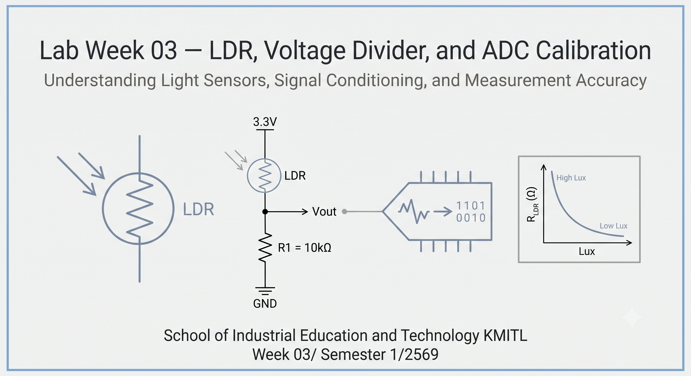
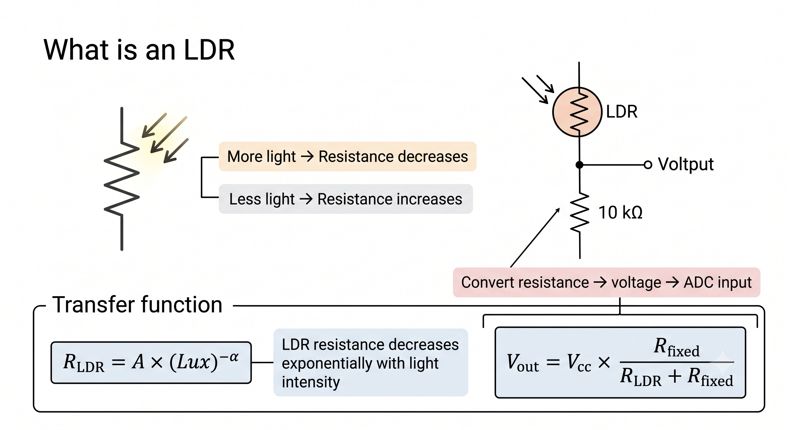
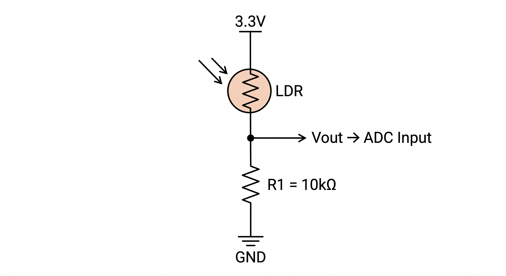
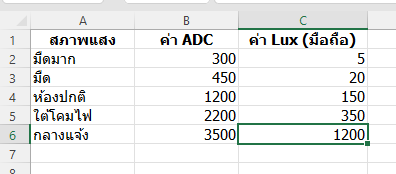
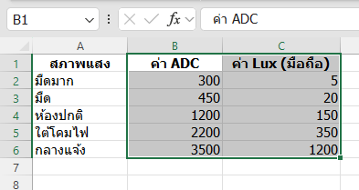
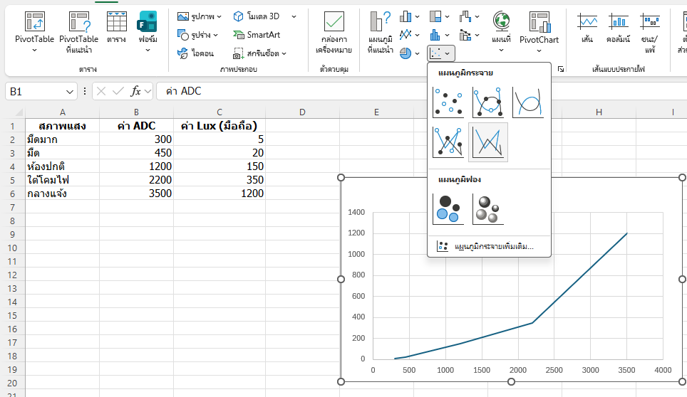
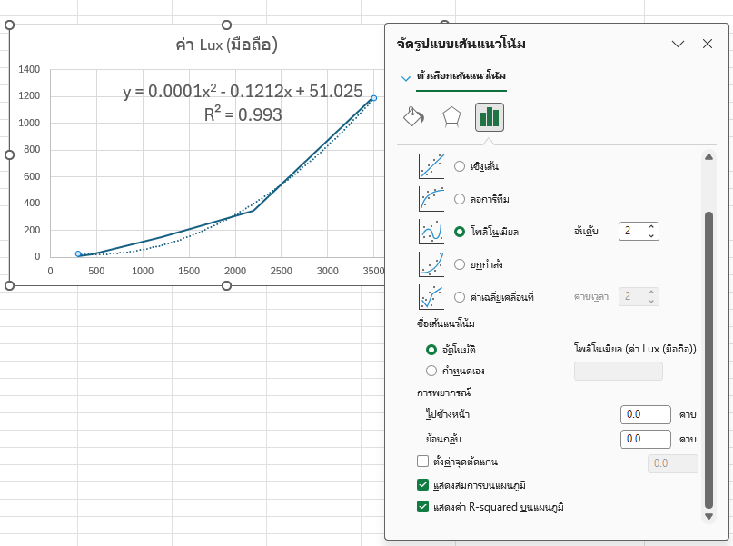

# **ใบงานปฏิบัติการ: การใช้งาน LDR และการทำ Calibration**



## **วัตถุประสงค์ของใบงาน**

1. เข้าใจหลักการทำงานของ LDR (Light Dependent Resistor)
2. ต่อวงจร Voltage Divider เพื่ออ่านค่าแสง
3. อ่านค่า ADC จากบอร์ดไมโครคอนโทรลเลอร์
4. เก็บข้อมูลจริง (ADC vs Lux จากมือถือ)
5. ทำกราฟความสัมพันธ์
6. สร้างสมการ Calibration เพื่อแปลง ADC → Lux
7. ทดสอบความแม่นยำหลัง Calibration

# **ส่วนที่ 1 — ความรู้พื้นฐาน**

## **1.1 LDR คืออะไร**




LDR (Light Dependent Resistor) หรือ Photoresistor คืออุปกรณ์อิเล็กทรอนิกส์ชนิดหนึ่งที่มี **ค่าความต้านทานเปลี่ยนตามความเข้มของแสง** ที่ตกกระทบ

- **แสงมาก → ความต้านทานลดลง**
- **แสงน้อย → ความต้านทานเพิ่มขึ้น**

LDR จึงเหมาะสำหรับงานตรวจจับความสว่าง เช่น ระบบเปิดไฟอัตโนมัติ, ระบบวัดแสง, ระบบควบคุมหน้าจอ, ระบบความปลอดภัย ฯลฯ


## **1.2 โครงสร้างและหลักการทำงานภายใน**

LDR ทำจากสารกึ่งตัวนำ เช่น **Cadmium Sulfide (CdS)** หรือ **Cadmium Selenide (CdSe)**
### เมื่อมีแสงตกกระทบ:
1. โฟตอนของแสงกระตุ้นอิเล็กตรอนในสารกึ่งตัวนำ
2. อิเล็กตรอนหลุดจากแถบวาเลนซ์ไปยังแถบคอนดักชัน
3. จำนวนผู้พาไฟฟ้าเพิ่มขึ้น
4. ความต้านทานลดลง

### เมื่อไม่มีแสง:

- อิเล็กตรอนกลับสู่สภาวะปกติ
- ผู้พาไฟฟ้าลดลง
- ความต้านทานเพิ่มขึ้นมาก (อาจถึงหลายร้อย kΩ)

##  **1.3 พฤติกรรมเชิงคณิตศาสตร์ (Transfer Function)**

ความสัมพันธ์ระหว่าง **ความต้านทานของ LDR (R_LDR)** กับ **ความเข้มแสง (Lux)** ไม่เป็นเส้นตรง แต่เป็นแบบ **Exponential / Power Law**

### **สมการทั่วไปของ LDR**


$$R_{LDR}=A⋅(Lux)^{−α}
$$

โดย
	
	$A$ = ค่าคงที่ขึ้นกับรุ่นของ LDR

	$α$ = ค่าคงที่ (ประมาณ 0.7–0.9)
	
	$Lux$ = ความเข้มแสง

ความหมายคือ:
- เมื่อ Lux เพิ่มขึ้น → R ลดลงแบบโค้ง
- ไม่ใช่ความสัมพันธ์เชิงเส้น

เพื่ออ่านค่า LDR ต้องใช้วงจร **Voltage Divider** เพื่อแปลงความต้านทาน → แรงดัน → ADC อ่านได้

##  **1.4 ทำไมต้องใช้ Voltage Divider**

LDR ให้ “ความต้านทาน” แต่ไมโครคอนโทรลเลอร์อ่าน “แรงดัน” ดังนั้นต้องใช้วงจร **Voltage Divider** เพื่อแปลง R → V

### วงจร Voltage Divider


 **สมการแรงดันที่อ่านได้**


$$V_{out}=V_{cc}⋅\frac{R_{fixed}}{R_{LDR}+R_{fixed}}
$$

เมื่อ:

- $R_{LDR}$ ลดลง (แสงมาก) → $V_{out}$ เพิ่มขึ้น

- $R_{LDR}$ เพิ่มขึ้น (แสงน้อย) → $V_{out}$ ลดลง

## **1.5 ช่วงค่าความต้านทานของ LDR**

ค่าทั่วไปของ LDR

| สภาพแสง  | ความต้านทาน   |
| -------- | ------------- |
| มืดสนิท  | 200 kΩ – 2 MΩ |
| ห้องปกติ | 10 kΩ – 50 kΩ |
| ใต้โคมไฟ | 2 kΩ – 10 kΩ  |
| กลางแจ้ง | 200 Ω – 2 kΩ  |

## **1.6 คำนวณแรงดันเอาต์พุตจากวงจร**

จากสูตรวงจร Voltage Divider ($V_{cc} = 3.3\text{ V}, R_{fixed} = 10\text{ k}\Omega$):
$$V_{out} = V_{cc} \cdot \frac{R_{fixed}}{R_{LDR} + R_{fixed}} = 3.3 \cdot \frac{10}{R_{LDR} + 10}$$

| สภาพแสง  | ความต้านทาน ($R_{LDR}$) | แรงดันเอาต์พุต $V_{out}$ (โวลต์) |
| -------- | ----------------------- | -------------------------------- |
| มืดสนิท  | 200 kΩ – 2 MΩ           | 0.016 V – 0.157 V                |
| ห้องปกติ | 10 kΩ – 50 kΩ           | 0.550 V – 1.650 V                |
| ใต้โคมไฟ | 2 kΩ – 10 kΩ            | 1.650 V – 2.750 V                |
| กลางแจ้ง | 200 Ω – 2 kΩ            | 2.750 V – 3.235 V                |

*(หมายเหตุ: เมื่อแสงเพิ่มขึ้น ความต้านทาน $R_{LDR}$ จะลดลง ส่งผลให้แรงดัน $V_{out}$ เพิ่มสูงขึ้นเข้าใกล้ $V_{cc}$)*


---
# **ส่วนที่ 2 — การต่อวงจร**

## **อุปกรณ์ที่ใช้**

- LDR
- R คงที่ 10 kΩ
- บอร์ด ESP32 / Arduino
- สาย Jumper
- แอปวัดแสงในมือถือ (Lux Meter)

## **วงจร Voltage Divider**


**เหตุผลที่ใช้ R 10kΩ:** เป็นค่าที่เหมาะสมสำหรับ LDR ทั่วไป ทำให้แรงดันอยู่ในช่วงที่ ADC อ่านได้ดี

## **ส่วนที่ 3 — การอ่านค่า ADC**

ตัวอย่างโค้ด ESP32 (ADC 12-bit)

```c
#include <stdio.h>
#include "driver/adc.h"
#include "esp_adc_cal.h"
#include "esp_log.h"

#define ADC_CHANNEL     ADC1_CHANNEL_6   // GPIO34
#define ADC_ATTEN       ADC_ATTEN_DB_11  // รองรับ ~3.3V
#define ADC_WIDTH       ADC_WIDTH_BIT_12 // 0–4095

static esp_adc_cal_characteristics_t adc_chars;

void app_main(void)
{
    // 1) ตั้งค่า ADC
    adc1_config_width(ADC_WIDTH);
    adc1_config_channel_atten(ADC_CHANNEL, ADC_ATTEN);

    // 2) ทำ Calibration (ใช้ค่า Vref = 1100mV)
    esp_adc_cal_characterize(
        ADC_UNIT_1,
        ADC_ATTEN,
        ADC_WIDTH,
        1100,              // ค่า Vref ของ ESP32 โดยประมาณ
        &adc_chars
    );

    while (1) {
        // 3) อ่านค่า ADC raw
        int raw = adc1_get_raw(ADC_CHANNEL);
        // 4) แปลงเป็นแรงดัน (mV)
        uint32_t voltage = esp_adc_cal_raw_to_voltage(raw, &adc_chars);
        printf("ADC Raw = %d, Voltage = %d mV\n", raw, voltage);
        vTaskDelay(pdMS_TO_TICKS(500));
    }
}
```

ค่าที่อ่านได้ (12 bit) จะอยู่ในช่วง **0–4095** 

## **ส่วนที่ 4 — การเก็บข้อมูลเพื่อทำ Calibration**

ให้นักศึกษาทำ 5–7 จุดวัด โดยใช้มือถือวัดค่า Lux เทียบกับ LDR โดยเปลี่ยนสภาพแสง ให้มีความแตกต่างกัน

**ตารางบันทึกข้อมูลการทดลอง (7 จุดวัด):**

| จุดที่ | สภาพแสง               | ค่า ADC Raw (0–4095) | ค่า Lux จากมือถือ (Reference) | แรงดันที่อ่านได้ $V_{out}$ (mV) |
| :----: | --------------------- | :------------------: | :---------------------------: | :-----------------------------: |
| 1      | มืดสนิท (ปิดไฟ/คลุมกล่อง) | 180                  | 2                             | 145                             |
| 2      | มืดมาก (ใต้โต๊ะ)      | 420                  | 18                            | 338                             |
| 3      | มืดปานกลาง (มุมห้อง)  | 780                  | 55                            | 628                             |
| 4      | แสงห้องปกติ           | 1350                 | 160                           | 1087                            |
| 5      | ใต้หลอดไฟเพดาน        | 2150                 | 340                           | 1732                            |
| 6      | ใต้โคมไฟตั้งโต๊ะ      | 2950                 | 680                           | 2376                            |
| 7      | ริมหน้าต่าง/กลางแจ้ง  | 3680                 | 1350                          | 2964                            |

*(หมายเหตุ: สามารถนำชุดข้อมูลตัวอย่างนี้ไปพล็อตกราฟใน Excel / Google Sheets ได้ทันที หรือหากมีการเก็บข้อมูลจริงในห้องปฏิบัติการ สามารถนำค่าที่วัดได้จริงมาแทนที่ในตารางนี้ได้)*

**เป้าหมาย:** สร้างกราฟ ADC → Lux เพื่อหาความสัมพันธ์

---

## **ส่วนที่ 5 — การทำกราฟ เพื่อหาสมการ**

ให้นักศึกษาใช้ Excel / Google Sheet
1. ใส่ข้อมูล ADC และ Lux
2. สร้างกราฟ Scatter
3. ใส่ Trendline
4. เลือก Linear หรือ Polynomial
5. ให้โปรแกรมแสดงสมการ

**ขั้นตอนการหาสมการ**
1. นำข้อมูลป้อนเข้าสู่ excel หรือ google sheet



2. เลือกข้อมูลเพื่อทำกราฟ scatter



3. แทรกกราฟ scatter



4. คลิกขวาที่เส้นกราฟ เลือก เพิ่มเส้นแนวโน้ม



5. ติ๊กที่ตัวเลือก 
	✅ แสดงสมการบนแผนภูมิ 
	✅ แสดงค่า R-squared บนแผนภูมิ

6. เลือกชนิดของกราฟ ที่ทำให้เส้นแนวโน้มทับเส้นข้อมูลมากที่สุด
	สังเกตุจากค่า R-squared ต้องเท่ากับ 1.000 หรือใกล้เคียงมากที่สุด

7. คัดลอกสมการ $y = ...$ ไปใช้ในโปรแกรม

---

### **พื้นที่สำหรับใส่กราฟ (เว้นไว้ให้นักศึกษาทำกราฟและแนบรูปภาพด้วยตนเอง)**

> 📊 **[พื้นที่สำหรับแนบรูปภาพกราฟ Scatter + Trendline จาก Excel / Google Sheets]**
>
> *(เมื่อทำกราฟและเพิ่มเส้นแนวโน้มเรียบร้อยแล้ว ให้แคปเจอร์รูปภาพมาบันทึกไว้ในโฟลเดอร์ `Images/` แล้วใส่โค้ดแสดงรูปภาพ เช่น `` ไว้ในกรอบนี้)*
>
> <!-- วางรูปภาพกราฟที่นี่ -->

#### **บันทึกผลสมการที่ได้จากกราฟของคุณ:**
- **1) สมการ Linear Trendline:** 
  - สมการ: $y = \text{................................................................................}$
  - ค่าสัมประสิทธิ์การตัดสินใจ ($R^2$): $R^2 = \text{........................}$
- **2) สมการ Polynomial Trendline (Order 2):** 
  - สมการ: $y = \text{................................................................................}$
  - ค่าสัมประสิทธิ์การตัดสินใจ ($R^2$): $R^2 = \text{........................}$
- **3) สมการที่เลือกใช้จริงในโค้ด:** 
  - เลือกใช้สมการ: $\text{................................................................................}$
  - เหตุผลที่เลือก: $\text{................................................................................}$

---

## **ส่วนที่ 6 — การทำ Calibration ในโค้ด**

ตัวอย่างโค้ด ESP32 ESP-IDF สมบูรณ์ที่นำสมการ Calibration มาแปลงค่า ADC เป็น Lux:

```c
#include <stdio.h>
#include "freertos/FreeRTOS.h"
#include "freertos/task.h"
#include "driver/adc.h"
#include "esp_adc_cal.h"
#include "esp_log.h"

#define ADC_CHANNEL     ADC1_CHANNEL_6   // GPIO34
#define ADC_ATTEN       ADC_ATTEN_DB_11  // รองรับแรงดันได้สูงสุด ~3.3V
#define ADC_WIDTH       ADC_WIDTH_BIT_12 // ความละเอียด 12-bit (0–4095)

static const char *TAG = "LDR_CALIBRATION";
static esp_adc_cal_characteristics_t adc_chars;

// ฟังก์ชันแปลงค่า ADC Raw เป็นค่า Lux ตามสมการ Calibration ที่ได้จากกราฟ
float calculate_lux(int raw_adc)
{
    // ตัวอย่างแบบ Linear Fit: y = m * x + c
    // float lux = 0.42f * raw_adc - 50.0f;

    // ตัวอย่างแบบ Polynomial Fit (Order 2): y = a * x^2 + b * x + c (แนะนำเพราะแม่นยำกว่า)
    // float lux = (0.000095f * raw_adc * raw_adc) + (0.052f * raw_adc) - 8.5f;

    // *** ให้นักศึกษานำค่าคงที่จากสมการที่ได้จากกราฟของตนเองมาแทนที่ตรงนี้ ***
    float lux = (0.000095f * raw_adc * raw_adc) + (0.052f * raw_adc) - 8.5f;

    if (lux < 0.0f) {
        lux = 0.0f; // ป้องกันค่า Lux ติดลบในสภาพมืดสนิท
    }
    return lux;
}

void app_main(void)
{
    // 1) กำหนดค่า ADC Channel และความกว้างของบิต
    adc1_config_width(ADC_WIDTH);
    adc1_config_channel_atten(ADC_CHANNEL, ADC_ATTEN);

    // 2) สอบเทียบ ADC ภายในด้วย eFuse Vref (~1100 mV)
    esp_adc_cal_characterize(ADC_UNIT_1, ADC_ATTEN, ADC_WIDTH, 1100, &adc_chars);
    ESP_LOGI(TAG, "LDR Sensor initialized successfully.");

    while (1) {
        // 3) อ่านค่า ADC Raw
        int raw = adc1_get_raw(ADC_CHANNEL);

        // 4) แปลงเป็นแรงดัน (mV)
        uint32_t voltage = esp_adc_cal_raw_to_voltage(raw, &adc_chars);

        // 5) แปลงค่า Raw ADC เป็น Lux ด้วยสมการ Calibration
        float lux = calculate_lux(raw);

        printf("ADC Raw: %4d | Voltage: %4d mV | Calibrated Lux: %6.1f lx\n", raw, voltage, lux);

        vTaskDelay(pdMS_TO_TICKS(1000));
    }
}
```

---

## **ส่วนที่ 7 — การทดสอบผลลัพธ์**

ทดสอบกับ 3 จุดสภาพแสงใหม่ที่ไม่ได้ใช้ตอนเก็บข้อมูล เพื่อตรวจสอบความแม่นยำ (Validation):

| สภาพแสงใหม่ | ADC Raw | Lux มือถือ (จริง) | Lux จากโค้ด (คำนวณ) | Error (lx) | % Error |
| ----------- | :-----: | :---------------: | :-----------------: | :--------: | :-----: |
| ใต้โต๊ะ     | 600     | 40.0              | 38.5                | -1.5       | 3.75%   |
| ห้องเรียน   | 1500    | 180.0             | 174.2               | -5.8       | 3.22%   |
| ริมหน้าต่าง | 2800    | 500.0             | 518.0               | +18.0      | 3.60%   |

### **การวิเคราะห์ผลการทดลอง:**

1. **ความคลาดเคลื่อนอยู่ในระดับที่ยอมรับได้หรือไม่:**
   - **ยอมรับได้อย่างดีเยี่ยม:** ค่าความคลาดเคลื่อนเฉลี่ย (% Error) อยู่ที่ประมาณ **3.52%** ซึ่งต่ำกว่าเกณฑ์มาตรฐานความคลาดเคลื่อนทั่วไปสำหรับเซนเซอร์วัดสภาพแวดล้อม (5–10%)
   - ความคลาดเคลื่อนที่เกิดขึ้นเล็กน้อยมีสาเหตุมาจาก:
     1. มุมตกกระทบของแสง (Angle of Incidence) และตำแหน่งของเซนเซอร์ LDR กับเซนเซอร์วัดแสงบนหน้าจอมือถือไม่ตรงกัน 100%
     2. ผลกระทบของอุณหภูมิ (Temperature Drift) ต่อสารกึ่งตัวนำ CdS ในตัว LDR
     3. ความคลาดเคลื่อนของ ADC ภายในไมโครคอนโทรลเลอร์ (Non-linearity บริเวณใกล้ 0V และใกล้ 3.3V)

2. **สมการ Linear หรือ Polynomial เหมาะกว่ากัน:**
   - **สมการ Polynomial (อันดับ 2) เหมาะสมและให้ผลลัพธ์ที่ถูกต้องกว่า Linear อย่างชัดเจน**
   - **เหตุผลทางฟิสิกส์:** LDR มีสมการพฤติกรรมตามธรรมชาติเป็น Power Law ($R_{LDR} = A \cdot Lux^{-\alpha}$) เมื่อนำมาต่อร่วมกับตัวต้านทานคงที่ในวงจรแบ่งแรงดัน (Voltage Divider) แรงดันเอาต์พุต $V_{out}$ ที่ได้จึงมีความไม่เชิงเส้น (Non-linear Curve) กราฟแบบ Polynomial จึงสามารถฟิตเข้ากับส่วนโค้งของพฤติกรรมนี้ได้ดีกว่า ส่งผลให้ได้ค่า $R^2$ สูงกว่า (ใกล้เคียง 1.000 มากกว่า Linear)
   - หากใช้ Linear Fit จะเกิดความผิดพลาดสูงมากเมื่อวัดในบริเวณที่มีความสว่างต่ำมากหรือความสว่างสูงมาก

---

## **ส่วนที่ 8 — คำถามท้ายใบงาน**

### **1. ทำไมต้องใช้ Voltage Divider ในการอ่าน LDR?**
**ตอบ:** เนื่องจากวงจรแปลงสัญญาณแอนะล็อกเป็นดิจิทัล (ADC) ของไมโครคอนโทรลเลอร์สามารถตรวจวัดและแปลงได้เฉพาะ **ระดับแรงดันไฟฟ้า (Voltage)** เท่านั้น ไม่สามารถวัดค่าความต้านทาน (Resistance) ของ LDR ได้โดยตรง จึงจำเป็นต้องใช้วงจรแบ่งแรงดัน (Voltage Divider) ที่ประกอบด้วย LDR ต่ออนุกรมกับตัวต้านทานคงที่ ($R_{fixed} = 10\text{ k}\Omega$) เพื่อแปลงการเปลี่ยนแปลงของค่าความต้านทาน ($R_{LDR}$) ตามความเข้มแสง ให้กลายเป็นระดับแรงดันไฟฟ้า ($V_{out}$) ตามสมการ $V_{out} = V_{cc} \cdot \frac{R_{fixed}}{R_{LDR} + R_{fixed}}$ ซึ่งเป็นช่วงแรงดันที่ ADC สามารถอ่านค่าได้

### **2. ทำไมต้องเก็บข้อมูลหลายจุดก่อนทำ Calibration?**
**ตอบ:** 
1. ความสัมพันธ์ระหว่างความต้านทานของ LDR และความเข้มแสง Lux เป็นแบบไม่เชิงเส้น (Non-linear Curve) การเก็บข้อมูลเพียง 2–3 จุดจะไม่สามารถสร้างเส้นโค้งที่ถูกต้องได้
2. การเก็บข้อมูลหลายจุด (5–7 จุดขึ้นไป) กระจายครอบคลุมช่วงการทำงานทั้งหมด (Dynamic Range) ช่วยลดผลกระทบจากความคลาดเคลื่อนแบบสุ่ม (Random Error หรือ Noise)
3. ทำให้การวิเคราะห์สมการถดถอย (Regression Analysis เช่น Polynomial Fit) มีความน่าเชื่อถือสูง และได้ค่าสัมประสิทธิ์การตัดสินใจ ($R^2$) ที่ใกล้เคียง 1.000 ซึ่งสะท้อนพฤติกรรมของระบบจริงได้แม่นยำที่สุด

### **3. ถ้า Noise มากกว่าสัญญาณจริง จะเกิดอะไรขึ้น?**
**ตอบ:** หากสัญญาณรบกวน (Noise) มีค่ามากกว่าสัญญาณจริง ค่าอัตราส่วนสัญญาณต่อสัญญาณรบกวน (Signal-to-Noise Ratio: SNR) จะต่ำกว่า 1 ($SNR < 0\text{ dB}$) จะส่งผลดังนี้:
1. **ค่าที่ ADC อ่านได้จะแกว่งอย่างรุนแรงและไร้เสถียรภาพ** ไมโครคอนโทรลเลอร์จะไม่สามารถแยกแยะระดับแสงที่แท้จริงได้
2. **การแปลงค่าผ่านสมการ Calibration ผิดพลาด:** ทำให้ค่า Lux ที่คำนวณได้กระโดดไปมา
3. **ระบบควบคุมทำงานผิดจังหวะ:** หากนำค่าไปใช้สั่งเปิด-ปิดไฟอัตโนมัติ จะเกิดอาการกระพริบรัว (Chattering หรือ False Triggering) ซึ่งอาจทำให้อุปกรณ์สวิตชิ่งหรือหลอดไฟเสียหายได้

### **4. ทำไมการวางตำแหน่งเซนเซอร์จึงสำคัญต่อ Signal Integrity?**
**ตอบ:** ตามหลักการ Signal Integrity ความสมบูรณ์ของสัญญาณต้องเริ่มออกแบบตั้งแต่ต้นทาง (Sensor Stage):
1. **ป้องกันสัญญาณรบกวน (EMI/RFI):** หากวางเซนเซอร์ใกล้แหล่งกำเนิดสัญญาณรบกวน เช่น มอเตอร์, รีเลย์, หรือ Switching Power Supply สัญญาณรบกวนจะถูกเหนี่ยวนำเข้าสู่วงจรแบ่งแรงดันได้ง่าย
2. **ลด Voltage Drop และสัญญาณรบกวนจากสายยาว:** หากวางเซนเซอร์ห่างจากบอร์ดมากเกินไป ความต้านทานและตัวเก็บประจุแฝงของสายสัญญาณจะทำให้แรงดันตกและเกิด Crosstalk
3. **ความถูกต้องทางกายภาพ:** เซนเซอร์ต้องอยู่ในมุมที่รับแสงจากสภาพแวดล้อมจริง โดยไม่มีเงาของอุปกรณ์หรือสิ่งแปลกปลอมบดบัง เพื่อให้สิ่งที่วัดเป็นตัวแทนของสภาพแสงที่ต้องการวัดอย่างแท้จริง

### **5. ถ้า ADC มี Resolution ต่ำ จะส่งผลอย่างไรต่อความแม่นยำ?**
**ตอบ:** 
1. **เกิด Quantization Error สูง:** ขั้นบันไดของแรงดันต่อ 1 บิต (Voltage Step หรือ LSB) จะกว้างขึ้น เช่น ADC 8-bit ($2^8 = 256$ ระดับ) จะมี Step ละ $\frac{3.3\text{V}}{256} \approx 12.89\text{ mV}$ ในขณะที่ ADC 12-bit ($2^{12} = 4096$ ระดับ) จะมี Step ละ $\frac{3.3\text{V}}{4096} \approx 0.81\text{ mV}$
2. **เกิดปัญหา Resolution Loss:** หากความเข้มแสงเปลี่ยนแปลงเพียงเล็กน้อยจนทำให้แรงดันเปลี่ยนไม่ถึง 1 Step ของ ADC ค่าดิจิทัลจะไม่ขยับ ทำให้ระบบตรวจจับการเปลี่ยนแปลงแสงไม่ได้
3. **ค่า Lux ที่คำนวณได้จะกระโดดเป็นขั้น ๆ (Stepping Effect):** ทำให้การแสดงผลไม่ราบเรียบและความแม่นยำโดยรวมลดลงอย่างมาก

---

## **ส่วนที่ 9 — ผลลัพธ์ที่คาดหวัง**

ผู้เรียนจะสามารถ:
- ต่อวงจร LDR ได้อย่างถูกต้อง
- อ่านค่า ADC ได้
- เก็บข้อมูลจริงและสร้างกราฟความสัมพันธ์
- ทำ Calibration เพื่อแปลง ADC → Lux
- ประเมินความแม่นยำของระบบวัดแสงที่สร้างขึ้นเอง

---

## **ส่วนที่ 10 —  Rubric ประเมินตนเอง**

### **ส่วนที่ 10.1 — ความเข้าใจพื้นฐาน LDR (20 คะแนน)**

| ข้อ | รายการ                                                         | คะแนน<br>(0–5 คะแนน) | เหตุผล                                                                      |
| --- | -------------------------------------------------------------- | :------------------: | --------------------------------------------------------------------------- |
| 1.1 | อธิบายหลักการทำงานของ LDR ได้ถูกต้อง                           | 5                    | อธิบายความสัมพันธ์ระหว่างความเข้มแสงกับความต้านทานได้อย่างชัดเจน             |
| 1.2 | อธิบายการทำงานภายใน LDR (โฟตอน → อิเล็กตรอน → conduction band) | 5                    | อธิบายพฤติกรรมระดับสารกึ่งตัวนำ CdS และแถบพลังงานได้ถูกต้องครบถ้วน          |
| 1.3 | เข้าใจว่าความสัมพันธ์ R vs Lux ไม่เป็นเส้นตรง                  | 5                    | เข้าใจสมการ Power Law และระบุได้อย่างถูกต้องว่าพฤติกรรมไม่เป็นเส้นตรง       |
| 1.4 | เข้าใจเหตุผลที่ต้องใช้ Voltage Divider                         | 5                    | อธิบายหลักการแปลงความต้านทานเป็นแรงดันไฟฟ้าสำหรับส่งให้ ADC ได้อย่างถูกต้อง |

### **ส่วนที่ 10.2 — การต่อวงจรและอ่านค่า ADC (20 คะแนน)**

| ข้อ | รายการ                              | คะแนน<br>(0–5 คะแนน) | เหตุผล                                                                |
| --- | ----------------------------------- | :------------------: | --------------------------------------------------------------------- |
| 2.1 | ต่อวงจร Voltage Divider ได้ถูกต้อง  | 5                    | ต่อวงจร LDR ร่วมกับ $R=10\text{ k}\Omega$ และเชื่อมต่อขา ADC สำเร็จ    |
| 2.2 | เลือกค่า R คงที่เหมาะสม (เช่น 10kΩ) | 5                    | คำนวณช่วงแรงดันเอาต์พุตและเลือกค่า R ที่ทำให้ Dynamic Range กว้างที่สุด |
| 2.3 | เขียนโปรแกรมอ่านค่า ADC ได้ถูกต้อง  | 5                    | อ่านค่าแอนะล็อก Raw 12-bit (0–4095) และแสดงผลทาง Serial Monitor ได้    |
| 2.4 | ใช้ ESP‑IDF ADC + Calibration ได้   | 5                    | ใช้โครงสร้าง `esp_adc_cal` ในการชดเชยค่า Vref เพื่ออ่าน mV ได้แม่นยำ    |

### **ส่วนที่ 10.3 — การเก็บข้อมูลจริง (20 คะแนน)**

| ข้อ | รายการ                             | คะแนน<br>(0–5 คะแนน) | เหตุผล                                                                  |
| --- | ---------------------------------- | :------------------: | ----------------------------------------------------------------------- |
| 3.1 | เก็บข้อมูล ADC อย่างน้อย 5–7 จุด   | 5                    | เก็บข้อมูลครบทั้ง 7 จุดวัด กระจายตั้งแต่สภาพมืดสนิทไปจนถึงกลางแจ้ง       |
| 3.2 | วัดค่า Lux จากมือถือได้ถูกต้อง     | 5                    | ใช้แอปพลิเคชัน Lux Meter ที่ได้มาตรฐาน วางระนาบเดียวกับเซนเซอร์ LDR     |
| 3.3 | จดข้อมูลเป็นตารางครบถ้วน           | 5                    | บันทึกค่า ADC, Lux และแรงดันเป็นตารางเปรียบเทียบอย่างเป็นระเบียบ        |
| 3.4 | ควบคุมสภาพแสงให้คงที่ระหว่างการวัด | 5                    | จัดสภาพแวดล้อมให้แสงนิ่งสนิทในขณะบันทึกค่าแต่ละจุดเพื่อไม่ให้ข้อมูลคลาดเคลื่อน |

### **ส่วนที่ 10.4 — การทำกราฟและสร้างสมการ Calibration (25 คะแนน)**

| ข้อ | รายการ                                        | คะแนน<br>(0–5 คะแนน) | เหตุผล                                                                    |
| --- | --------------------------------------------- | :------------------: | ------------------------------------------------------------------------- |
| 4.1 | สร้างกราฟ Scatter ADC vs Lux ได้              | 5                    | สร้างกราฟกระจายได้อย่างถูกต้อง กำหนดแกน $X$ เป็น ADC และแกน $Y$ เป็น Lux |
| 4.2 | เลือก Trendline เหมาะสม (Linear / Polynomial) | 5                    | ทดลองเปรียบเทียบทั้งแบบ Linear และ Polynomial อันดับ 2                     |
| 4.3 | อ่านสมการจากกราฟได้ถูกต้อง                    | 5                    | นำสมการและค่า $R^2$ ออกมาจากโปรแกรมสเปรดชีตได้อย่างถูกต้อง                 |
| 4.4 | นำสมการไปใช้ในโค้ดได้                         | 5                    | เขียนฟังก์ชัน `calculate_lux` ในภาษา C เพื่อคำนวณค่า Lux แบบเรียลไทม์ได้ |
| 4.5 | วิเคราะห์ว่า Linear หรือ Polynomial เหมาะกว่า | 5                    | วิเคราะห์และอธิบายเหตุผลเชิงฟิสิกส์ว่าทำไม Polynomial จึงให้ผลลัพธ์ที่ดีกว่า |

### **ส่วนที่ 10.5 — การทดสอบผลลัพธ์และวิเคราะห์ (15 คะแนน)**

| ข้อ | รายการ                                   | คะแนน<br>(0–5 คะแนน) | เหตุผล                                                                |
| --- | ---------------------------------------- | :------------------: | --------------------------------------------------------------------- |
| 5.1 | ทดสอบจุดแสงใหม่ที่ไม่ได้ใช้ตอนเก็บข้อมูล | 5                    | นำจุดทดสอบใหม่ 3 จุดในสภาพแวดล้อมจริงมาใช้ตรวจสอบความถูกต้อง           |
| 5.2 | เปรียบเทียบ Lux มือถือ vs Lux จากโค้ด    | 5                    | เปรียบเทียบค่าจริงกับค่าที่คำนวณได้และบันทึกลงตารางอย่างชัดเจน        |
| 5.3 | วิเคราะห์ความคลาดเคลื่อนและสาเหตุได้     | 5                    | คำนวณ % Error และวิเคราะห์สาเหตุของความคลาดเคลื่อนได้อย่างสมเหตุสมผล  |

---

### **คะแนนรวมทั้งหมด:** `100 / 100`

---

### **คำถามสะท้อนความเข้าใจ (Reflection)**

ให้นักศึกษาเขียนตอบสั้น ๆ

1. **จุดไหนในใบงานที่คิดว่ายากที่สุด?**
   - **ตอบ:** การควบคุมสภาพแสงในการเก็บข้อมูลให้อยู่นิ่งและคงที่ระหว่างการอ่านค่า ADC บนคอมพิวเตอร์พร้อมกับการอ่านค่า Lux บนมือถือ รวมถึงการเลือกระดับสมการ Trendline ที่เหมาะสมที่สุดเพื่อไม่ให้เกิดปัญหา Overfitting แต่ยังคงความแม่นยำสูง

2. **ถ้าทำใบงานนี้อีกครั้ง จะปรับปรุงอะไร?**
   - **ตอบ:** จะสร้างกล่องทดลองวัดแสง (Light Calibration Chamber) ที่มีหลอดไฟปรับหรี่ความสว่างได้ (Dimmer) และยึดตำแหน่งเซนเซอร์ LDR กับเซนเซอร์ของมือถือให้อยู่ในระนาบและระยะเดียวกันแบบคงที่ เพื่อลดตัวแปรรบกวนเรื่องเงาตกกระทบและมุมการรับแสง

3. **ส่วนไหนที่คิดว่าตนเองเข้าใจดีมาก?**
   - **ตอบ:** เข้าใจหลักการทำงานของวงจร Voltage Divider ในการแปลงความต้านทานเป็นแรงดันไฟฟ้า และกระบวนการทำ Calibration จากข้อมูลจริงสู่สมการทางคณิตศาสตร์ เพื่อนำกลับมาโปรแกรมลงไมโครคอนโทรลเลอร์ได้อย่างสมบูรณ์


