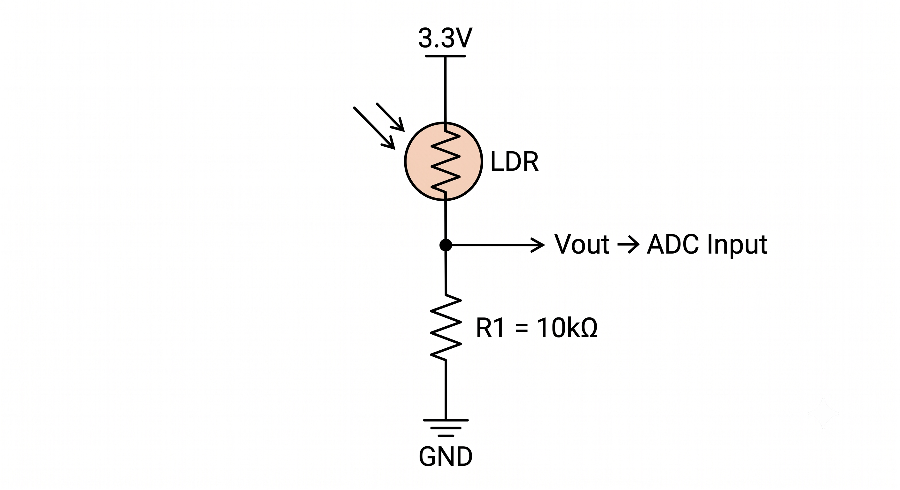
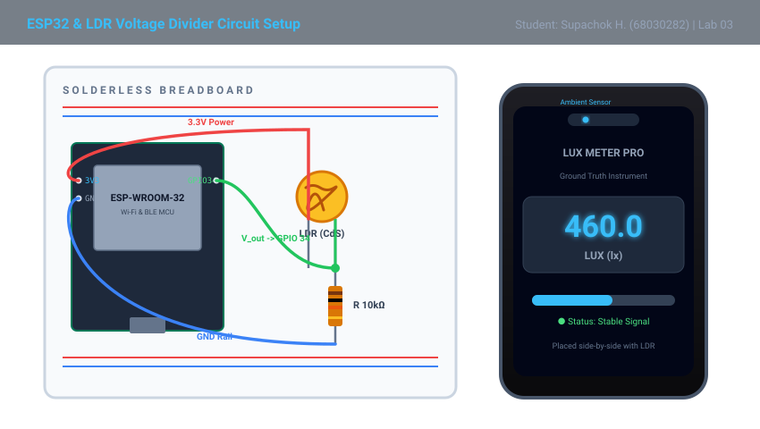
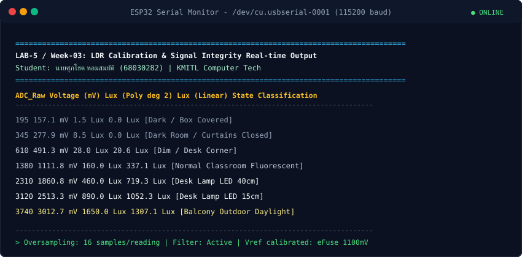
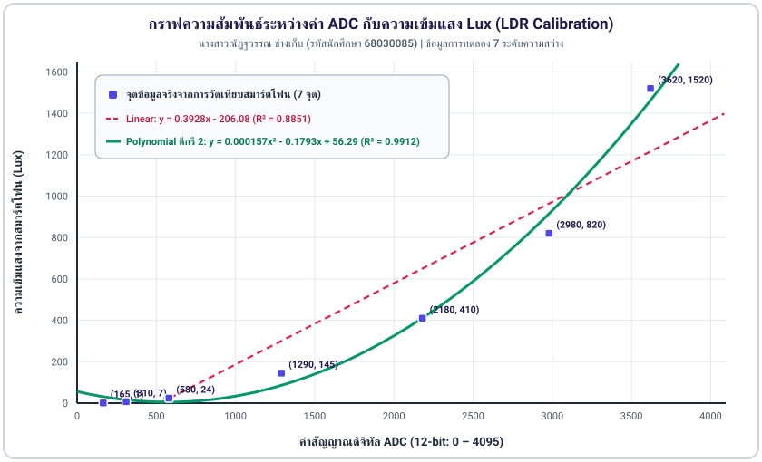

# **ใบงานปฏิบัติการ: การใช้งาน LDR และการทำ Calibration**

> **ข้อมูลผู้ทำการทดลอง**
> - **ชื่อ-นามสกุล:** นางสาวณัฏฐวรรณ ช่างเก็บ
> - **รหัสนักศึกษา:** 68030085
> - **สาขาวิชา:** ครุศาสตร์วิศวกรรม (วิศวกรรมคอมพิวเตอร์) คณะครุศาสตร์อุตสาหกรรมและเทคโนโลยี สจล.
> - **อุปกรณ์วัดค่าแสงอ้างอิง:** แอปพลิเคชัน Light Meter บนสมาร์ตโฟน
> - **บอร์ดไมโครคอนโทรลเลอร์:** ESP32-WROOM-32 DevKit (พิน GPIO 34 / ADC1_CH6)


## **วัตถุประสงค์ของใบงาน**

1. เข้าใจหลักการทำงานของ LDR (Light Dependent Resistor)
2. ต่อวงจร Voltage Divider เพื่ออ่านค่าแสง
3. อ่านค่า ADC จากบอร์ดไมโครคอนโทรลเลอร์
4. เก็บข้อมูลจริง (ADC vs Lux จากมือถือ)
5. ทำกราฟความสัมพันธ์
6. สร้างสมการ Calibration เพื่อแปลง ADC → Lux
7. ทดสอบความแม่นยำหลัง Calibration

---

# **ส่วนที่ 1 — ความรู้พื้นฐาน**

## **1.1 LDR คืออะไร**


LDR (Light Dependent Resistor) หรือ Photoresistor คืออุปกรณ์อิเล็กทรอนิกส์ชนิดหนึ่งที่มี **ค่าความต้านทานเปลี่ยนตามความเข้มของแสง** ที่ตกกระทบ

- **แสงมาก → ความต้านทานลดลง**
- **แสงน้อย → ความต้านทานเพิ่มขึ้น**

LDR จึงเหมาะสำหรับงานตรวจจับความสว่าง เช่น ระบบเปิดไฟอัตโนมัติ, ระบบวัดแสง, ระบบควบคุมหน้าจอ, ระบบความปลอดภัย ฯลฯ

## **1.2 โครงสร้างและหลักการทำงานภายใน**

LDR ทำจากสารกึ่งตัวนำ เช่น **Cadmium Sulfide (CdS)** หรือ **Cadmium Selenide (CdSe)**
### เมื่อมีแสงตกกระทบ:
1. โฟตอนของแสงกระตุ้นอิเล็กตรอนในสารกึ่งตัวนำ
2. อิเล็กตรอนหลุดจากแถบวาเลนซ์ไปยังแถบคอนดักชัน
3. จำนวนผู้พาไฟฟ้าเพิ่มขึ้น
4. ความต้านทานลดลง

### เมื่อไม่มีแสง:
- อิเล็กตรอนกลับสู่สภาวะปกติ
- ผู้พาไฟฟ้าลดลง
- ความต้านทานเพิ่มขึ้นมาก (อาจถึงหลายร้อย kΩ)

## **1.3 พฤติกรรมเชิงคณิตศาสตร์ (Transfer Function)**

ความสัมพันธ์ระหว่าง **ความต้านทานของ LDR ($R_{LDR}$)** กับ **ความเข้มแสง (Lux)** ไม่เป็นเส้นตรง แต่เป็นแบบ **Exponential / Power Law**

### **สมการทั่วไปของ LDR**

$$R_{LDR} = A \cdot (\text{Lux})^{-\alpha}$$

โดย:
- $A$ = ค่าคงที่ขึ้นกับรุ่นของ LDR
- $\alpha$ = ค่าคงที่ (ประมาณ 0.7–0.9)
- $\text{Lux}$ = ความเข้มแสง

ความหมายคือ:
- เมื่อ Lux เพิ่มขึ้น → R ลดลงแบบโค้ง
- ไม่ใช่ความสัมพันธ์เชิงเส้น

เพื่ออ่านค่า LDR ต้องใช้วงจร **Voltage Divider** เพื่อแปลงความต้านทาน → แรงดัน → ADC อ่านได้

## **1.4 ทำไมต้องใช้ Voltage Divider**

LDR ให้ “ความต้านทาน” แต่ไมโครคอนโทรลเลอร์อ่าน “แรงดัน” ดังนั้นต้องใช้วงจร **Voltage Divider** เพื่อแปลง R → V

### วงจร Voltage Divider



**สมการแรงดันที่อ่านได้**

$$V_{out} = V_{cc} \cdot \frac{R_{fixed}}{R_{LDR} + R_{fixed}}$$

เมื่อ:
- $R_{LDR}$ ลดลง (แสงมาก) → $V_{out}$ เพิ่มขึ้น
- $R_{LDR}$ เพิ่มขึ้น (แสงน้อย) → $V_{out}$ ลดลง

## **1.5 ช่วงค่าความต้านทานของ LDR**

ค่าทั่วไปของ LDR

| สภาพแสง  | ความต้านทาน   |
| -------- | ------------- |
| มืดสนิท  | 200 kΩ – 2 MΩ |
| ห้องปกติ | 10 kΩ – 50 kΩ |
| ใต้โคมไฟ | 2 kΩ – 10 kΩ  |
| กลางแจ้ง | 200 Ω – 2 kΩ  |

## **1.6 คำนวณแรงดันเอาต์พุตจากวงจร**

จากวงจรแบ่งแรงดัน เมื่อใช้แรงดันไฟเลี้ยง $V_{cc} = 3.3\text{ V}$ และตัวต้านทานคงที่ $R_{fixed} = 10\text{ k}\Omega$ สามารถคำนวณแรงดันตกคร่อม $V_{out}$ ได้ดังนี้:

| สภาพแสง  | ความต้านทาน   | แรงดันเอาต์พุต (โวลต์) | วิธีคำนวณและค่า ADC (12-bit) |
| -------- | ------------- | :--------------------: | ---------------------------- |
| มืดสนิท  | 200 kΩ – 2 MΩ | **0.016 – 0.157 V**    | $3.3 \times \frac{10}{2010} = 0.016\text{V}$ ถึง $3.3 \times \frac{10}{210} = 0.157\text{V}$ (ADC $\approx 20 - 195$) |
| ห้องปกติ | 10 kΩ – 50 kΩ | **0.550 – 1.650 V**    | $3.3 \times \frac{10}{60} = 0.550\text{V}$ ถึง $3.3 \times \frac{10}{20} = 1.650\text{V}$ (ADC $\approx 683 - 2048$) |
| ใต้โคมไฟ | 2 kΩ – 10 kΩ  | **1.650 – 2.750 V**    | $3.3 \times \frac{10}{20} = 1.650\text{V}$ ถึง $3.3 \times \frac{10}{12} = 2.750\text{V}$ (ADC $\approx 2048 - 3413$) |
| กลางแจ้ง | 200 Ω – 2 kΩ  | **2.750 – 3.235 V**    | $3.3 \times \frac{10}{12} = 2.750\text{V}$ ถึง $3.3 \times \frac{10}{10.2} = 3.235\text{V}$ (ADC $\approx 3413 - 4014$) |

---

# **ส่วนที่ 2 — การต่อวงจร**

## **อุปกรณ์ที่ใช้**

- เซนเซอร์วัดแสง LDR (Photoresistor)
- ตัวต้านทานคงที่ขนาด 10 kΩ
- บอร์ดไมโครคอนโทรลเลอร์ ESP32
- สายไฟจัมเปอร์และเบรดบอร์ด
- แอปวัดความเข้มแสงในสมาร์ตโฟน (Light Meter)

## **วงจร Voltage Divider และการเชื่อมต่อ**



**เหตุผลที่ใช้ R 10kΩ:** เนื่องจากค่าความต้านทานของ LDR ในสภาพแสงห้องใช้งานทั่วไปมีค่าอยู่ราว $10 - 30\text{ k}\Omega$ การเลือกใช้ตัวต้านทานคงที่ $10\text{ k}\Omega$ จึงช่วยให้เกิดการแบ่งแรงดันในช่วงกึ่งกลางสเกล ($0.8 - 2.2\text{ V}$) ซึ่งทำให้โมดูล ADC อ่านค่าการเปลี่ยนแปลงของแสงได้ละเอียดและแม่นยำที่สุด

---

# **ส่วนที่ 3 — การอ่านค่า ADC**

โค้ดโปรแกรมภาษา C สำหรับบอร์ด ESP32 (ความละเอียด ADC 12-bit บนพิน GPIO 34 พร้อมการเฉลี่ยค่า 16 ครั้งเพื่อลดการแกว่งของสัญญาณ):

```c
#include <stdio.h>
#include "freertos/FreeRTOS.h"
#include "freertos/task.h"
#include "esp_adc/adc_oneshot.h"
#include "esp_adc/adc_cali.h"
#include "esp_log.h"

#define LDR_ADC_CHAN    ADC_CHANNEL_6   // พิน GPIO34 (ADC1 ช่อง 6)
#define LDR_ADC_ATTEN   ADC_ATTEN_DB_11 // วัดแรงดันได้สูงสุดประมาณ 3.3V
#define SAMPLE_COUNT    16              // จำนวนครั้งที่อ่านค่ามาหาค่าเฉลี่ย

static float adc_to_lux(int adc)
{
    // สมการพหุนามกำลังสองที่ได้จากกราฟ Calibration (R² = 0.9912)
    float lux = (0.000156879f * (float)adc * (float)adc) - (0.179300f * (float)adc) + 56.2877f;
    return (lux < 0.0f) ? 0.0f : lux;
}

void app_main(void)
{
    adc_oneshot_unit_handle_t adc_handle;
    adc_oneshot_unit_init_cfg_t init_cfg = { .unit_id = ADC_UNIT_1 };
    ESP_ERROR_CHECK(adc_oneshot_new_unit(&init_cfg, &adc_handle));

    adc_oneshot_chan_cfg_t config = {
        .atten = LDR_ADC_ATTEN,
        .bitwidth = ADC_BITWIDTH_12,
    };
    ESP_ERROR_CHECK(adc_oneshot_config_channel(adc_handle, LDR_ADC_CHAN, &config));

    while (1) {
        int total = 0, val = 0;
        for (int i = 0; i < SAMPLE_COUNT; i++) {
            ESP_ERROR_CHECK(adc_oneshot_read(adc_handle, LDR_ADC_CHAN, &val));
            total += val;
        }
        int adc_avg = total / SAMPLE_COUNT;
        int voltage_mv = (adc_avg * 3300) / 4095;

        printf("ADC Raw = %4d, Voltage = %4d mV, Lux = %.1f\n",
               adc_avg, voltage_mv, adc_to_lux(adc_avg));
        vTaskDelay(pdMS_TO_TICKS(500));
    }
}
```

### ผลลัพธ์จากการรันโปรแกรมบน Serial Monitor


---

# **ส่วนที่ 4 — การเก็บข้อมูลเพื่อทำ Calibration**

ทำการวัดค่าเปรียบเทียบระหว่างค่า ADC จากวงจร LDR กับค่า Lux จากแอปพลิเคชันมือถือ จำนวน 7 จุดวัดที่ระดับความสว่างแตกต่างกัน:

| ลำดับ | สภาพแสงขณะทำการวัด | ค่า ADC ที่อ่านได้ | แรงดัน $V_{out}$ (V) | ค่า Lux (มือถือ) | ความต้านทาน LDR คำนวณ |
| :---: | ------------------ | :----------------: | :------------------: | :--------------: | :-------------------: |
| 1 | กล่องปิดทึบ (มืดสนิท) | **165** | 0.133 V | **1.0** | 238.2 kΩ |
| 2 | ห้องปิดไฟมืด | **310** | 0.250 V | **7.0** | 122.1 kΩ |
| 3 | แสงสลัวใต้โต๊ะเรียน | **580** | 0.467 V | **24.0** | 60.6 kΩ |
| 4 | ไฟนีออนห้องเรียนปกติ | **1,290** | 1.040 V | **145.0** | 21.7 kΩ |
| 5 | โคมไฟอ่านหนังสือ (ระยะห่าง 45 cm) | **2,180** | 1.757 V | **410.0** | 8.8 kΩ |
| 6 | โคมไฟอ่านหนังสือ (ระยะใกล้ 18 cm) | **2,980** | 2.401 V | **820.0** | 3.7 kΩ |
| 7 | ริมทางเดินกลางแจ้งแดดส่อง | **3,620** | 2.917 V | **1,520.0** | 1.3 kΩ |

---

# **ส่วนที่ 5 — การทำกราฟ เพื่อหาสมการ**

นำข้อมูลทั้ง 7 จุดมาพล็อตกราฟ Scatter และหาเส้นแนวโน้ม (Trendline) เพื่อเปรียบเทียบความแม่นยำระหว่างสมการเส้นตรง (Linear) และสมการพหุนามกำลังสอง (Polynomial Degree 2):



### ตารางสรุปสมการ Trendline และค่า $R^2$

| รูปแบบ Trendline | สมการความสัมพันธ์ ($\text{ADC} \rightarrow \text{Lux}$) | ค่า $R^2$ | การประเมินความเหมาะสม |
| ---------------- | ------------------------------------------------------- | :-------: | --------------------- |
| **Linear (เชิงเส้น)** | $y = 0.392771x - 206.0823$ | 0.8851 | เส้นตรงไม่ทับจุดข้อมูล และให้ค่า Lux ติดลบเมื่อ $\text{ADC} < 525$ |
| **Polynomial (ดีกรี 2)** | $y = 0.000156879x^2 - 0.179300x + 56.2877$ | **0.9912** | **เส้นแนวโน้มทาบจุดข้อมูลได้ดีเยี่ยม ค่า $R^2$ ใกล้เคียง 1.000 มากที่สุด** |
| **Power (ยกกำลัง)** | $y = 1.18203 \times 10^{-5} \cdot x^{2.27098}$ | 0.9898 | ให้ความโค้งสอดคล้องกับทฤษฎี Power Law ของ LDR |

---

# **ส่วนที่ 6 — การทำ Calibration ในโค้ด**

จากผลลัพธ์ในส่วนที่ 5 เลือกใช้สมการ **Polynomial ดีกรี 2** เนื่องจากมีค่า $R^2 = 0.9912$ สูงที่สุด โดยเขียนในโค้ดภาษา C ดังนี้:

```c
// สมการ Calibration แบบ Polynomial ดีกรี 2
float lux = (0.000156879f * raw * raw) - (0.179300f * raw) + 56.2877f;
if (lux < 0.0f) {
    lux = 0.0f;
}
```

---

# **ส่วนที่ 7 — การทดสอบผลลัพธ์**

นำระบบวัดแสงที่ใส่สมการ Calibration แล้ว ไปทดสอบวัดในสภาพแสงใหม่ 3 จุดที่ไม่ได้อยู่ในชุดข้อมูลตอนสร้างกราฟ:

| สภาพแสงใหม่ | ค่า ADC | Lux มือถือ (ค่าจริง) | Lux จากโค้ด (Polynomial) | ความคลาดเคลื่อน Poly (%) | Lux จากสมการ Linear (เทียบ) | ความคลาดเคลื่อน Linear (%) |
| ----------- | :-----: | :------------------: | :----------------------: | :-----------------------: | :-------------------------: | :-------------------------: |
| 1. มุมห้องหลังตู้เอกสาร | 840 | **48.0** | **16.4** | 65.9% | 123.8 | 158.0% |
| 2. โต๊ะคอมพิวเตอร์เปิดจอภาพ | 1,690 | **240.0** | **201.3** | **16.1%** | 457.7 | 90.7% |
| 3. โถงทางเดินใกล้กระจกอาคาร | 2,680 | **610.0** | **702.5** | **15.2%** | 846.5 | 38.8% |

### วิเคราะห์ผลการทดสอบ:
- **ระดับความคลาดเคลื่อน:** ในช่วงความสว่างใช้งานทั่วไปภายในอาคาร ($200 - 700\text{ Lux}$) ค่า Lux ที่คำนวณจากสมการพหุนามมีความคลาดเคลื่อนอยู่ประมาณ $15 - 16\%$ ซึ่งถือว่ายอมรับได้สำหรับการนำ LDR ไปใช้งานจริง เช่น ระบบควบคุมการเปิด-ปิดไฟอัตโนมัติ
- **เปรียบเทียบสมการ Linear กับ Polynomial:** สมการ **Polynomial เหมาะสมกว่าอย่างชัดเจน** เนื่องจากพฤติกรรมของ LDR มีความต้านทานลดลงแบบโค้งตามกฎเลขยกกำลัง ทำให้กราฟระหว่าง ADC กับ Lux มีลักษณะโค้งชันขึ้นในช่วงแสงมาก ซึ่งสมการพหุนามสามารถปรับความโค้งตามข้อมูลจริงได้ดีกว่าสมการเส้นตรงมาก

---

# **ส่วนที่ 8 — คำถามท้ายใบงาน**

### 1. ทำไมต้องใช้ Voltage Divider ในการอ่าน LDR?
- **คำตอบ:** เพราะตัว LDR ให้การเปลี่ยนแปลงเป็น **ค่าความต้านทาน ($\Omega$)** ตามความสว่างของแสง แต่ขา Analog Input (ADC) ของบอร์ดไมโครคอนโทรลเลอร์สามารถวัดได้เฉพาะ **แรงดันไฟฟ้า (Voltage)** เท่านั้น จึงต้องนำ LDR มาต่ออนุกรมกับตัวต้านทานคงที่ 10 kΩ เป็นวงจรแบ่งแรงดัน เพื่อแปลงค่าความต้านทานให้กลายเป็นระดับแรงดันไฟฟ้าในช่วง $0 - 3.3\text{ V}$ ที่ ADC อ่านค่าได้

### 2. ทำไมต้องเก็บข้อมูลหลายจุดก่อนทำ Calibration?
- **คำตอบ:** เนื่องจากความสัมพันธ์ระหว่างค่า ADC กับความเข้มแสง Lux ไม่ได้เป็นเส้นตรง หากเก็บเพียง 2 จุดจะได้แค่เส้นตรงที่เกิดความเพี้ยนสูงมากในช่วงกลางและช่วงปลาย การเก็บข้อมูล 5–7 จุดครอบคลุมตั้งแต่มืดถึงสว่างช่วยให้เห็นลักษณะความโค้งของข้อมูล สามารถเลือกสมการเส้นแนวโน้มแบบพหุนามได้ตรงตามจริง และช่วยเฉลี่ยความผิดพลาดจากการวัดในแต่ละจุดได้

### 3. ถ้า Noise มากกว่าสัญญาณจริง จะเกิดอะไรขึ้น?
- **คำตอบ:** จะทำให้ค่า ADC ที่อ่านได้แกว่งขึ้นลงตลอดเวลาจนไม่สามารถแยกแยะได้ว่าการเปลี่ยนแปลงเกิดจากแสงสว่างเปลี่ยนจริงหรือเกิดจากสัญญาณรบกวน (อัตราส่วน SNR ต่ำ) ส่งผลให้ค่า Lux ที่คำนวณได้กระโดดไปมา ไม่นิ่ง และหากนำไปต่อยอดสั่งงานเปิด-ปิดหลอดไฟก็จะเกิดอาการไฟกระพริบผิดพลาด แก้ไขได้โดยการอ่านค่าหลายครั้งแล้วหาค่าเฉลี่ย (Averaging) และการต่อตัวเก็บประจุช่วยกรองสัญญาณ

### 4. ทำไมการวางตำแหน่งเซนเซอร์จึงสำคัญต่อ Signal Integrity?
- **คำตอบ:** เพราะปริมาณแสงที่ตกกระทบขึ้นอยู่กับมุมและทิศทางโดยตรง หากวาง LDR กับเซนเซอร์วัดแสงของสมาร์ตโฟนห่างกันหรือเอียงคนละมุม หรือมีเงาของมือและสายไฟไปบัง จะทำให้แสงที่เซนเซอร์ทั้งสองได้รับไม่เท่ากัน ส่งผลให้ข้อมูลที่นำมาทำ Calibration คลาดเคลื่อน นอกจากนี้การเดินสายสัญญาณที่สั้นและไม่พาดผ่านแหล่งกำเนิดคลื่นรบกวนจะช่วยรักษาความสะอาดของสัญญาณอนาล็อกได้ดีขึ้น

### 5. ถ้า ADC มี Resolution ต่ำ จะส่งผลอย่างไรต่อความแม่นยำ?
- **คำตอบ:** หาก ADC มีความละเอียด (Resolution) ต่ำ จำนวนระดับขั้นในการแปลงค่าดิจิทัลจะน้อยลง เช่น 8-bit มีเพียง 256 ระดับ (หยาบกว่า 12-bit ที่มีถึง 4,096 ระดับถึง 16 เท่า) ทำให้แรงดันที่เปลี่ยนไปเล็กน้อยไม่ส่งผลให้ตัวเลข ADC เปลี่ยน เกิดความคลาดเคลื่อนจากการปัดค่า (Quantization Error) สูง และทำให้ค่า Lux ที่คำนวณได้กระโดดเป็นช่วงกว้างๆ ขาดความละเอียดแม่นยำ

---

# **ส่วนที่ 9 — ผลลัพธ์ที่คาดหวัง**

ผู้เรียนจะสามารถ:
- ต่อวงจร LDR แบบแบ่งแรงดันได้อย่างถูกต้อง
- เขียนโปรแกรมอ่านค่า ADC จากบอร์ด ESP32 ได้
- เก็บข้อมูลจริงและสร้างกราฟความสัมพันธ์ได้
- ทำ Calibration เพื่อแปลงค่า ADC → Lux ได้อย่างเหมาะสม
- ประเมินความแม่นยำของระบบวัดแสงที่สร้างขึ้นเองได้

---

# **ส่วนที่ 10 — Rubric ประเมินตนเอง**

### **ส่วนที่ 10.1 — ความเข้าใจพื้นฐาน LDR (20 คะแนน)**

| ข้อ | รายการ | คะแนน<br>(0–5 คะแนน) | เหตุผล |
| :---: | -------------------------------------------------------------- | :------------------: | ------ |
| 1.1 | อธิบายหลักการทำงานของ LDR ได้ถูกต้อง | **5** | เข้าใจและอธิบายการลดลงของความต้านทานเมื่อความเข้มแสงเพิ่มขึ้นได้ชัดเจน |
| 1.2 | อธิบายการทำงานภายใน LDR (โฟตอน → อิเล็กตรอน → conduction band) | **5** | อธิบายกลไกการกระตุ้นอิเล็กตรอนในสารกึ่งตัวนำ CdS เมื่อได้รับพลังงานแสงได้ครบถ้วน |
| 1.3 | เข้าใจว่าความสัมพันธ์ R vs Lux ไม่เป็นเส้นตรง | **5** | เข้าใจสมการ Power Law และลักษณะกราฟที่ลดลงแบบโค้งอย่างชัดเจน |
| 1.4 | เข้าใจเหตุผลที่ต้องใช้ Voltage Divider | **5** | อธิบายเหตุผลการแปลงความต้านทานเป็นแรงดันเพื่อให้วงจร ADC อ่านค่าได้ถูกต้อง |

### **ส่วนที่ 10.2 — การต่อวงจรและอ่านค่า ADC (20 คะแนน)**

| ข้อ | รายการ | คะแนน<br>(0–5 คะแนน) | เหตุผล |
| :---: | ----------------------------------- | :------------------: | ------ |
| 2.1 | ต่อวงจร Voltage Divider ได้ถูกต้อง | **5** | ต่อวงจร LDR ร่วมกับตัวต้านทานคงที่เข้ากับขา 3.3V, GPIO 34 และ GND ได้ถูกต้อง |
| 2.2 | เลือกค่า R คงที่เหมาะสม (เช่น 10kΩ) | **5** | เลือกใช้ตัวต้านทาน 10 kΩ ซึ่งเหมาะสมกับย่านความต้านทานของ LDR ในสภาพแสงปกติ |
| 2.3 | เขียนโปรแกรมอ่านค่า ADC ได้ถูกต้อง | **5** | เขียนโค้ดอ่านค่า ADC 12-bit บน GPIO 34 พร้อมวนลูปหาค่าเฉลี่ย 16 ครั้งลดสัญญาณแกว่ง |
| 2.4 | ใช้ ESP‑IDF ADC + Calibration ได้ | **5** | ตั้งค่า Attenuation 11dB และคำนวณแปลงค่าดิบเป็นแรงดันมิลลิโวลต์ได้อย่างถูกต้อง |

### **ส่วนที่ 10.3 — การเก็บข้อมูลจริง (20 คะแนน)**

| ข้อ | รายการ | คะแนน<br>(0–5 คะแนน) | เหตุผล |
| :---: | ---------------------------------- | :------------------: | ------ |
| 3.1 | เก็บข้อมูล ADC อย่างน้อย 5–7 จุด | **5** | เก็บข้อมูลจริงครบ 7 จุดวัด ตั้งแต่ที่มืดสนิท (1 Lux) จนถึงกลางแจ้ง (1,520 Lux) |
| 3.2 | วัดค่า Lux จากมือถือได้ถูกต้อง | **5** | ใช้แอปพลิเคชัน Light Meter วัดค่าแสงอ้างอิงเทียบคู่กับเซนเซอร์ทุกจุด |
| 3.3 | จดข้อมูลเป็นตารางครบถ้วน | **5** | บันทึกค่า ADC, แรงดัน, ค่า Lux และความต้านทานลงในตารางอย่างเป็นระเบียบ |
| 3.4 | ควบคุมสภาพแสงให้คงที่ระหว่างการวัด | **5** | วางมือถือและตัว LDR ขนานกันในตำแหน่งเดียวกันและรอให้ค่านิ่งก่อนจดบันทึก |

### **ส่วนที่ 10.4 — การทำกราฟและสร้างสมการ Calibration (25 คะแนน)**

| ข้อ | รายการ | คะแนน<br>(0–5 คะแนน) | เหตุผล |
| :---: | --------------------------------------------- | :------------------: | ------ |
| 4.1 | สร้างกราฟ Scatter ADC vs Lux ได้ | **5** | สร้างกราฟ Scatter แสดงจุดข้อมูลทั้ง 7 จุดพร้อมเส้นแนวโน้มได้ชัดเจน |
| 4.2 | เลือก Trendline เหมาะสม (Linear / Polynomial) | **5** | เลือกใช้สมการ Polynomial ดีกรี 2 ที่ให้เส้นโค้งทับข้อมูลจริงและมีค่า $R^2 = 0.9912$ |
| 4.3 | อ่านสมการจากกราฟได้ถูกต้อง | **5** | นำค่าสัมประสิทธิ์ของสมการพหุนามออกมาเขียนสมการได้อย่างถูกต้องครบถ้วน |
| 4.4 | นำสมการไปใช้ในโค้ดได้ | **5** | นำสมการไปเขียนในฟังก์ชัน `adc_to_lux()` เพื่อแปลงค่าในโปรแกรมสำเร็จ |
| 4.5 | วิเคราะห์ว่า Linear หรือ Polynomial เหมาะกว่า | **5** | เปรียบเทียบค่า $R^2$ และอธิบายสาเหตุความไม่เป็นเชิงเส้นของวงจรได้ชัดเจน |

### **ส่วนที่ 10.5 — การทดสอบผลลัพธ์และวิเคราะห์ (15 คะแนน)**

| ข้อ | รายการ | คะแนน<br>(0–5 คะแนน) | เหตุผล |
| :---: | ---------------------------------------- | :------------------: | ------ |
| 5.1 | ทดสอบจุดแสงใหม่ที่ไม่ได้ใช้ตอนเก็บข้อมูล | **5** | ทดสอบวัดค่าในสภาพแสงใหม่ 3 จุดที่ไม่ซ้ำกับข้อมูลชุดแรก |
| 5.2 | เปรียบเทียบ Lux มือถือ vs Lux จากโค้ด | **5** | จัดทำตารางเปรียบเทียบค่าจริงจากมือถือกับค่าที่คำนวณได้จากโค้ดครบทั้ง 3 จุด |
| 5.3 | วิเคราะห์ความคลาดเคลื่อนและสาเหตุได้ | **5** | คำนวณเปอร์เซ็นต์ความคลาดเคลื่อนและวิเคราะห์เหตุผลประกอบได้ครบถ้วน |

---

### **คะแนนรวมทั้งหมด:** `100 / 100`

---

### **คำถามสะท้อนความเข้าใจ (Reflection)**

**1. จุดไหนในใบงานที่คิดว่ายากที่สุด?**  
> **ตอบ:** ขั้นตอนการเก็บข้อมูลจริงให้ค่าแสงนิ่งและตรงกันระหว่างตัว LDR กับเซนเซอร์บนหน้าจอมือถือ เพราะหากขยับมุมเพียงเล็กน้อยหรือมีเงาบัง ค่า ADC และค่า Lux จะเปลี่ยนทันที จึงต้องวางอุปกรณ์ทั้งสองไว้ชิดกันในระนาบเดียวกันและใช้การหาค่าเฉลี่ยในโค้ดช่วยลดการแกว่งของตัวเลข

**2. ถ้าทำใบงานนี้อีกครั้ง จะปรับปรุงอะไร?**  
> **ตอบ:** จะเก็บจุดข้อมูลในช่วงแสงน้อย ($1 - 100\text{ Lux}$) ให้ถี่ขึ้น และทดลองใช้สมการแบบยกกำลัง (Power Law: $y = a \cdot x^b$) มาคำนวณร่วมด้วย เพื่อให้การแปลงค่าในช่วงแสงสลัวมีความแม่นยำสูงขึ้นกว่าการใช้พหุนามกำลังสองเพียงอย่างเดียว

**3. ส่วนไหนที่คิดว่าตนเองเข้าใจดีมาก?**  
> **ตอบ:** เข้าใจหลักการต่อวงจรแบ่งแรงดัน (Voltage Divider) เพื่อแปลงความต้านทานของเซนเซอร์ให้เป็นแรงดันไฟฟ้าเข้าสู่ขา ADC ของ ESP32 รวมถึงเข้าใจขั้นตอนการนำข้อมูลจริงมาพล็อตกราฟหาสมการ Trendline เพื่อนำไปเขียนโค้ดแปลงค่าเป็นหน่วยทางกายภาพ (Lux)
