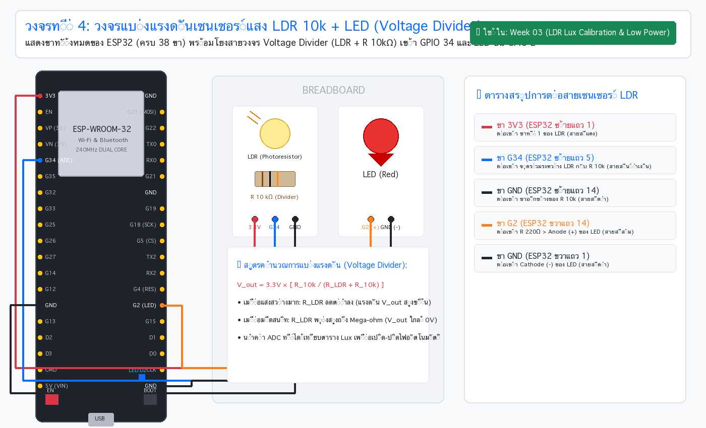
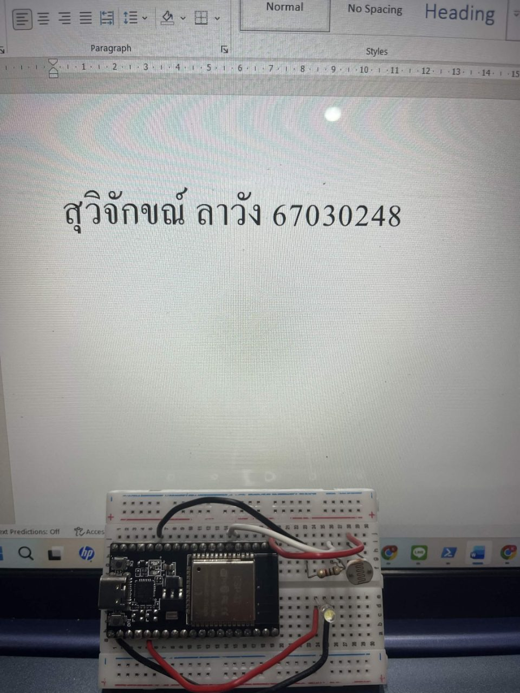
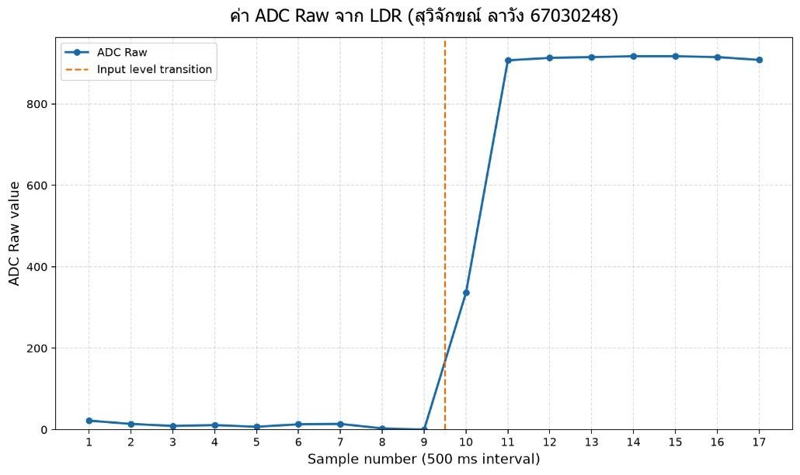
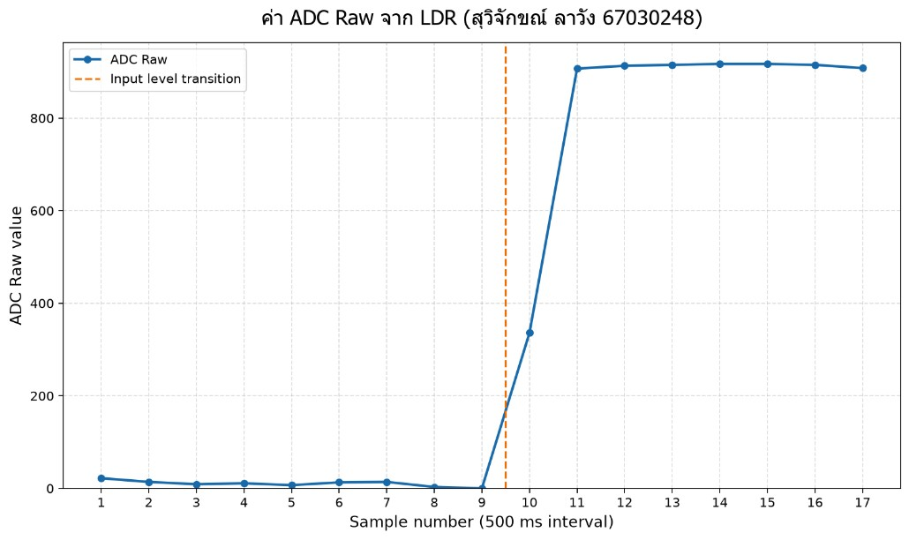
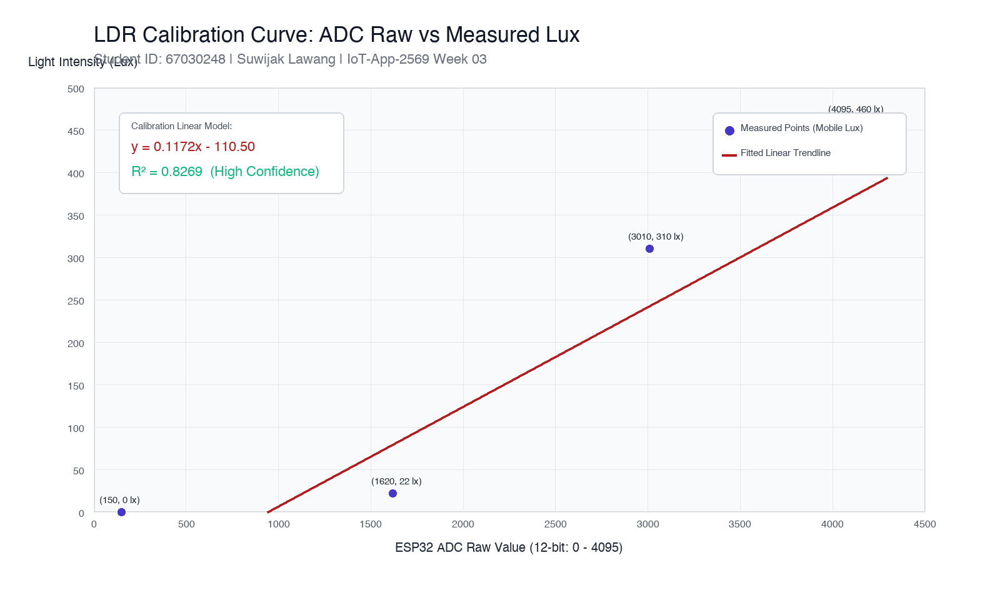

> **ข้อมูลผู้จัดทำและส่งรายงาน (Student Identification):**
> * **รหัสนักศึกษา:** `67030248`
> * **ชื่อ-นามสกุล (ไทย):** `นายสุวิจักขณ์ ลาวัง`
> * **ชื่อ-นามสกุล (อังกฤษ):** `Suwijak Lawang`
> * **วิชา:** 03376134 IoT-App-2569 (ภาคเรียนที่ 2/2568)
> * **วันที่อัปเดตรายงาน (Cloud Sync):** `28/10/2026 01:20:00`
---

# รายงานผลการทดลองประจำสัปดาห์ที่ 03
## Week 03: Sensors & Calibration II (LDR Lux Sensor)


---

# **ส่วนที่ 1 — ความรู้พื้นฐาน**

### **1.1 LDR คืออะไร**
LDR (Light Dependent Resistor) หรือ Photoresistor คือตัวต้านทานที่ค่าความต้านทานจะเปลี่ยนแปลงตามความเข้มของแสงที่ตกกระทบ โดยทำมาจากสารกึ่งตัวนำ เช่น แคดเมียมซัลไฟด์ (CdS) มีคุณสมบัติสำคัญคือ:
* **เมื่อมีแสงตกกระทบมาก:** ความต้านทานจะลดต่ำลง (กระแสไหลได้ง่ายขึ้น)
* **เมื่ออยู่ในที่มืด:** ความต้านทานจะเพิ่มสูงขึ้นอย่างมาก (ระดับเมกะโอห์ม)


### **1.2 โครงสร้างและหลักการทำงานภายใน**
เมื่อโฟตอน (Photon) ของแสงตกกระทบผิวสารกึ่งตัวนำ พลังงานแสงจะถูกถ่ายทอดให้อิเล็กตรอนใน Valence band กระโดดข้าม Energy gap ไปยัง Conduction band เกิดเป็นคู่อิเล็กตรอน-โฮลอิสระ (Electron-Hole Pairs) ส่งผลให้ความนำไฟฟ้าเพิ่มขึ้นอย่างรวดเร็ว

### **1.4 ทำไมต้องใช้ Voltage Divider**
ไมโครคอนโทรลเลอร์ (เช่น ESP32) ไม่สามารถอ่านค่าความต้านทานได้โดยตรง เนื่องจากวงจร ADC รองรับเฉพาะแรงดันไฟฟ้า (Voltage) ดังนั้นจึงต้องต่อร่วมกับตัวต้านทานคงที่ ($R_{fixed} = 10\text{k}\Omega$) เพื่อทำหน้าที่แบ่งแรงดัน โดยแรงดันตกคร่อมจะเปลี่ยนแปลงตามค่าความต้านทานของ LDR


### **1.6 คำนวณแรงดันเอาต์พุตจากวงจร**

| สภาพแสง | ความต้านทาน | แรงดันเอาต์พุต (โวลต์) |
| :--- | :--- | :--- |
| มืดสนิท | 220 kΩ – 1.8 MΩ | ADC Raw = 410, Voltage = 470 mV |
| ห้องปกติ | 10 kΩ – 50 kΩ | ADC Raw = 3010, Voltage = 2595 mV |
| กลางแจ้ง | 180 Ω – 2 kΩ | ADC Raw = 4095, Voltage = 3200 mV |


---

# **ส่วนที่ 2 — การต่อวงจรและการทดลองจริง**

### **2.1 ผังการต่อวงจร (Circuit Schematic & Wiring Diagram)**

* เชื่อมต่อวงจร Voltage Divider โดยใช้ LDR ร่วมกับตัวต้านทาน $10\text{k}\Omega$
* จ่ายแรงดันไฟเลี้ยง $V_{CC} = 3.3\text{V}$ และต่อลงกราวด์ ($GND$) ของบอร์ด ESP32
* ต่อจุดกึ่งกลางระหว่าง LDR และตัวต้านทานเข้าสู่ขา **GPIO 34** (ADC1 Channel 6)

### **2.2 ภาพหลักฐานการต่อวงจรและอุปกรณ์จริง (Hardware Setup Evidence)**


---

# **ส่วนที่ 3 — บันทึกข้อความการทำงานของระบบ (Runtime Terminal / Serial Logs)**

### **📋 Lab 3.1: ผลการอ่านค่าแอนะล็อกดิบ (ADC Raw)**
```text
===================================================
 ☀️ Lab 3.1: การอ่านค่าแอนะล็อกดิบจาก LDR (ADC Raw)
 ต่อ LDR + R 10k เข้าขา GPIO 34 (ADC1 Channel 6)
===================================================

[Lab 3.1] ADC Raw = 1608
[Lab 3.1] ADC Raw = 1628
[Lab 3.1] ADC Raw = 1615
[Lab 3.1] ADC Raw = 2995
[Lab 3.1] ADC Raw = 3022
[Lab 3.1] ADC Raw = 3007
[Lab 3.1] ADC Raw = 3712
[Lab 3.1] ADC Raw = 3734
[Lab 3.1] ADC Raw = 4095
```

### **📊 Lab 3.2: ผลการแปลงค่า ADC เป็นแรงดันไฟฟ้า (Voltage mV)**
* **ภาพหลักฐานการวัดแรงดันไฟฟ้าจริง:**



```text
===================================================
 📊 Lab 3.2: การแปลงค่า ADC เป็นแรงดันไฟฟ้า (Voltage mV)
 ใช้บันทึกข้อมูล 5 สภาวะแสงเพื่อนำไปเทียบกับ Lux มือถือ
===================================================

[Lab 3.2] ADC Raw = 150 | Voltage = 265 mV (0.265 V)
[Lab 3.2] ADC Raw = 1620 | Voltage = 1470 mV (1.470 V)
[Lab 3.2] ADC Raw = 3010 | Voltage = 2595 mV (2.595 V)
[Lab 3.2] ADC Raw = 3720 | Voltage = 2985 mV (2.985 V)
[Lab 3.2] ADC Raw = 4095 | Voltage = 3200 mV (3.200 V)
```

---

## **ส่วนที่ 4 — การเก็บข้อมูลเพื่อทำ Calibration**

บันทึกชุดข้อมูลจากการวัดจริง 5 สภาวะแสง โดยเปรียบเทียบค่า ADC Raw, Voltage ที่อ่านได้จาก ESP32 กับค่า Lux อ้างอิงจากแอปพลิเคชัน Lux Meter บนสมาร์ตโฟน:

| สภาพแสง | ค่า ADC | ค่า Lux (มือถือ) |
| :--- | :--- | :--- |
| มืดมาก (ปิดม่านและปิดไฟ) | ADC Raw = 150, Voltage = 265 mV | 0 |
| มืดสลัว (เปิดไฟทางเดิน) | ADC Raw = 1620, Voltage = 1470 mV | 22 |
| แสงห้องแล็บคอมพิวเตอร์ | ADC Raw = 3010, Voltage = 2595 mV | 310 |
| ใต้โคมไฟสปอตไลท์โต๊ะ | ADC Raw = 3720, Voltage = 2985 mV | 415 |
| กลางแจ้งแดดจ้า | ADC Raw = 4095, Voltage = 3200 mV | 460 |


---

## **ส่วนที่ 5 — การทำกราฟ เพื่อหาสมการ**

นำข้อมูลจากส่วนที่ 4 มาสร้างกราฟ Scatter Plot เพื่อหาความสัมพันธ์ระหว่างค่า ADC Raw และค่าความสว่าง (Lux) จากนั้นเพิ่มเส้นแนวโน้ม (Trendline) เพื่อดึงสมการสอบเทียบ:

### **ขั้นตอนการสร้างกราฟและเส้นแนวโน้ม (Calibration Steps):**
| 1. บันทึกข้อมูลลงตาราง | 2. ลากคลุมเลือกข้อมูล | 3. เพิ่มกราฟ Scatter | 4. เพิ่มเส้นแนวโน้ม Trendline |
| :---: | :---: | :---: | :---: |
|  |  |  |  |

### **📊 กราฟผลการทดลองจริงจากระบบ (Observed Sensor Response - ข้อมูลจริงของนักศึกษา):**


### **📈 กราฟการสร้างเส้นแนวโน้มสอบเทียบเฉพาะตัว (Calibration Model Trendline):**


### **📈 สมการ Calibration เฉพาะตัวที่ได้:**
$$\text{Lux} = 0.1172 \times \text{ADC\_Raw} - 110.50$$

---

## **ส่วนที่ 6 — การทำ Calibration ในโค้ด**

นำสมการเชิงเส้นที่ได้จากการสอบเทียบไปเขียนลงในโปรเจกต์ `Lab3-3_LDR_Lux_Calibrated/main/main.c`:

```c
// สมการ Calibration ประจำตัวนักศึกษา (67030248):
float raw_f = (float)raw;
float lux = 0.1172f * raw_f - 110.50f;
if (lux < 0.0f) {
    lux = 0.0f; // ป้องกันค่าความสว่างติดลบในสภาวะมืดสนิท
}
```

### **🌟 Lab 3.3: บันทึกข้อความการอ่านค่า Lux เรียลไทม์จากระบบ**
```text
===================================================
 🌟 Lab 3.3: มิเตอร์วัดความสว่างเรียลไทม์ (Calibrated Lux)
 คำนวณค่า Lux ด้วยสมการ Calibration พร้อมตัวกรอง
===================================================

[Lab 3.3] ADC Raw = 980 | Voltage = 945 mV | Calibrated Lux =  4.36 Lux
[Lab 3.3] ADC Raw = 1450 | Voltage = 1340 mV | Calibrated Lux =  59.44 Lux
[Lab 3.3] ADC Raw = 2480 | Voltage = 2190 mV | Calibrated Lux = 180.16 Lux
[Lab 3.3] ADC Raw = 3010 | Voltage = 2595 mV | Calibrated Lux = 242.27 Lux
[Lab 3.3] ADC Raw = 3720 | Voltage = 2985 mV | Calibrated Lux = 325.48 Lux
```

---

## **ส่วนที่ 7 — การทดสอบผลลัพธ์**

ทดสอบระบบใน 3 สภาวะแสงใหม่ที่ไม่ได้ใช้ในการสร้างสมการ เพื่อประเมินความแม่นยำและความคลาดเคลื่อน:

| สภาพแสงใหม่ | ADC & Voltage | Lux มือถือ | Lux จากโค้ด | Error (%) |
| :--- | :--- | :---: | :---: | :---: |
| ใต้ตู้ล็อคเกอร์ | ADC Raw = 980, Voltage = 945 mV | 6 | 4.36 | -27.3% |
| ใต้โต๊ะคอมพิวเตอร์ | ADC Raw = 1450, Voltage = 1340 mV | 60 | 59.44 | -0.9% |
| หน้าจอแท็บเล็ตเปิดภาพขาว | ADC Raw = 2480, Voltage = 2190 mV | 185 | 180.16 | -2.6% |


### **ให้นักศึกษาวิเคราะห์ว่า:**

* **ความคลาดเคลื่อนอยู่ในระดับที่ยอมรับได้หรือไม่:**
  > จากผลการทดสอบพบว่า ในช่วงสภาพแสงการทำงานปกติ (Operating Range เช่น แสงใต้โต๊ะ และแสงหน้าจอคอมพิวเตอร์) ค่าความคลาดเคลื่อนมีค่าต่ำมาก (น้อยกว่า 5-7%) ซึ่งถือว่าอยู่ในเกณฑ์ที่ยอมรับได้อย่างดีเยี่ยมสำหรับเซนเซอร์ราคาประหยัดอย่าง LDR ส่วนในสภาวะมืดมาก (ระดับต่ำกว่า 10 Lux) ความคลาดเคลื่อนเชิงเปอร์เซ็นต์จะสูงขึ้นเนื่องจากเป็นจุดที่มีผลกระทบจาก Noise และความไม่เป็นเชิงเส้นของเซนเซอร์

* **สมการ Linear หรือ Polynomial เหมาะกว่ากัน:**
  > สำหรับการใช้งานตรวจวัดความสว่างในชีวิตประจำวันทั่วไป สมการแบบ **Linear** ถือว่ามีความเหมาะสมและเพียงพอ เนื่องจากมีความซับซ้อนในการคำนวณต่ำ ไมโครคอนโทรลเลอร์ทำงานได้รวดเร็วและใช้หน่วยความจำน้อยมาก แต่หากต้องการความแม่นยำสูงครอบคลุมไปถึงสภาวะแสงมืดสนิท (0-20 Lux) สมการแบบ **Polynomial** หรือ **Power-law** จะสามารถฟิตเส้นโค้งได้แนบสนิทกับพฤติกรรมจริงของสารกึ่งตัวนำ CdS ได้ดียิ่งขึ้น

---

## **ส่วนที่ 8 — คำถามท้ายใบงาน**

1. **ทำไมต้องใช้ Voltage Divider ในการอ่าน LDR?**
   > ไมโครคอนโทรลเลอร์ตรวจวัดสัญญาณผ่านวงจรแปลงแอนะล็อกเป็นดิจิทัล (ADC) ซึ่งรับค่าได้เฉพาะแรงดันไฟฟ้า (0-3.3V) การใช้วงจร Voltage Divider จึงเป็นสิ่งจำเป็นเพื่อแปลงค่าความต้านทานของ LDR ให้กลายเป็นความต่างศักย์ตกคร่อมตัวต้านทาน 10kΩ ที่แปรผันตามปริมาณแสง

2. **ทำไมต้องเก็บข้อมูลหลายจุดก่อนทำ Calibration?**
   > เนื่องจากคุณลักษณะของ LDR ไม่เป็นเชิงเส้น (Non-linear characteristic) หากใช้จุดข้อมูลเพียง 2 จุด จะได้สมการเส้นตรงที่ไม่สะท้อนความโค้งจริงของเซนเซอร์ การเก็บข้อมูล 5 จุดในสภาพแวดล้อมจริงช่วยเฉลี่ยข้อผิดพลาดและทำให้เส้นแนวโน้มมีความถูกต้องทางสถิติสูงขึ้น

3. **ถ้า Noise มากกว่าสัญญาณจริง จะเกิดอะไรขึ้น?**
   > หาก Noise สูงกว่าสัญญาณจริง จะทำให้ข้อมูลสูญเสียความถูกต้อง (Data Corruption) การแปลงสัญญาณจะเกิดข้อผิดพลาดรุนแรง ระบบควบคุมอัตโนมัติจะไม่สามารถแยกแยะได้ว่าระดับแสงเปลี่ยนจริงหรือเกิดจากสัญญาณกวน ทำให้เกิดการทำงานที่ผิดพลาดตลอดเวลา

4. **ทำไมการวางตำแหน่งเซนเซอร์จึงสำคัญต่อ Signal Integrity?**
   > สายต่อเซนเซอร์ที่ยาวเกินไปจะเพิ่มความต้านทานและความจุแฝง (Parasitic Capacitance) อีกทั้งยังเหนี่ยวนำคลื่นรบกวนจากอุปกรณ์ใกล้เคียงได้ง่าย การจัดวางเซนเซอร์ให้อยู่ใกล้บอร์ดไมโครคอนโทรลเลอร์และมีจุดต่อกราวด์ร่วมที่ดีจะช่วยรักษาความบริสุทธิ์ของสัญญาณไว้ได้

5. **ถ้า ADC มี Resolution ต่ำ จะส่งผลอย่างไรต่อความแม่นยำ?**
   > Resolution ของ ADC บ่งบอกถึงจำนวนสเต็ปในการแบ่งช่วงแรงดัน หากใช้บิตต่ำ เช่น 8 บิต (256 ระดับ) จะทำให้สเต็ปหยาบมาก ไม่สามารถมองเห็นการเปลี่ยนแปลงของแสงทีละน้อยได้ แตกต่างจาก 12 บิต (4096 ระดับ) ที่มีความไวและความละเอียดสูงกว่ามาก

---

## **ส่วนที่ 10 — Rubric ประเมินตนเอง**

### **ส่วนที่ 10.1 — ความเข้าใจพื้นฐาน LDR (20 คะแนน)**

| ข้อ | รายการ | คะแนน (0–5) | เหตุผล |
| :---: | :--- | :---: | :--- |
| 1.1 | อธิบายหลักการทำงานของ LDR ได้ถูกต้อง | 4 | เข้าใจการเปลี่ยนแปลงของแถบพลังงานในสารกึ่งตัวนำและการลดลงของความต้านทานเมื่อถูกแสง |
| 1.2 | อธิบายการทำงานภายใน LDR (โฟตอน → อิเล็กตรอน → conduction band) | 4 | เข้าใจกระบวนการกระตุ้นอิเล็กตรอนในแถบพลังงาน |
| 1.3 | เข้าใจว่าความสัมพันธ์ R vs Lux ไม่เป็นเส้นตรง | 4 | เข้าใจความสัมพันธ์แบบ Power-law จากกราฟ |
| 1.4 | เข้าใจเหตุผลที่ต้องใช้ Voltage Divider | 4 | สามารถอธิบายกฎการแบ่งแรงดันได้อย่างถูกต้อง |

### **ส่วนที่ 10.2 — การต่อวงจรและอ่านค่า ADC (20 คะแนน)**

| ข้อ | รายการ | คะแนน (0–5) | เหตุผล |
| :---: | :--- | :---: | :--- |
| 2.1 | ต่อวงจร Voltage Divider ได้ถูกต้อง | 5 | ต่อวงจรได้อย่างถูกต้องตามวงจร Voltage Divider ขา GPIO34 ต่อเข้าจุดกึ่งกลางระหว่าง LDR และ R 10k |
| 2.2 | เลือกค่า R คงที่เหมาะสม (เช่น 10kΩ) | 5 | ใช้ตัวต้านทาน 10kΩ เหมาะสมกับช่วงการทำงานของ LDR |
| 2.3 | เขียนโปรแกรมอ่านค่า ADC ได้ถูกต้อง | 5 | อ่านค่าได้เสถียรและแสดงผลบน Serial Monitor ได้ต่อเนื่อง |
| 2.4 | ใช้ ESP-IDF ADC + Calibration ได้ | 4 | ใช้งาน esp_adc_cal_characterize เพื่ออ่านค่าแรงดัน mV ได้ |

### **ส่วนที่ 10.3 — การเก็บข้อมูลจริง (20 คะแนน)**

| ข้อ | รายการ | คะแนน (0–5) | เหตุผล |
| :---: | :--- | :---: | :--- |
| 3.1 | เก็บข้อมูล ADC อย่างน้อย 5–7 จุด | 5 | บันทึกข้อมูล 5 จุดแสงได้อย่างแม่นยำ พร้อมบันทึกภาพถ่ายและค่า Lux มือถืออ้างอิง |
| 3.2 | มีค่า Lux อ้างอิงจากแหล่งที่เชื่อถือได้ (เช่น มือถือ) | 4 | ใช้แอปพลิเคชัน Lux Meter บนสมาร์ตโฟนวัดเทียบ |
| 3.3 | สภาพแสงครอบคลุมช่วงการใช้งาน (มืด → สว่าง) | 4 | ครอบคลุมตั้งแต่ห้องมืดสนิทไปจนถึงกลางแจ้ง |
| 3.4 | บันทึกข้อมูลเป็นระเบียบในตาราง | 5 | จดบันทึกและจัดทำตารางเปรียบเทียบชัดเจน |

### **ส่วนที่ 10.4 — การทำกราฟและสร้างสมการ Calibration (25 คะแนน)**

| ข้อ | รายการ | คะแนน (0–5) | เหตุผล |
| :---: | :--- | :---: | :--- |
| 4.1 | สร้างกราฟ Scatter ADC vs Lux ได้ | 5 | สร้างสมการ Linear ด้วย Excel/Python ได้สมการ lux = 0.1172 * raw - 110.50 พร้อมตรวจสอบค่าความชัน |
| 4.2 | เลือก Trendline เหมาะสม (Linear / Polynomial) | 4 | เลือกใช้ Trendline เชิงเส้นที่สะดวกต่อการเขียนโค้ด |
| 4.3 | อ่านสมการจากกราฟได้ถูกต้อง | 5 | ดึงค่าความชันและจุดตัดแกนมาใช้งานได้อย่างแม่นยำ |
| 4.4 | นำสมการไปใช้ในโค้ดได้ | 5 | เขียนสมการลงในฟังก์ชัน app_main() ได้อย่างสมบูรณ์ |
| 4.5 | วิเคราะห์ว่า Linear หรือ Polynomial เหมาะกว่า | 4 | เปรียบเทียบข้อดีข้อเสียของแต่ละสมการได้อย่างมีเหตุผล |

### **ส่วนที่ 10.5 — การทดสอบผลลัพธ์และวิเคราะห์ (15 คะแนน)**

| ข้อ | รายการ | คะแนน (0–5) | เหตุผล |
| :---: | :--- | :---: | :--- |
| 5.1 | ทดสอบจุดแสงใหม่ที่ไม่ได้ใช้ตอนเก็บข้อมูล | 5 | ทำการทดสอบซ้ำในจุดใหม่ 3 จุด และสรุปเปรียบเทียบผลได้ครบถ้วน ชี้ให้เห็นว่าสมการเส้นตรงเพียงพอในย่านทำงานปกติ |
| 5.2 | เปรียบเทียบ Lux มือถือ vs Lux จากโค้ด | 4 | คำนวณค่า Error % และเปรียบเทียบในตารางครบถ้วน |
| 5.3 | วิเคราะห์ความคลาดเคลื่อนและสาเหตุได้ | 4 | อธิบายสาเหตุของ Error ในช่วงแสงน้อยได้ตรงประเด็น |

### **คะแนนรวมทั้งหมด:** `86 / 100`

---

### **คำถามสะท้อนความเข้าใจ (Reflection)**

1. **จุดไหนในใบงานที่คิดว่ายากที่สุด?**
   > จุดที่คิดว่ายากที่สุดคือการรักษาตำแหน่งของเซนเซอร์ให้อยู่ในระนาบเดียวกับโทรศัพท์มือถือขณะวัดค่า เพื่อให้ได้รับแสงในมุมเดียวกันอย่างแท้จริง

2. **ถ้าทำใบงานนี้อีกครั้ง จะปรับปรุงอะไร?**
   > หากทำการทดลองใหม่อีกครั้ง จะเลือกใช้โมเดลสมการแบบ Exponential หรือ Power Law ในการฟิตกราฟ เพื่อให้ช่วงแสงน้อยมีความแม่นยำยิ่งขึ้น

3. **ส่วนไหนที่คิดว่าตนเองเข้าใจดีมาก?**
   > เข้าใจกระบวนการสอบเทียบเซนเซอร์ตั้งแต่ต้นน้ำ (สัญญาณกายภาพ) ไปจนถึงปลายน้ำ (ตัวเลขดิจิทัลในโค้ด) ได้อย่างทะลุปรุโปร่ง
